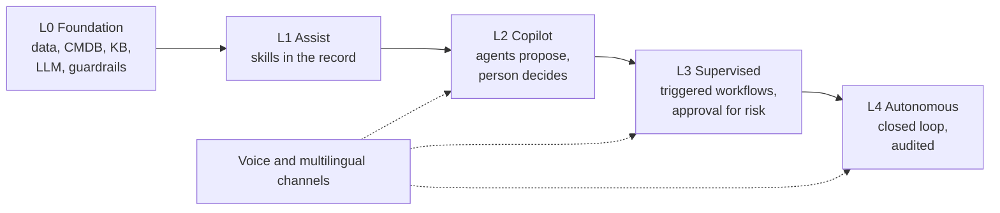
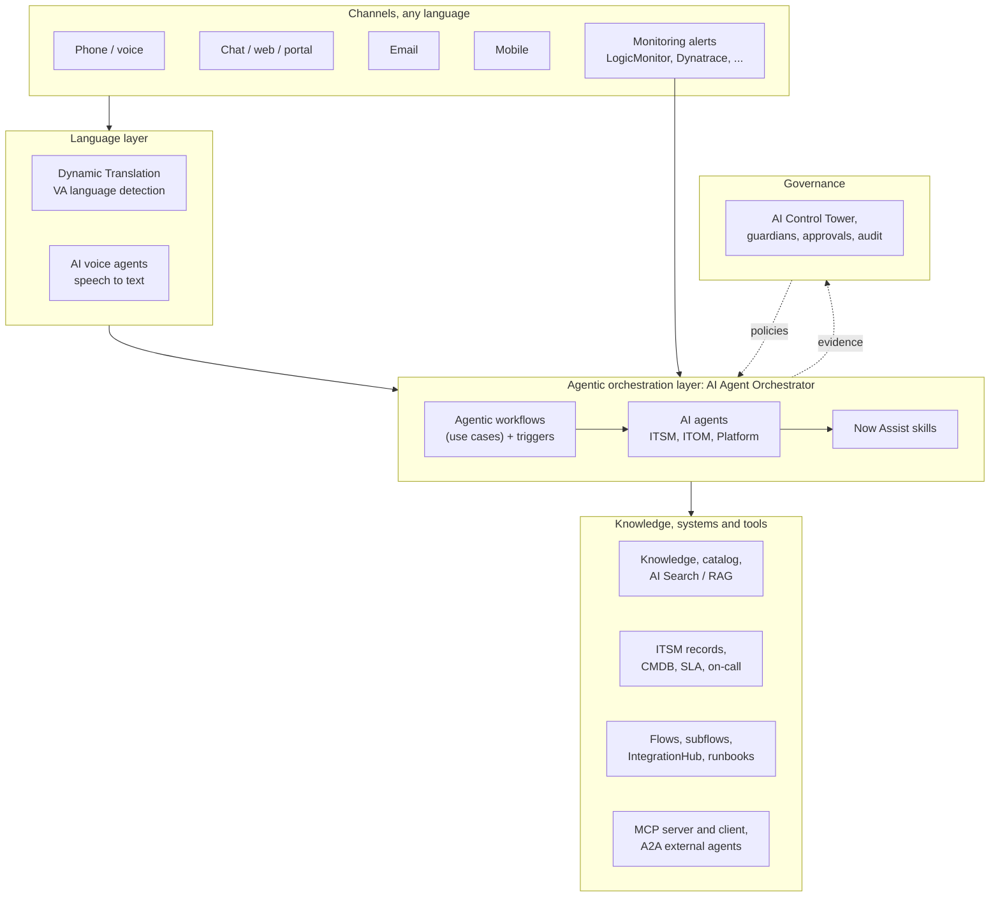

# Strategy: from skills to autonomous IT

## The idea

Clients do not trust an autonomous agent on day one. They trust it after they have seen the
same intelligence help a person, then suggest an action, then act with approval, and only
then act alone. The strategy follows that order. Each step reuses what the previous one built:

1. **Skills** give people summaries, drafts and suggestions inside the record.
2. **Agents** chain skills and tools to investigate and propose, with a person driving.
3. **Agentic workflows** run several agents together from a trigger, with checkpoints.
4. **Autonomous workflows** close the loop for low-risk, well-measured cases, and escalate the
   rest with full context.
5. **Voice and multilingual** channels put the same workflows behind a phone call or a chat in
   any language.

## The autonomy ladder

| Level | Name | Who acts | ServiceNow mechanism | Example on everis2 |
|---|---|---|---|---|
| L0 | Foundation | Nobody yet | Data, CMDB, knowledge, LLM providers, guardrails, AI Control Tower | Model providers, guardian settings |
| L1 | Assist | Person, helped by AI | Now Assist **skills** in the form, workspace and chat | Incident summarization, Resolution notes generation |
| L2 | Copilot | Agent proposes, person decides each step | AI agents and agentic workflows in **copilot** mode | Incident assist, Investigate and recommend incident resolution |
| L3 | Supervised | Agent acts, person approves risky steps | Agentic workflows started by **triggers**, approval tools, work notes as evidence | Triage and categorize ITSM incidents on every new incident |
| L4 | Autonomous | Agent acts and closes, person audits | **Autopilot** mode, guardrails, audit in AI Control Tower | Generate Resolution Plan (the only autopilot use case on everis2 today) |
| Voice | Any level, any channel | Same workflows behind voice and chat | AI voice agents, Virtual Agent, Dynamic Translation | Create incident with voice AI agent (`OFF`) |

**Rule for moving a use case up a level:** it has run at the current level in the demo with a
measured quality bar (for example, 9 of 10 categorisations accepted without change), its
actions are reversible or approved, and its evidence is written to the record.

## Reference architecture

This is the ServiceNow version of the three reference slides. The orchestration layer is the
ServiceNow AI Agent Orchestrator (agentic workflows, called use cases on the instance), not an
external framework. External agents and tools join through MCP and A2A.

## How the reference slides map to ServiceNow

| Slide element | ServiceNow on everis2 | Status |
|---|---|---|
| Voice Agent | `sn_itsm_voice_aia` voice agents (6), `sn_voice_aia` | `OFF`, telephony channel `MISSING` |
| Service Desk Agent | `sn_itsm_aia` incident agents, Create Incident AI Agent, Catalog Agent | `ON` |
| Translation Agent | Dynamic Translation, VA Language Detection and Translation, Azure Translator spoke, Now Assist multilingual settings | `ON` (only Spanish UI pack active) |
| Resolver Agent | Next action recommendation, Suggested Actions, Record management, flows | `ON` |
| Orchestrator (LangGraph on the slide) | AI Agent Orchestrator: agentic workflows, triggers, execution plans | `ON` |
| Work prioritisation, queue and workload | Prioritize work, Work Allocator, Optimal Ticket Assignment | `ON` |
| SLA and policy | Explain SLA, Proactive Escalation | `ON` |
| Operational insight | Issue trend analysis, Dashboard Summarization, Data Visualization Generation | `ON` |
| Triage and enrichment agent | Alert Assist skills, Manage alerts AI agent, Triage and categorize ITSM incidents | `ON` |
| Root cause analysis agent | SRE Investigate AI Agent, LogicMonitor API Agent, Related Changes Analysis | `ON`, monitoring connections to configure |
| Remediation agent | LEAP Ansible Execution Agent, alert remediation subflows, Zscaler and Installed App SME agents | `ON`, execution back-ends `MISSING` |
| On-call agent | On Call Retrieval, Who is On Call | `ON`, Teams notification `MISSING` |
| Recurring issue agent | LEAP, Link incident to problem, Problems investigation | `ON` |
| Knowledge and evidence agent | Wrap-up and resolve incident, KB generation, LEAP KB Creation Agent | `ON` |

## Build principles

1. **Out of the box first.** everis2 has 159 agents and 320 skill configurations. Configure,
   chain and trigger them before writing anything.
2. **No custom scoped applications.** A scoped app counts as a custom application for App
   Engine licensing. We build everything in the **Global scope**:
   - agent, tool and workflow configuration in AI Agent Studio, saved in Global;
   - glue logic as Flow Designer flows, subflows and actions in Global;
   - script includes only where a flow action cannot do it, named with a project prefix;
   - one update set per use case or per phase, named `AIT-<phase>-<use case>-<short name>`.
3. **Customise copies, not originals.** When an out-of-the-box agent needs a different prompt
   or tool, duplicate it in Global and change the copy, so upgrades do not overwrite our work
   and we do not skip upgrades on the originals.
4. **Evidence on the record.** Every agent writes what it found and what it did to work notes,
   so the demo shows the reasoning and the client sees auditability.
5. **Risky actions need approval.** Any action that changes production state (restart, rollback,
   access change) goes through an approval step until the use case has earned L4.
6. **Everything in git.** snagentic mirrors the instance into the everis2 workspace after each
   phase, so we can review, diff and rebuild the demo on another instance.

AI usage (Now Assist assists, AI agents, voice minutes) has its own entitlement, separate from
App Engine. It must be confirmed for the demo and for the client; see
[07-implementation-plan.md](07-implementation-plan.md#prerequisites).
