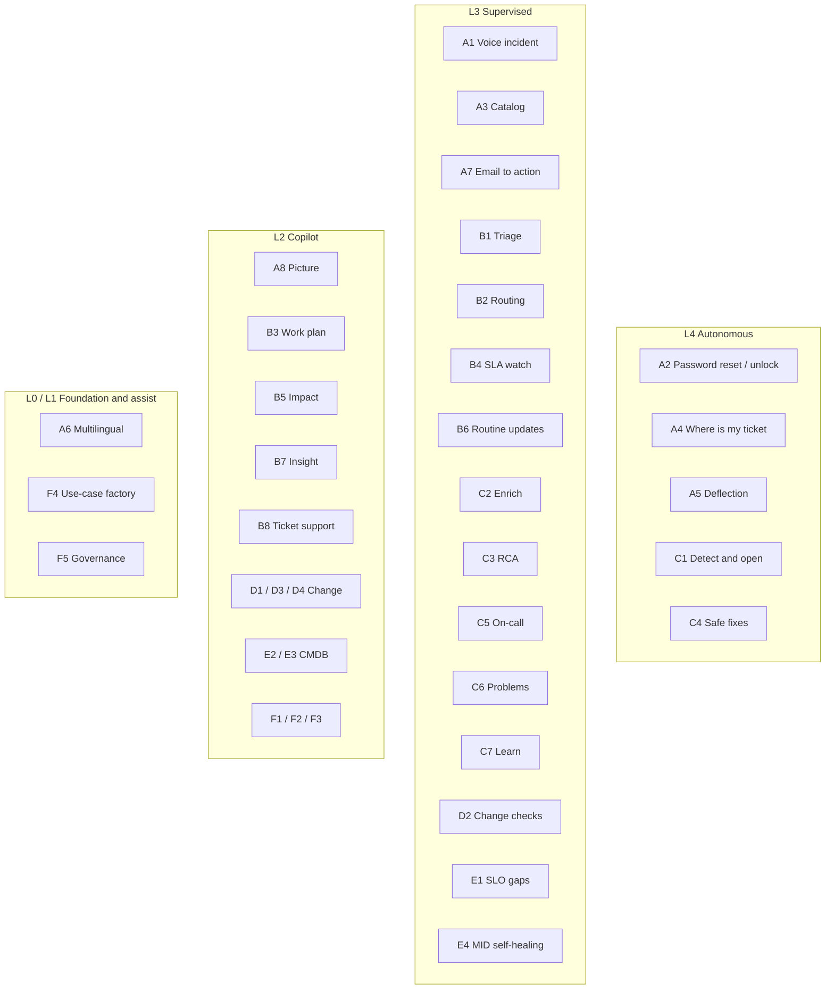
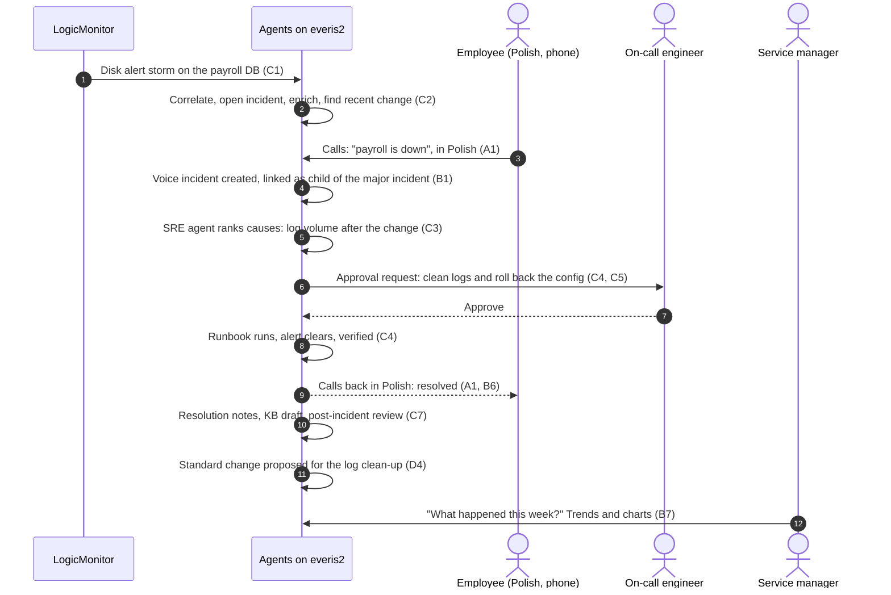

# Use-case map

All use cases on one page. Each row links to its detail: flow, agents, skills, prerequisites,
human checkpoints and KPIs. "Phase" refers to [06-roadmap.md](06-roadmap.md).

## By journey

| ID | Use case | Now | Target | Phase | Main agents | Readiness |
|---|---|---|---|---|---|---|
| [A1](use-cases/A-multilingual-service-desk.md#a1-report-an-incident-by-phone-in-any-language) | Report an incident by phone, in any language | – | L3 | P4 | Create incident with voice, Create Incident AI Agent | Voice `OFF`, telephony `MISSING` |
| [A2](use-cases/A-multilingual-service-desk.md#a2-password-reset-and-account-unlock-by-voice) | Password reset and account unlock by voice | – | L4 | P4 | Password reset with voice, Account unlock with voice | Voice `OFF`, identity check `BUILD` |
| [A3](use-cases/A-multilingual-service-desk.md#a3-order-from-the-catalog-by-conversation) | Order from the catalog by conversation | L2 | L3 | P2 chat, P4 voice | Catalog Agent | `ON` |
| [A4](use-cases/A-multilingual-service-desk.md#a4-where-is-my-ticket) | "Where is my ticket?" | L2 | L4 | P2 chat, P4 voice | Request Status Agent | `ON` |
| [A5](use-cases/A-multilingual-service-desk.md#a5-resolve-before-a-ticket-exists-deflection) | Resolve before a ticket exists | L2 | L4 | P4 | Create Incident AI Agent, Installed App SME, Zscaler SME | `ON`, endpoint tooling `MISSING` |
| [A6](use-cases/A-multilingual-service-desk.md#a6-multilingual-conversations-both-directions) | Multilingual conversations | L1 | L1 | P1 | Language Configuration, Translation Settings | `ON` |
| [A7](use-cases/A-multilingual-service-desk.md#a7-email-to-action) | Email to action | – | L3 | P3 | Intent Identification, Intent Executor, Email Generator | `ON`, intents `BUILD` |
| [A8](use-cases/A-multilingual-service-desk.md#a8-picture-to-ticket) | Picture to ticket | L2 | L2 | P2 | Image Processor, Content insights | `ON` |
| [B1](use-cases/B-service-intelligence.md#b1-triage-every-new-incident) | Triage every new incident | L2 | L3 | P3 | Categorize, Classify service and CI, Link major incident or problem | `ON`, trigger `BUILD` |
| [B2](use-cases/B-service-intelligence.md#b2-route-and-balance-the-queue) | Route and balance the queue | L2 | L3 | P3 | Work Allocator | `ON` |
| [B3](use-cases/B-service-intelligence.md#b3-my-work-plan) | My work plan | L2 | L2 | P2 | Prioritize work, Suggested Actions | `ON` |
| [B4](use-cases/B-service-intelligence.md#b4-sla-and-escalation-watch) | SLA and escalation watch | L2 | L3 | P3 | Proactive Escalation, Explain SLA | `ON`, schedule `BUILD` |
| [B5](use-cases/B-service-intelligence.md#b5-customer-and-service-impact) | Customer and service impact | L2 | L2 | P2 | Service impact analysis agents, Incident context | `ON`, needs CMDB data |
| [B6](use-cases/B-service-intelligence.md#b6-communications-on-every-ticket) | Communications on every ticket | L1 | L3 | P1, P3 | Email Generator + response skills | `ON` |
| [B7](use-cases/B-service-intelligence.md#b7-operational-insight) | Operational insight | L1 | L2 | P1, P2 | Issue trend analysis, Data Visualization Generation | `ON` |
| [B8](use-cases/B-service-intelligence.md#b8-ticket-level-support) | Ticket-level support | L4 (plans) | L2 | P1, P2 | Incident assist, Generate Resolution Plan | `ON` |
| [C1](use-cases/C-incident-troubleshooting.md#c1-detect-correlate-and-open-the-incident) | Detect, correlate, open the incident | L3 | L4 | P4 | Alert Automation, AIOps autonomous rule | `ON`, event source to set |
| [C2](use-cases/C-incident-troubleshooting.md#c2-triage-and-enrich) | Triage and enrich | L2 | L3 | P3 | Manage alerts, impact agents | `ON` |
| [C3](use-cases/C-incident-troubleshooting.md#c3-root-cause-analysis) | Root cause analysis | L3 (one trigger) | L3 | P2, P3 | SRE Investigate, LogicMonitor API, MCP agents | `ON`, credentials to set |
| [C4](use-cases/C-incident-troubleshooting.md#c4-remediate-with-approval) | Remediate with approval | – | L3, safe fixes L4 | P4 | LEAP Ansible Execution, remediation subflows | Back-ends `MISSING` |
| [C5](use-cases/C-incident-troubleshooting.md#c5-on-call-and-escalation) | On-call and escalation | L2 | L3 | P3 | On Call Retrieval, Proactive Escalation | `ON`, Teams `MISSING` |
| [C6](use-cases/C-incident-troubleshooting.md#c6-recurring-issues-to-problems) | Recurring issues to problems | L2 | L3 | P2, P3 | LEAP, Link incident to problem, Problems investigation | `ON` |
| [C7](use-cases/C-incident-troubleshooting.md#c7-verify-document-learn) | Verify, document, learn | L2 | L3 | P1, P3 | Wrap-up and resolve incident, LEAP KB Creation | `ON` |
| [D1](use-cases/D-change-and-release.md#d1-create-a-change-from-a-sentence) | Create a change from a sentence | L2 | L2 | P2 | Create change request, Change template suggestion | `ON` |
| [D2](use-cases/D-change-and-release.md#d2-assess-risk-conflicts-and-quality-on-submit) | Assess risk, conflicts, quality | L2 | L3 | P3 | Conflict and quality assessors | `ON`, trigger `BUILD` |
| [D3](use-cases/D-change-and-release.md#d3-plan-and-schedule) | Plan and schedule | L2 | L2 | P2 | Change Request Plans, Schedule Change Request | `ON` |
| [D4](use-cases/D-change-and-release.md#d4-grow-standard-changes) | Grow standard changes | L2 | L2 | P2 | Standard change template proposal | `ON` |
| [E1](use-cases/E-reliability-and-cmdb.md#e1-slo-gaps-after-a-major-incident) | SLO gaps after a major incident | – | L3 | P4 (if entitled) | Reliability Domain, SLO Gap, SLO Creator | SLO app `MISSING` |
| [E2](use-cases/E-reliability-and-cmdb.md#e2-synthetic-monitoring-coverage) | Synthetic monitoring coverage | – | L2 | P4 (if entitled) | Synthetic Creator | Synthetic app `MISSING` |
| [E3](use-cases/E-reliability-and-cmdb.md#e3-service-maps-and-csdm) | Service maps and CSDM | – | L2 | P0 data, P4 agents | Service Map Creation specialists | Partly `OFF` |
| [E4](use-cases/E-reliability-and-cmdb.md#e4-discovery-and-mid-server-self-healing) | Discovery and MID self-healing | – | L3 | P4 (if MID) | Pattern Diagnostic, MID Guardian | MID unconfirmed |
| [F1](use-cases/F-knowledge-experience-governance.md#f1-knowledge-health) | Knowledge health | L1 | L2 | P2 | KB consolidation, KB creation | Skills partly `OFF` |
| [F2](use-cases/F-knowledge-experience-governance.md#f2-experience-and-surveys) | Experience and surveys | L2 | L2 | P2 | Survey Analysis | `ON` |
| [F3](use-cases/F-knowledge-experience-governance.md#f3-approvals-for-managers) | Approvals for managers | – | L2 | P2 | Approval Assistance Agent | `OFF` |
| [F4](use-cases/F-knowledge-experience-governance.md#f4-find-the-next-automation-use-case-factory) | Find the next automation | L1 | L1 | P2 onwards | Automation Explorer, AI Agent Advisor skills | `ON` |
| [F5](use-cases/F-knowledge-experience-governance.md#f5-ai-governance-and-control-tower) | AI governance and control tower | L0 | L0 | P0, gate before P3 | Now Assist Admin agents | `ON`, guardrails at monitor |

## By autonomy level at the end of the roadmap

## The golden demo storyline

One story that strings the strongest use cases together, for the April 2027 demo:

## More use cases to explore

Candidates for the next iteration. Each needs a detail section from
[use-cases/_template.md](use-cases/_template.md) before it is planned. F4 (the use-case
factory) is the tool to rank them with client data.

| Candidate | Why it matters | Starting point on everis2 |
|---|---|---|
| Major incident bridge assistant | Live summary, stakeholder updates and timeline during the bridge | Link major incident, Major incident email content, Post incident review, Sidebar discussion summarization |
| VIP and sentiment watch | Protect executives and frustrated users before they escalate | Incident sentiment analysis, Proactive Escalation |
| Access request with policy check | Most common catalog request; agent checks policy and role conflicts | Catalog Agent, ApprovalChecklistGeneration, Group and roles assignment agent |
| Software licence reclaim | Savings story for the CIO | Catalog Agent, Email Generator; needs Software Asset Management |
| Endpoint self-healing at scale | Fix Outlook, Teams, VPN before users call | Installed App SME, Zscaler SME, AI Desktop Actions |
| Shift-left from L2 to L1 | Analysts resolve more with agent guidance | Generate Resolution Plan, Next action recommendation, Quick Win Classifier |
| Swarming on hard incidents | Agent finds the experts and opens the swarm | Additional incident context (on-call experts), Sidebar discussion summarization |
| Cloud alert investigation with partner agents | Show A2A and MCP interoperability | Gemini Cloud Assist A2A, AWS CloudWatch and Azure Monitor MCP agents |
| Document-driven requests | Invoices, contracts or forms attached to tickets become data | Content insights AI agent, Document extraction, Smart Documents |
| Notification clean-up | Fewer, better notifications | Notification Agent, Notification Content Agent |
| Instance self-implementation | AI sets up SSO, SLAs, groups and data imports | Implementation Agent Orchestrator, SSO Configuration Agent, SLA Management AI Agent |
| Project delivery for IT | Charters, stories, status for IT projects | Project charter, story generation and summarization agents (SPM) |
