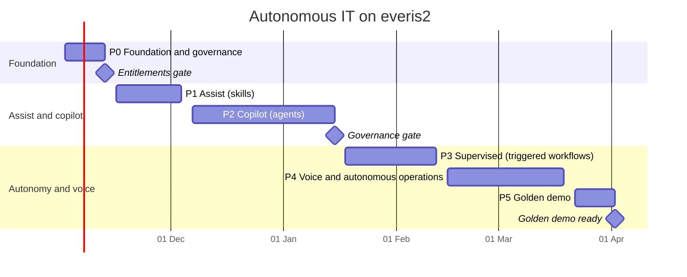
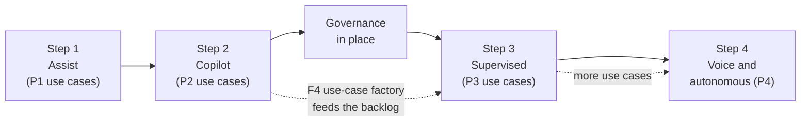

# Roadmap

Six phases, about 22 weeks, from 2 November 2026 to the golden demo on 2 April 2027. Each phase
ends with a demo the team can show, and each moves a set of use cases one level up the
autonomy ladder. Two gates stop the plan if their conditions are not met.

## Phases

| Phase | Dates | Goal | Use cases | Demo at the end | Exit criteria |
|---|---|---|---|---|---|
| P0 Foundation and governance | 2 to 13 Nov | Clean, governed instance with realistic data | F5, E3 (data), hygiene | "This is how AI is governed here": models, guardians, skill admin by conversation | Hygiene items closed; guardians at BLOCK in a test; demo data loaded; entitlements confirmed |
| Entitlements gate | 13 Nov | Know what we can switch on | – | – | Written answer on: voice and telephony, ITOM AIOps and Discovery, SLO and synthetic apps, MID Server, Teams, AI usage allowance |
| P1 Assist | 16 Nov to 4 Dec | Every ITSM record has AI help | A6, B6, B7, B8 (skills), C7 (skills) | An analyst works an incident in Spanish and English with summaries, drafts and resolution notes | Skills on in product for incident, request, change, problem, chat; translation working in VA |
| P2 Copilot | 7 Dec to 15 Jan | Agents investigate and propose, people decide | A3, A4 (chat), A8, B3, B5, B8, C3 (copilot), C6, D1, D3, D4, F1, F2, F3, F4 | "Ask the agent": plan my day, investigate this incident, raise a change from a sentence, what is trending | Each use case runs end to end in copilot with acceptance tracked |
| Governance gate | 15 Jan | Allowed to let agents act | – | – | F5 complete: AI Control Tower approvals on, risk policy for actions written, quality bar met in P2 |
| P3 Supervised | 18 Jan to 12 Feb | Workflows start by themselves, risky steps approved | A7, B1, B2, B4, B6 (routine), C2, C3 (trigger), C5, C6, C7, D2 | New incidents arrive triaged and enriched; SLA risks escalate before breach; changes are checked on submit | Triggers live; every agent action writes evidence; corrections measured |
| P4 Voice and autonomous operations | 15 Feb to 19 Mar | Voice channel and closed-loop operations | A1, A2, A3 and A4 (voice), A5, C1, C4, E1, E2, E4 (as entitled) | A phone call in Polish becomes a resolved incident; an alert is fixed by a runbook after one approval | Voice live on one number; one remediation loop closes; safe-fix list signed off |
| P5 Golden demo | 22 Mar to 2 Apr | One rehearsed storyline, resettable | Golden storyline in [03-use-case-map.md](03-use-case-map.md#the-golden-demo-storyline) | Full storyline in 20 minutes, plus short cuts per audience | Two clean rehearsals; reset script; mirror committed |

## What the client journey looks like

The same phases are the client's journey, at the client's pace. The demo proves each step
before the client is asked to take it.

## Decisions needed from the team

1. Confirm the phase dates and the golden demo date.
2. Confirm the build principle: Global scope and update sets, no scoped apps.
3. Choose the monitoring tool for the troubleshooting story (LogicMonitor as in the slide, or
   a simulated source).
4. Choose the voice languages for A1 (proposal: Spanish, English, Polish, Portuguese).
5. Owners for the entitlement questions before 13 November.
