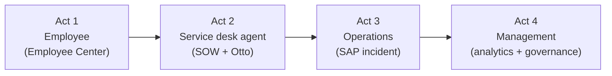

# Demo script: Autonomous IT on everis2

A 35-minute walkthrough of one working day at a client that runs SAP. Every scene uses a step that
has been tested and scored against an answer key. Scores and evidence are in
[evidence/quality-2026-10-28](evidence/quality-2026-10-28/).

The questions are typed **exactly as written** (in Spanish): the wording was tested, and small changes
can change the answer. The narration is a guide; say it in your own words.

## Before the demo (allow 2 hours)

| When | What | Why |
|---|---|---|
| Day before | Create a fresh MFA incident with a Spanish work note, In Progress, in DEMO.PI.Identity, assigned to the persona (as INC0025491). | Scene 2.4 resolves it, so each run needs a new one |
| Day before | Create a fresh MFA incident from the persona with no assignment, routed to Network (as INC0025307). | Scene 2.2: assign it live and the recommendation appears |
| Day before | Create a fresh MFA incident in DEMO.PI.M365, the wrong group (as INC0026051). | Scene 2.2b: the plan cites similar incidents and recommends Identity |
| 90 min before | Create and close a change on SAP AppSRV01 (as CHG0030111). | Scene 3.1: the AI links the alerts to a recent change |
| 30 min before | Send the three SAP events (payloads in `q05-fix-runs.md`, source AIT-Demo). | The alerts and their AI notes are ready when you reach scene 3.1 |
| 15 min before | Open two tabs: Employee Center chat and Service Operations Workspace. Impersonate **Analista AIT (ES)**. | Answers follow the user's language; the persona is Spanish |
| 15 min before | In the Otto panel, start a **new chat** before each scene. | Old topics hold the chat |
| 5 min before | Run scene 1.1 once. | Warms up the panel |

**Rules during the demo:**

- Type "Sí" or "No"; don't click the confirmation buttons. They are sometimes read wrongly.
- If the panel freezes on "Processing", reload the page. The answer is usually already there.
- Don't ask follow-up questions in the analytics chat (scene 4.1).

## Act 1: the employee (8 min)

**Where:** Employee Center → chat (`/esc?id=ai_native_chat`), as the persona.

**Story:** "An analyst at the client works from home today. Three things happen before 10:00."

### 1.1 An answer from the knowledge base (score about 11)

> No puedo conectarme a la VPN desde casa con mi portátil Windows, ¿qué hago?

**Expect:** five steps from KB0010019 in Spanish, each with a citation link, then "Crear un nuevo
incidente".

**Say:** "This answer comes from the client's own article, not the internet. Each step links to its
source. If the article didn't exist, it would say so: try the printer question."

**Optional:**

> ¿Cómo configuro la impresora de la planta 3 de la oficina de Madrid?

It answers that it has no instructions and offers a request and an incident.

### 1.2 Request software (score about 11)

> Quiero pedir Microsoft Visio para mi portátil, lo necesito para dibujar los planos de red de la oficina

**Expect:**

1. One recommendation, Visio.
2. Iniciar solicitud: the reason is already filled in from the sentence.
3. "¿En qué equipo lo instalamos?", with the user's two laptops as chips. Pick PC-AIT-ES-01.
4. The summary before sending shows "Solicitudes de Visio abiertas: RITM0010068 pendiente de
   aprobación; RITM0010067 Cumplimiento" (build B6).
5. Enviar: a new RITM, or stop here because she already has one.

**Say:** "It didn't ask again for what she had already said, it knows which laptops are hers, and it
shows that she already asked for Visio before she sends a duplicate."

**Avoid:**
- The recommendation card keeps the English item name. Don't zoom in on it.
- The platform adds "Read only, cannot change" in English under the open requests.

### 1.3 Status of my requests (score about 11)

> ¿Qué pasa con mi solicitud RITM0010067? ¿Por qué tarda tanto?

**Expect:** it says the request waits for the vendor licence (from the fulfiller's comment), with the
history.

**Say:** "The fulfiller wrote one customer-visible comment, and the AI turned it into an answer. That
is the process change: write for the customer, and the assistant explains."

Then, in a new chat, the overview (build B2):

> ¿Cómo van mis solicitudes e incidencias?

**Expect:** her 5 tickets, then the key points: INC0025715 needs her answer (VPN client version, and
whether it also drops on cable); RITM0010068 waits for Bow Ruggeri's approval; RITM0010067 is 2 days
late.

**Say:** "One question, and she knows what is on her side, who is blocking the rest, and what is late."

**Avoid:** the action buttons are in English.

## Act 2: the service desk agent (10 min)

**Where:** Service Operations Workspace, Otto panel, as the persona.

**Story:** "Now we are on the other side of the counter."

### 2.1 The wrong door (score about 9)

Open INC0025308 ("Necesito un segundo monitor"), new chat:

> ¿Esta incidencia es realmente una incidencia? ¿Qué debo hacer con ella?

**Expect:** "no parece ser una incidencia real", a request for a monitor while the current one works,
reclassify as a catalog request.

**Say:** "A good share of tickets are requests in disguise. The AI spots them before anyone works on
them."

**Avoid:** it doesn't name the catalog item yet. Say that this comes next.

### 2.2 Recommend a resolution (automatic)

Open the fresh MFA incident and assign it to DEMO.PI.Identity and the persona. Within about a minute,
a work note "Investigate and recommend" appears with a plan in Spanish.

**Say:** "Nobody asked. Assigning the ticket was enough. The plan matches how this was fixed nine
times this year."

### 2.2b Recommend with evidence, and the right group (score about 12)

Before assigning the fresh MFA incident that was routed to the wrong group (as INC0026051 in
DEMO.PI.M365), new chat:

> Dame un plan de resolución con evidencias para esta incidencia a partir de incidencias similares ya resueltas, y dime si está en el grupo correcto.

Answer "use the open incident" if it asks. **Expect** (build B8, about 40 s):
- 4 or 5 steps, each ending with the incidents it comes from, for example "[INC0011988, INC0010743]";
- "el arreglo funcionó en 6 incidencias similares, resueltas entre el 14 y el 28 de octubre";
- "se recomienda reasignar a DEMO.PI.Identity": Identity resolved all 6, M365 none.

**Say:** "Every step can be checked: click the incident it cites. And it tells the agent that the
ticket is in the wrong queue, with the evidence."

**Avoid:** an incident with only one similar case: it then says the evidence is not enough to change
the group, which is right but less striking.

### 2.3 Why did the SLA breach? (score about 11)

Open INC0010147, new chat:

> ¿Por qué se ha incumplido el SLA de esta incidencia?

**Expect:**
- the P2 resolution SLA, breached on 1 May;
- the Database group held it for 48 days 16 hours, and the other groups only for seconds ("no son la
  causa");
- a short timeline and a next action.

**Say:** "This is the question the sponsor asks every Monday. Not 'what does the SLA record say', but
'who held it, and what do we do now'."

**Avoid:**
- Asking about silence or the last contact: it has no work-note data and says so.
- Any incident created after 28 October without an SLA history.

### 2.4 Wrap up and resolve (score about 9)

Open the In Progress MFA incident, new chat:

> Cierra y resuelve esta incidencia

1. "Sí" to use the page context.
2. It proposes resolution notes in Spanish, from the work note. Approve them (if Approve loops, type
   "Sin cambios, aplica estas notas").
3. Resolved, with code "Solución proporcionada".

**Say:** "Ten minutes of admin at the end of every ticket, done in thirty seconds, and the notes are
better than what we usually write."

**Avoid:**
- The "create article" step after resolving: it hangs. Stop the scene at "resolved".
- If one message starts two runs and the panel stops updating, reload.

## Act 3: operations, an SAP incident (10 min)

**Story:** "At 11:00, SAP sales orders start failing."

### 3.1 Alerts that explain themselves (score about 10)

**Where:** Service Operations Workspace as **admin**. The persona has no Event Management role; say so.

Open the alert group (as Alert0010114) and show:

1. Three alerts (disk, work processes, load balancer), **grouped** because the CIs are related.
2. All three were routed to DEMO.PI.SAP from the CI's support group.
3. On the primary alert, the **AI insights**. The probable cause is "regression ... from the recent SAP
   kernel upgrade 7.89 PL 200", with the next step "roll back to the prior kernel".
4. On the group's alert form, **Quick Incident**. The new incident already has CI SAP AppSRV01, group DEMO.PI.SAP
   and one work note (build B7): the owner Elena Soto, **CHG0030111** by number, the three alerts, and
   the AI summary.

**Say:** "Nobody wrote a rule for this. The AI read the alert, the CI and the change calendar, and
found the change from one hour earlier. That is the first question every incident bridge asks. And
when we open the incident, the analysis travels with it."

**Avoid:**
- The notes are in English, because they run as the system.
- On the load balancer alert it guesses the wrong path. Show the primary alert.
- Quick Incident only once per alert: create it in the rehearsal on other alerts, not on the demo ones.

### 3.2 Who is on call, and hand it over (score about 11)

**Where:** back to the persona. Open INC0025716 (SAP V1 801), new chat:

> ¿Quién está de guardia ahora en el grupo de esta incidencia, hasta cuándo, quién es el siguiente si no responde, y cómo le contacto?

**Expect** (build B3, about 45 s; say "Sí" to use the page context): Marta Ruiz on call until
1 November 23:59, then Jordi Puig; if she doesn't answer, Elena Soto; phones and emails.

Then, in a new chat:

> Asigna esta incidencia a la persona de guardia y deja una nota de trabajo: revisar primero el transporte de condiciones de precios

**Expect:** two confirmations (answer "Sí" both times), then the incident is assigned to Marta, In
Progress, with the note written by the persona.

**Say:** "At night, this saves the call to the person who knows the rota, and the hand-over is one
sentence. The AI asks before it changes anything."

**Avoid:**
- Naming someone outside the group: it refuses, correctly, but it breaks the flow.
- After the demo, reset the incident (unassigned, New).

### 3.3 Ask the runbook (score about 9 on content)

Open the runbook PDF on INC0025194 in the Document Viewer → Ask Otto → "Answer questions about the
document":

> ¿Cuál es la causa más frecuente del error V1 801?

> ¿Puedo reiniciar PRD para arreglarlo?

**Expect:** the transport of price conditions (80 %); "never without an approved emergency change".

**Say:** "Runbooks are long and read at 3 a.m. Here they answer questions."

**Avoid:**
- Redaction: it failed on this PDF.
- Questions the document doesn't answer: it stays silent.
- It was tested in English as the admin, not yet as the persona. Run it once before the demo.

### 3.4 Make it automatic next time (score about 10)

**Where:** admin. On one of the SAP alerts, new chat:

> Create an alert grouping automation so that future alerts on the SAP PRD hosts (SAP AppSRV01, SAP AppSRV02, SAP LoadBal01, SAP WEB01 to WEB04) that happen within 30 minutes of each other are grouped into one, even when the CIs are not related. Show me the proposal first and keep it inactive.

**Expect:** a proposal (the seven nodes, 30 minutes), then "Yes, create it inactive" creates the
automation. Open "View automation" to show it inactive.

**Say:** "The operator describes the rule in words; the AI builds it, switched off, for a human to
test and activate."

**Avoid:**
- Asking for a *response* automation: the agent only builds grouping rules.
- Asking how many past alerts it would match: it can't count them.
- Delete the automation made in the rehearsal first, or it will propose a duplicate.

## Act 4: management (7 min)

### 4.1 A chart from a question, then the numbers (score about 11)

**Where:** Service Operations Workspace, persona, **new chat**:

> Compara en un gráfico de columnas apiladas las incidencias registradas en agosto y en septiembre de 2026, por mes y por prioridad

**Expect:** a stacked column chart, August against September.

The chart has no text summary. Then, in a **new chat** (build B1):

> ¿Cuántas incidencias se registraron en agosto y en septiembre de 2026, y qué prioridad explica la diferencia entre los dos meses?

**Expect:** 843 and 895, +52 (+6.2 %); P4 explains 73 % of the rise (+38), then P3 (+10).

**Say:** "The chart shows it; the second answer explains it, with exact numbers."

**Avoid:**
- The words "abiertas" (read as "still open") and "barras" (draws an empty chart).
- Follow-up questions in the same chat.

### 4.2 Governance: is it safe, who uses it (score 8)

**Where:** Platform Analytics → **AI Agent Analytics**, as admin.

Show:
- agent runs per week;
- blocked executions, which match the tables exactly;
- the error and Ongoing slices.

**Say:** "Every number on this page matches the raw tables. We checked."

**Avoid:**
- The old "Value Dashboard": every value widget says Error. That is a setup gap after the 22 October
  upgrade (see `q13-fix-runs.md`).
- "Ongoing": almost all of it is our own test chats.

## Close (2 min)

"Everything you saw is out of the box, configured in Global update sets, with no scoped app and no
extra licence. The quality method is the point:

- an answer key for every step;
- six criteria;
- a retest after every fix.

In two days the average went from 6 to about 10 of 12. The next phase builds the gaps you saw named
on screen: the numbers in the chart, the request overview, and actions from the on-call answer."

## Fallbacks

| If | Do |
|---|---|
| A scene fails live | Show the transcript in the scene's evidence file and move on |
| The panel never answers | Reload, start a new chat, and retype the question once; then move on |
| The answer comes out in English | You are not impersonating the persona. Check the user menu |
| The SAP alerts have no AI notes | They take about 100 s after the event. Send the events earlier |

## Scenes left out, and why

| Step | Reason |
|---|---|
| Knowledge article from the wrap-up | Hangs inside the agent |
| Smart Documents redaction | Failed on the test PDF |
| AI Value | No managed assets; being fixed (`q13-fix-runs.md`) |
