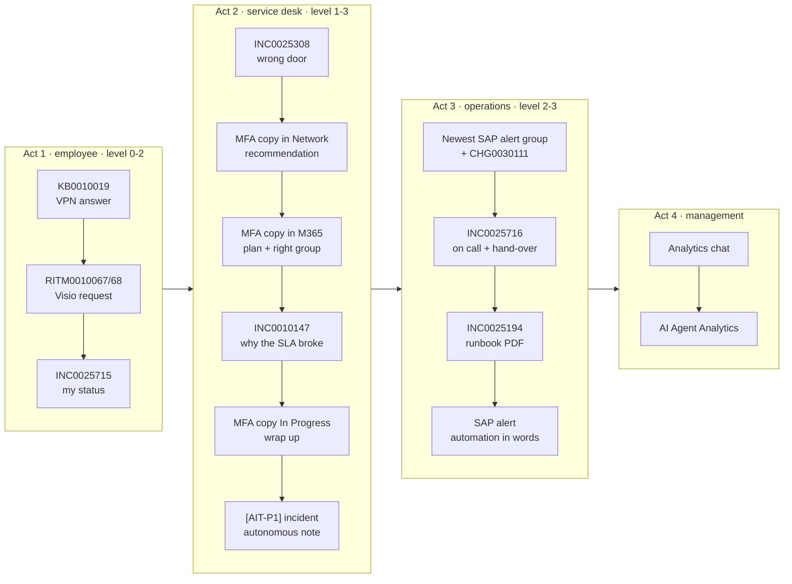

# Demo route: the records, in the order of the storyline

The short version of [the demo script](08-demo-script.md): which record to open at each beat, and
what to show on it. It follows the storyline "one working day, one rung higher on the autonomy ladder
at each act".

## The day before: run one Fix Script

1. As admin: **System Definition → Fix Scripts → "AIT demo 1 - prepare (day before)" → Run Fix
   Script → Proceed**. It takes about 10 seconds.
2. Read the last lines of the output (scroll to the bottom of the window). It lists the demo route
   below, with **today's numbers** for the fresh records, and `OK` or `CHECK` on each one.
3. Write down the four new numbers (scenes 2.2, 2.2b, 2.4 and 2.5). The route below shows the numbers
   of the run on 30 October as an example.
4. Fix any `CHECK` line. The usual one is 3.4: delete the grouping automation "Group by SAP PRD hosts"
   left by the last demo (Event Management → Alert grouping automations), or the AI proposes a
   duplicate.

What the script does ([source](build/demo-1-prepare-fix-script.js), update set `AIT-P2-demo-prep`):

| Step | Records | Why |
|---|---|---|
| Retire the last demo's copies | `[AIT-DEMO]` and `[AIT-P1]` incidents still New, In Progress or On Hold are resolved | The queues stay clean between demos |
| Fresh MFA incidents | Copies of INC0025307 (in Network), INC0026051 (in M365) and INC0025491 (In Progress, assigned to the persona, with the analyst's Spanish note), caller Abel Tuter | Scenes 2.2, 2.2b and 2.4 use them up. The persona's own list doesn't change |
| Reset the on-call incident | INC0025716: DEMO.PI.SAP, unassigned, New | Scene 3.2 assigns it |
| SAP outage | Closes the old demo alerts, moves CHG0030111 to 80 minutes before now, sends the three SAP events again | Scene 3.1: new grouped alerts with AI notes that cite the kernel change |
| The autonomous SLA note | An `[AIT-P1]` incident in Workplace, moved to SAP 3 minutes later | Scene 2.5: the note is there the next day |
| Check the rest | KB, requests, SLA history, trigger, persona tickets, automations | One `CHECK` line for anything a past demo changed |

It changes no configuration and is safe to run twice; each run makes new copies. For a live scene 2.5,
run **"AIT demo 2 - start SLA clock (live)"** at the start of Act 2 instead; the note arrives about
9.5 minutes later ([source](build/demo-2-start-sla-clock-fix-script.js)).

## The route

Instance: `everisspainsludemo2.service-now.com`. SOW means Service Operations Workspace
(`/now/sow/record/<table>/<sys_id>`); ESC means the Employee Center chat (`/esc?id=ai_native_chat`).
Impersonate **Analista AIT (ES)** except where it says admin.

| # | Where | Record (30 Oct run) | Do | Show |
|---|---|---|---|---|
| 1.1 | ESC chat | KB0010019 (`kb_knowledge` 296be998…7b9b) | Ask the VPN question | Five steps from the article, each with its source |
| 1.2 | ESC chat | RITM0010067, RITM0010068 | Ask for Visio | The laptop chips, and the warning that she already has two Visio requests |
| 1.3 | ESC chat | INC0025715, RITM0010068, RITM0010067 | "¿Cómo van mis solicitudes e incidencias?" | What she must answer (INC0025715), who must approve (RITM0010068), what is late (RITM0010067) |
| 2.1 | SOW | INC0025308 (d10d555c…7b02) | "¿Esta incidencia es realmente una incidencia?" | It is a request in disguise |
| 2.2 | SOW | **MFA copy in Network** (INC0026085) | Assign it to DEMO.PI.Identity and the persona | Within a minute, the "Investigate and recommend" plan appears as a note |
| 2.2b | SOW | **MFA copy in M365** (INC0026086) | Ask for the plan with evidence and the group | Steps that cite resolved incidents, and "reasignar a DEMO.PI.Identity" (6 to 0) |
| 2.3 | SOW | INC0010147 (d13e9ef9…7beb) | "¿Por qué se ha incumplido el SLA?" | Database held it 48 days; the other groups are not the cause |
| 2.4 | SOW | **MFA copy In Progress** (INC0026087) | "Cierra y resuelve esta incidencia" | Close notes in Spanish from the analyst's note; Resolved |
| **2.5** | SOW | **`[AIT-P1]` incident** (INC0026088) | Open it; don't use the panel | The note `[AIT auto · SLA en riesgo]`: risk, cause (nobody owns it, 3 min lost in Workplace), on call Marta Ruiz, next step. **Nobody asked** |
| 3.1 | SOW, admin | Newest alert group on SAP AppSRV01 (Alert0010124), CHG0030111 (dd9c97d4…7b8f) | Open the group, then the primary alert | Three grouped alerts, the AI cause "kernel 7.89 PL 200" from the change, then Quick Incident with the analysis in the note |
| 3.2 | SOW | INC0025716 (b5ca9f10…7bfc) | Ask who is on call; then "Asigna esta incidencia a la persona de guardia…" | Marta Ruiz until 1 Nov, then Jordi, escalation Elena; assigned after two "Sí" |
| 3.3 | SOW | INC0025194, attachment Runbook_SAP_SD-OPS-017_V1-801.pdf | Document Viewer → Ask Otto | The most common cause (80 %) and "never restart PRD without an emergency change" |
| 3.4 | SOW, admin | A SAP alert of 3.1 | Describe the grouping rule in words | The automation, created inactive |
| 4.1 | SOW chat | – | The two analytics questions, each in a new chat | Stacked chart, then 843 against 895, P4 explains 73 % |
| 4.2 | Platform Analytics, admin | AI Agent Analytics | – | Runs, blocked runs and errors; every number matches the tables |

**Shorter demo (20 minutes):** 1.1, 1.3, 2.2b, 2.3, **2.5**, 3.1, 3.2. It keeps one scene per rung of the
ladder and the autonomous note as the turn.

## Tested on 30 October 2026

Run from the Fix Script form as admin at 10:31 (instance time), with "Proceed":

| Check | Result |
|---|---|
| Output | All lines `OK` except 3.4 (the Q06 automation "Group by SAP PRD hosts" is still there) |
| Copies | INC0026085 (Network), INC0026086 (M365), INC0026087 (In Progress, persona, the analyst's Spanish note); caller Abel Tuter |
| SAP outage | Alerts Alert0010122 and Alert0010123 grouped under Alert0010124 within 10 s; the AI summary at 10:33:40 names "a kernel update and instance restart" |
| Hand-off | The scheduled job moved INC0026088 to DEMO.PI.SAP at 10:34:56 (reassignment count 1) |
| Autonomous note | At 10:41:26 on INC0026088, by Analista AIT (ES): "nadie lo tiene asignado; sin actualizaciones desde hace 9 min; pasó 3 min en DEMO.PI.Workplace antes de llegar a DEMO.PI.SAP", on call Marta Ruiz with the escalation to Elena Soto, "asignarlo ahora a Marta Ruiz y llamarla" |
| Persona tickets | 4 open (INC0025715, INC0025716, RITM0010067, RITM0010068) |

The first draft retired every active `[AIT-P1]` incident, including resolved ones, so it rewrote the
close notes of the pilot test incidents INC0026068 to INC0026084 (their work notes, the evidence, are
unchanged). The script now retires only New, In Progress and On Hold copies.

**Revert:** delete the two Fix Scripts (update set `AIT-P2-demo-prep`). The demo records are data,
retired by the next run.

## After the demo

The next run of the Fix Script retires the copies and resets INC0025716. Only one thing is manual:
delete the automation that scene 3.4 created, before the next demo (the script flags it with `CHECK`).
