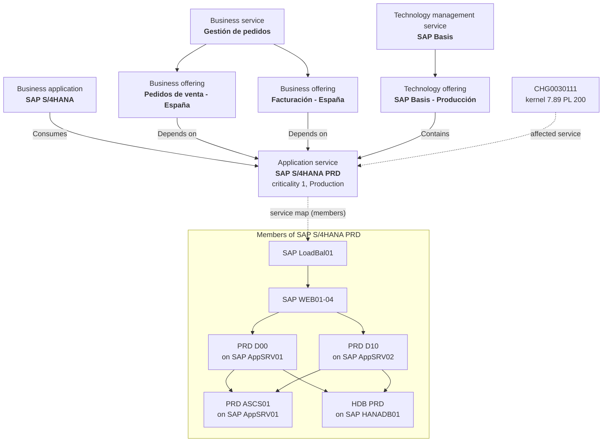

# CSDM chain for SAP: from an alert to the business it hurts

**Status: designed, not built.** Nothing has been changed on everis2. The design is based on the
read-only mirror of 27 October and on the code of the agents. The four Fix Scripts in `build/` are
written but have not run yet: running the build needs the owner's approval and an admin login.

## Why

The SAP outage in Act 3 already shows alerts that explain themselves: three events are grouped, and
the AI names the kernel change as the likely cause. It does not show **who is hurt**. The SAP
hosts belong to no application service, so:

- the alert names no affected service;
- the impact agents have nothing to follow;
- grouping scene 3.4 has to ask for alerts to be grouped "even when the CIs are not related".

With a CSDM chain, the same outage tells a business story. *"Sales orders in Spain are failing
because SAP S/4HANA PRD lost a dialog instance after last night's kernel change. Two employees
have already reported it. The SAP Basis team owns the fix."*

## The chain

| Layer | Record | Class | Linked by |
|---|---|---|---|
| Business service | Gestión de pedidos | `cmdb_ci_service_business` | Parent of its offerings |
| Business offerings | Pedidos de venta - España, Facturación - España | `service_offering` | *Depends on::Used by* → application service |
| Business application | SAP S/4HANA | `cmdb_ci_business_app` | *Consumes::Consumed by* → application service |
| Technology management service | SAP Basis, with offering SAP Basis - Producción | `cmdb_ci_service_technical`, `service_offering` | *Contains::Contained by* → application service |
| Application service | SAP S/4HANA PRD | `cmdb_ci_service_discovered`, created by the CSDM helper with manual members | Its members make the service map |
| SAP software | PRD ASCS01, PRD D00, PRD D10, HDB PRD | `cmdb_ci_appl_sap_ascs`, `_di`, `_hana_db` | *Runs on::Runs* their host (created through the IRE) |
| Hosts | SAP LoadBal01, SAP WEB01-04, SAP AppSRV01-02 (reused), SAP HANADB01 (new) | as on the instance | *Depends on::Used by*, top-down |

Every record has the support, managing and change group **DEMO.PI.SAP**, the environment
**Production**, criticality **1 - most critical**, and an owner.

The relationship types are not a choice. They are the ones ServiceNow's own CSDM helper
(`CSDMAppServiceHelper`) creates, and the only ones the impact agent follows:

- in `EmAiaAlertImpactUtils.getCsdmRelationsForServiceInstances`, *Depends on* or *Contains*;
- the parent class must be exactly `service_offering`, `cmdb_ci_service_business` or
  `cmdb_ci_service_technical`.

## What each piece gives the agents

| Agent (everis2) | Reads | Needs from the chain | Works on this data |
|---|---|---|---|
| Manage alerts AI agent (autonomous, already in scene 3.1) | Alert CI, relationships between the grouped CIs, impacted services, changes on the CI or the service | Service map, CHG0030111 → service | Yes: it gains "affected service" in its insight |
| Analyze alert impact team (on request, in the panel) | 1. Is the alert eligible. 2. Service instances hit (impact graph). 3. Offerings and services above them, with criticality and owner. 4. Incidents and cases on them, filed by people within two hours of the alert | All of it, plus the user reports | Yes, once the impact graph has rows (see risks) |
| Alert Automation AI agent (scene 3.4) | Alerts, grouping automations | Optional: "group alerts of the same service" | Yes |
| CSDM Business Application to Infrastructure specialist | Business app and application services with matching names | Nothing: the build already links them | Not used: it is off, and it links with *Uses::Used by*, which is not CSDM |
| Service Map Creation, Analyze Potential Impact (change) | Discovery, running processes, traffic | Discovery data | No: there is no Discovery on everis2 |
| SLO Gap, SLO Creator, Reliability Domain | SLO tables | The SLO data app | No: the app is missing |

## The storyline: Act 3 with the business in it

The scenes keep the current route and add two beats (3.0 and 3.1b). They take about 4 minutes more.

| # | Where | Do | Show | Agent |
|---|---|---|---|---|
| **3.0** | CMDB Workspace or the service map, admin | Open SAP S/4HANA PRD | The chain from "Gestión de pedidos" down to the HANA host, one owner group everywhere. *"An agent is only as good as the map it reads"* | None (the foundation) |
| 3.1 | SOW, newest SAP alert group | Open the group, then the primary alert | As today, plus the affected service SAP S/4HANA PRD in the alert and the insight; CHG0030111 also lists the service | Manage alerts (autonomous) |
| **3.1b** | SOW, same alert, Otto panel | "Analiza el impacto de esta alerta" | The team's four steps as work notes: SAP S/4HANA PRD is hit; Pedidos de venta and Facturación - España (criticality 1, owner); SAP Basis - Producción; two employees reported it 4 and 7 minutes after the alert ("error de actualización V1") | Analyze alert impact team |
| 3.1c | SOW | Quick incident from the alert | The incident carries the CI, the group and the analysis (B7) | B7 business rule |
| 3.2-3.4 | as today | On call, runbook, automation | Scene 3.4 can now ask for "alerts of the SAP S/4HANA PRD service" | as today |

The message moves the audience from "the AI read the alert" to "the AI knows the business
behind the alert". The CMDB is what makes the difference, which also sets up the client's CMDB
work.

## How to build it

All scripts run in Global scope as admin. Use update set `AIT-CSDM-SAP`; the CIs are data, so it
captures nothing, but the Fix Scripts themselves go into it.

| Step | When | Script | Result |
|---|---|---|---|
| 1 | Once | [AIT CSDM SAP 1 - build](build/csdm-sap-1-build-fix-script.js) | The chain above. It finds records by business key, creates the missing ones and fills only empty fields. Safe to run again |
| 2 | Two minutes after step 1, and before each demo | [AIT CSDM SAP 2 - check](build/csdm-sap-2-check-fix-script.js) | Read-only. One `OK` or `CHECK` line per link the agents follow |
| 3 | Each demo, right after "AIT demo 1 - prepare" | [AIT CSDM SAP 3 - user reports](build/csdm-sap-3-user-reports-fix-script.js) | Two employee incidents on "Pedidos de venta - España", timed 4 and 7 minutes after the new alert |
| 9 | To remove it | [AIT CSDM SAP 9 - revert](build/csdm-sap-9-revert-fix-script.js) | Lists what step 1 made; deletes it with `DRY_RUN = false` |

Then rehearse 3.1b once and record its answer key in the quality plan, as for the other scenes.

## Not verified yet

These were not checked against the live data, because the browser had no session:

1. **The SAP demo hosts exist under these names**, and each host's class is not yet known. The
   build prints a `CHECK` line for any missing host.
2. **The impact graph fills for a hand-built service.** This is the key risk. The Event
   Management impact engine builds `em_impact_graph` from the service map, and the Alert Crawler
   copies it to `sn_em_ai_alert_services`. Step 2 checks both. If they stay empty, the fallback
   is to open the map once and save it, which recalculates it.
3. **The choice labels** ("Production", "1 - most critical", "Business Service", "Technical
   Service", "OK" for service severity). The scripts look them up by label and print a `CHECK`
   line when one is missing.
4. **The impact team can be started from the panel.** Its trigger is off, which is expected,
   because it runs on request.
5. **The two callers exist** (`abel.tuter`, `adela.cervantsz`).

## Decisions for the owner

| # | Decision | Recommendation |
|---|---|---|
| D1 | Names: SID `PRD`, "Gestión de pedidos", "SAP Basis", Spanish offerings | Keep: Spanish for the business layer, SAP's own terms for the technical one |
| D2 | Run step 1 on everis2 (it writes CMDB data, tagged `[AIT-DEMO]`, with a revert script) | Yes, then step 2 |
| D3 | Activate the CSDM Business Application to Infrastructure agent | No: it creates a non-CSDM relationship, and the build already makes the right one |
| D4 | Extend B7 so the quick incident also carries the business offering | Later: small, and only after 3.1b works |
| D5 | The 384 reconciliation rules at priority 9999 (see the CMDB assessment) | Leave them for the demo; don't show them as client practice |
