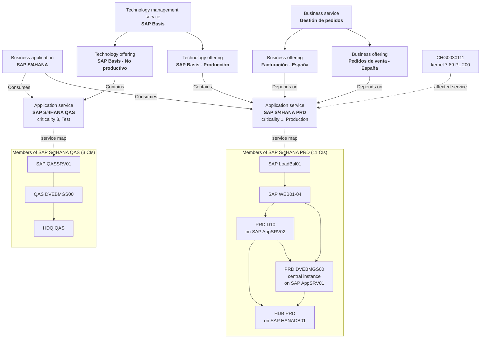

# CSDM model for SAP: from an alert to the business it hurts

**Status: designed and approved by the owner (2 November); not loaded yet.** The owner approved
loading the data on everis2. The Fix Scripts in `build/` are written and pass a syntax check, but
they have not run: the browser had no everis2 session. The design rests on the read-only mirror of
27 October and on the code of the agents.

## Why

The SAP outage in Act 3 already shows alerts that explain themselves: three events are grouped, and
the AI names the kernel change as the likely cause. It does not show **who is hurt**. The SAP
hosts belong to no application service, so:

- the alert names no affected service;
- the impact agents have nothing to follow;
- grouping scene 3.4 has to ask for alerts to be grouped "even when the CIs are not related".

With a CSDM model, the same outage tells a business story. *"Sales orders in Spain are failing
because SAP S/4HANA PRD lost a dialog instance after last night's kernel change. Two employees
have already reported it. The SAP Basis team owns the fix."* The same symptom on the quality
system gets a different answer: *"No business service depends on it; it can wait for office hours."*

## Business application and application service are different things

| | Business application **SAP S/4HANA** | Application service **SAP S/4HANA PRD** / **QAS** |
|---|---|---|
| What it is | The product the company owns: "we use SAP S/4HANA" | One running installation of that product |
| How many | One per product | One per environment |
| What it holds | Owner, vendor, criticality, lifecycle | Hosts, SAP instances, the service map, monitoring |
| Who uses it | Architects and portfolio managers | Operations, Event Management and the AI agents |
| CSDM domain | Design | Build and run (service delivery) |

That is why the model has **two** application services under one business application. Only
production carries business offerings, because no business process runs on the quality system.

## The model

| Layer | Record | Class | Linked by |
|---|---|---|---|
| Business application | SAP S/4HANA (category and type COTS are required by the instance) | `cmdb_ci_business_app` | *Consumes::Consumed by* → both application services |
| Business service | Gestión de pedidos | `cmdb_ci_service_business` | Parent of its offerings |
| Business offerings | Pedidos de venta - España, Facturación - España | `service_offering` | *Depends on::Used by* → **PRD only** |
| Technology management service | SAP Basis | `cmdb_ci_service_technical` | Parent of its offerings |
| Technology offerings | SAP Basis - Producción, SAP Basis - No productivo | `service_offering` | *Contains::Contained by* → PRD, QAS respectively |
| Application services | SAP S/4HANA PRD, SAP S/4HANA QAS | `cmdb_ci_service_discovered`, created by the CSDM helper with manual members | Their members make the service maps |
| SAP software | PRD DVEBMGS00 AppSRV01, PRD D10 AppSRV02, HDB PRD; QAS DVEBMGS00 QASSRV01, HDQ QAS | `cmdb_ci_appl_sap_ci` (central instance, the name the PRD events use), `_di`, `_hana_db` | *Runs on::Runs* their host (through the IRE) |
| Hosts | PRD: SAP LoadBal01, SAP WEB01-04, SAP AppSRV01-02 (reused), SAP HANADB01 (new). QAS: SAP QASSRV01 (new) | as on the instance; new ones `cmdb_ci_linux_server` | *Depends on::Used by*, top-down |

Every record has the support, managing and change group **DEMO.PI.SAP** and an owner. PRD records
are Production with criticality 1; QAS records are Test (everis2 has no QA environment choice) with
criticality 3.

The relationship types are not a choice. They are the ones ServiceNow's own CSDM helper
(`CSDMAppServiceHelper`) creates, and the only ones the impact agent follows:

- in `EmAiaAlertImpactUtils.getCsdmRelationsForServiceInstances`, *Depends on* or *Contains*;
- the parent class must be exactly `service_offering`, `cmdb_ci_service_business` or
  `cmdb_ci_service_technical`.

The impact agent does not read the business application. The business application is there for
CSDM completeness and for the map in scene 3.0.

## What each piece gives the agents

| Agent (everis2) | Reads | Needs from the model | Works on this data |
|---|---|---|---|
| Manage alerts AI agent (autonomous, already in scene 3.1) | Alert CI, relationships between the grouped CIs, impacted services, changes on the CI or the service | Service map, CHG0030111 → service | Yes: it gains "affected service" in its insight |
| Analyze alert impact team (on request, in the panel) | 1. Is the alert eligible. 2. Service instances hit (impact graph). 3. Offerings and services above them, with criticality and owner. 4. Incidents and cases on them, filed by people within two hours of the alert | All of it, plus the user reports | Yes, once the impact graph has rows (see risks) |
| Alert Automation AI agent (scene 3.4) | Alerts, grouping automations | Optional: "group alerts of the same service" | Yes |
| CSDM Business Application to Infrastructure specialist | Business app and application services with matching names | Nothing: the build already links them | Not used: it is off, and it links with *Uses::Used by*, which is not CSDM |
| Service Map Creation, Analyze Potential Impact (change) | Discovery, running processes, traffic | Discovery data | No: there is no Discovery on everis2 |
| SLO Gap, SLO Creator, Reliability Domain | SLO tables | The SLO data app | No: the app is missing |

## The storyline: Act 3 with the business in it

The scenes keep the current route and add three beats (3.0, 3.1b, 3.1c). They take about 6
minutes more.

| # | Where | Do | Show | Agent |
|---|---|---|---|---|
| **3.0** | CMDB Workspace or the service map, admin | Open the business application SAP S/4HANA, then SAP S/4HANA PRD | One product, two installations; from "Gestión de pedidos" down to the HANA host. *"An agent is only as good as the map it reads"* | None (the foundation) |
| 3.1 | SOW, newest SAP alert group | Open the group, then the primary alert | As today, plus the affected service SAP S/4HANA PRD in the alert and the insight; CHG0030111 also lists the service | Manage alerts (autonomous) |
| **3.1b** | SOW, same alert, Otto panel | "Analiza el impacto de esta alerta" | Four work notes: SAP S/4HANA PRD is hit; Pedidos de venta and Facturación - España (criticality 1, owner) and SAP Basis - Producción; two employees reported it 4 and 7 minutes after the alert ("error de actualización V1") | Analyze alert impact team |
| **3.1c** | SOW, the QAS alert on SAP QASSRV01 | Same question | The same symptom, but only SAP S/4HANA QAS and SAP Basis - No productivo: no business offering, no users. *"Same alert, different priority, because the CMDB knows the difference"* | Analyze alert impact team |
| 3.1d | SOW, PRD alert | Quick incident | The incident carries the CI, the group and the analysis (B7) | B7 business rule |
| 3.2-3.4 | as today | On call, runbook, automation | Scene 3.4 can now ask for "alerts of the SAP S/4HANA PRD service" | as today |

The message moves the audience from "the AI read the alert" to "the AI knows the business
behind the alert". The CMDB is what makes the difference, which also sets up the client's CMDB
work.

## How to load it

All scripts run in Global scope as admin (System Definition → Fix Scripts → New, paste, Run Fix
Script, or paste them into Scripts - Background). The instance runs them at ES3 level: no
reserved words such as `short` as property names. Use update set `AIT-CSDM-SAP`; the CIs are data, so it captures nothing, but the Fix
Scripts themselves go into it.

| Step | When | Script | Result |
|---|---|---|---|
| 0 | Once | [AIT demo groups and on-call](build/demo-groups-on-call-fix-script.js) | 22 fictitious Spanish users (`@example.com`, no password, role itil), some in two groups. Each of the 8 DEMO.PI groups gets 3 to 5 members, a manager, and a "24x7" rota: Primary rotates weekly through the engineers, Secondary is the manager. A group that already has a rota keeps it. The script ends by asking the on-call engine who is on call in each group |
| 1 | Once | [AIT CSDM SAP 1 - build](build/csdm-sap-1-build-fix-script.js) | The model above. It finds records by business key, creates the missing ones and fills only empty fields. Safe to run again |
| 2 | Before each demo, after step 3 | [AIT CSDM SAP 2 - check](build/csdm-sap-2-check-fix-script.js) | Read-only. One `OK` or `CHECK` line per link the agents follow, for PRD and QAS |
| 3 | Each demo, right after "AIT demo 1 - prepare" | [AIT CSDM SAP 3 - demo prep](build/csdm-sap-3-demo-prep-fix-script.js) | The QAS event, and two employee incidents on "Pedidos de venta - España", timed 4 and 7 minutes after the new PRD alert |
| 9 | To remove it | [AIT CSDM SAP 9 - revert](build/csdm-sap-9-revert-fix-script.js) | Lists what step 1 made; deletes it with `DRY_RUN = false` |

Then rehearse 3.1b and 3.1c once and record their answer keys in the quality plan, as for the
other scenes.

## Load results (2 November 2026)

All scripts ran on everis2 as Scripts - Background, in this order: groups, CSDM 1, AIT demo 1,
CSDM 3, CSDM 2. The check passes:

- SAP S/4HANA PRD has severity Critical once the alerts arrive, and 51 impact graph rows. It is
  linked to SAP S/4HANA, both business offerings and SAP Basis - Producción, and not to the
  non-production offering.
- SAP S/4HANA QAS has 17 impact graph rows and only SAP S/4HANA and SAP Basis - No productivo
  above it.
- The Alert Crawler lists SAP S/4HANA PRD on the **group alert** (Alert0010135), the parent of the
  SAP alerts, and SAP S/4HANA QAS on the QAS alert (Alert0010136). The check accepts either the
  alert or its group.
- Two employee incidents on "Pedidos de venta - España", 4 and 7 minutes after the PRD alert
  (INC0026105, INC0026106). CHG0030111 lists SAP S/4HANA PRD.
- Each service map holds more CIs than its manual members (PRD 23, QAS 7), because the map also
  stores its entry points.

Found on the way:

- The instance refuses a business application without an application category (business rule
  "Check if Application Category is empty"). The build sets one and type COTS.
- There is no QA environment choice; QAS records are Test.
- Fix Scripts and background scripts run at ES3 level: `short` is reserved.

Still to do: rehearse 3.1b and 3.1c in the Now Assist panel and record their answer keys.

## Second outage: HANA log volume (root cause demo)

[AIT CSDM SAP 4 - HANA outage](build/csdm-sap-4-hana-outage-fix-script.js) sends five SAP PRD
events, root cause first: HANA log volume 97 % and failing log backups on SAP HANADB01, then update
work processes stopped on the central instance, slow dialog on D10 and HTTP 503 on WEB02. It also
moves change CHG0030146 ("Firewall: restrict outbound traffic from the SAP PRD network", on SAP
HANADB01, DEMO.PI.Network) to 3 hours ago.

Tested on 2 November: the grouping automation "Group alerts with CI relationships" puts the five
alerts in one group whose CI is **SAP HANADB01** and whose primary alert is the HANA one. The AI
writes the group description and an analysis that names the log volume and the failing backups.
Quick Incident on the group then gives an incident with CI SAP HANADB01, service SAP S/4HANA PRD,
impact 1 and priority 1, and a B7 note with the service and its offerings, CHG0030146, the alerts
and the group's analysis.

Rules found while testing:

- **Keep PRD and QAS alerts 30 minutes apart.** The grouping automation follows CI relationships
  through the business application, which consumes both services, so a QAS alert within 30 minutes
  of a PRD outage joins its group (and the AI summary then mentions QAS). The HANA script closes
  the QAS demo alert first; on demo day, send the QAS event (script 3) at least 30 minutes after
  "AIT demo 1", or run 3.1c before 3.1. The alternative, changing the out-of-box automation, needs
  the owner's decision.
- **Keep the two PRD outages 30 minutes apart**, for the same reason; the HANA script warns.
- **B7 now reads the group's own AI analysis.** Before, it took the first critical member's notes,
  which on SAP AppSRV01 still blamed the kernel change of scene 3.1. It also fills the service and
  raises the impact from the service criticality.
- **The triage agent's trigger** ("triage", `sn_aia_trigger_configuration` 975a0275…, added on 2
  November for "Triage and categorize ITSM incidents", on create or update) ran as the assignee
  with strategy "Only if not currently running". An incident created from an alert has no
  assignee, so every run failed; once someone was assigned, each update started a new run (7 in 3
  minutes, category switching between Software and Database). Changed on the owner's request:
  run as the AI user *ITSM Worker AI Agent* (`itsm.aia.worker`), strategy **Once**. Retested on
  INC0026109: one run, completed, category Database, no repeat. Revert: `run_as=assigned_to`,
  `run_as_user` empty, `trigger_strategy=always`. Because it runs once per incident, use the
  "Triage" action in the panel to triage again. The out-of-box "on create" trigger is no
  alternative: it only fires for priority 3 to 5.

## Decisions

| # | Decision | Outcome |
|---|---|---|
| D1 | Names: SIDs `PRD` and `QAS`, "Gestión de pedidos", "SAP Basis", Spanish offerings | Proposed: Spanish for the business layer, SAP's own terms for the technical one |
| D2 | Load the data on everis2 (CMDB data tagged `[AIT-DEMO]`, with a revert script) | **Approved by the owner, 2 November** |
| D3 | Two application services (PRD and QAS) under one business application | **Approved by the owner, 2 November** |
| D4 | Activate the CSDM Business Application to Infrastructure agent | Recommended no: it creates a non-CSDM relationship, and the build already makes the right one |
| D5 | Extend B7 so the quick incident also carries the business offering | Later: small, and only after 3.1b works |
| D6 | The 384 reconciliation rules at priority 9999 (see the CMDB assessment) | Leave them for the demo; don't show them as client practice |
