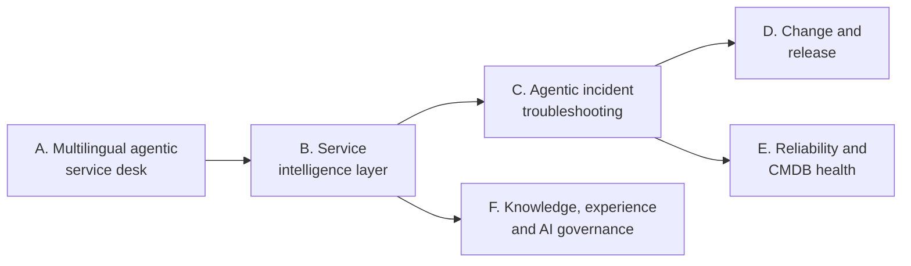

# Autonomous IT on ServiceNow: strategy, use cases and build plan

This repository holds the strategy for taking a client from **AI skills** (summarise, draft,
suggest) to **autonomous IT workflows** (agents that detect, decide and act, with people
approving the risky steps), including **voice and multilingual** channels.

It is built on what the demo instance **everis2** (`everisspainsludemo2.service-now.com`,
Zurich family) already has. Every agent and skill named here exists on everis2 unless it is
marked `MISSING` or `BUILD`. The facts come from a read-only mirror of the instance, taken on
2026-10-27. Nothing on the instance was changed.

## How to read it

| File | What it answers |
|---|---|
| [01-strategy.md](01-strategy.md) | The journey, the autonomy ladder, the reference architecture and the build principles (no scoped apps) |
| [02-everis2-baseline.md](02-everis2-baseline.md) | What everis2 has today: agents, skills, channels, gaps |
| [03-use-case-map.md](03-use-case-map.md) | **Start here for the team discussion.** All use cases on one page, by journey and autonomy level |
| [use-cases/](use-cases/) | One file per journey. Each use case lists its flow, agents, skills, prerequisites, human checkpoints and KPIs |
| [04-agent-catalog.md](04-agent-catalog.md) | Every IT-relevant AI agent on everis2 and the use cases that use it |
| [05-skill-catalog.md](05-skill-catalog.md) | Every IT-relevant Now Assist skill on everis2 and the use cases that use it |
| [06-roadmap.md](06-roadmap.md) | Phases, dates and the demo story at the end of each phase |
| [07-implementation-plan.md](07-implementation-plan.md) | Workstreams, tasks, enablement checklist and build conventions |
| [08-demo-script.md](08-demo-script.md) | 40-minute demo script: storyline, scenes, exact questions, what to expect and what to avoid |
| [09-demo-route.md](09-demo-route.md) | The records to open, in the order of the storyline, and the Fix Script that prepares them the day before |
| [use-cases/_template.md](use-cases/_template.md) | Template for adding a new use case |
| [capabilities/60-real-plan.md](capabilities/60-real-plan.md) | **The plan from the live tests (28 Oct):** what works, what breaks, Sprint 0 tasks R1 to R23, builds B1 to B8, phase 2 (W1 to W7: data readiness, analytics, event-driven agents, voice, value, kit), roadmap changes |
| [capabilities/70-quality-plan.md](capabilities/70-quality-plan.md) | **Quality plan:** the bar, the QA method and the fix for each of the 12 demo steps, step by step |
| [capabilities/](capabilities/) | AI capability assessment: overview, four domain dossiers, test plan with live results |
| [evidence/](evidence/) | Screenshots and logs of the live tests (P1-1 and all capabilities) |

## The journeys

The use cases are grouped into six journeys. The first three match the three NTT DATA
reference slides (agentic service desk, service intelligence layer, agentic incident
troubleshooting); the last three extend the story.

## Status tags used everywhere

| Tag | Meaning |
|---|---|
| `ON` | Present and active on everis2 |
| `OFF` | Present on everis2 but inactive: activation and configuration only |
| `MISSING` | Not on everis2: needs a plugin, a store app, an integration or an entitlement |
| `BUILD` | We build it, in the Global scope, from flows, subflows, tools and agent configuration |

## Build principle in one line

Use the out-of-the-box agents and skills first, configure them, chain them into agentic
workflows, and build only the missing glue in the **Global scope with update sets**. No custom
scoped applications, to avoid extra App Engine licensing. See
[01-strategy.md](01-strategy.md#build-principles).

## Keeping it current

The instance facts can be refreshed with snagentic (`snagentic pull` in the everis2 workspace).
When an agent or skill changes status, update its tag in the use case file and in the catalogs.
Add new use cases from [use-cases/_template.md](use-cases/_template.md) and register them in
[03-use-case-map.md](03-use-case-map.md).
