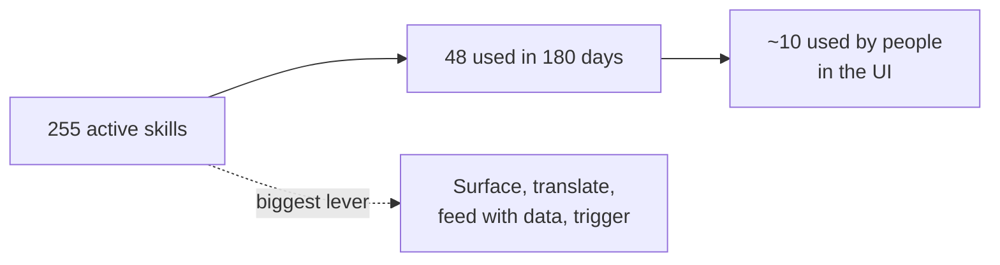

# AI capability assessment: getting the most out of everis2

**Date:** 28 October 2026. **Question:** of everything the instance is entitled to, what should we
switch on, for whom, with what business logic, and what tweaks make it really useful to people?

**Method:**
- Four domain reviews of the instance mirror, written as dossiers:
  - [service desk](10-service-desk.md)
  - [operations](20-operations.md)
  - [knowledge and analytics](30-knowledge-analytics.md)
  - [platform and governance](40-platform-governance.md)
- Live usage from the AI log (180 days).
- Live tests in the UI with evidence, in the [validation log](#live-validation-log) below. The
  dossiers are mirror analysis: anything marked "(inferred)" there is not yet confirmed on the instance.

**Read first:** the plan built from the live tests is [60-real-plan.md](60-real-plan.md), and the status of every
capability is in [50-test-plan.md](50-test-plan.md).

**Corrections to the dossiers from the live tests:**
- Employee Center already has the Otto AI chat with cited answers (`esc?id=ai_native_chat`). The knowledge
  dossier said the portal AI answer was missing.
- No AI agent trigger is active (V2).
- The POV calls come from the AI Agent Advisor, not from clustering or LEAP (V3).
- "Generate my work plan" usage was a blocked `system` trigger (V7).
- Guardians leave no visible trace in log mode (PG09).
- The SOW email composer has the Otto draft, but its icon shows only when the email body has focus (SD29).

## The headline

The instance is **switched on, but not used**. 255 skills are active; **48 made at least one AI call in
180 days**, and 11 agentic workflows ran at least once (but 78 of the 80 "Generate my work plan" runs were a
`system` trigger blocked by access, see V7). The AI that does run is mostly plumbing:
- agent building by colleagues;
- the autonomous alert agent;
- monthly clustering jobs nobody reads;
- agent memory.

The value is not in switching on more. It is in **putting what is already active in front of the right
person, with the right data, language and trigger**.

## What blocks usefulness today (cross-cutting)

| # | Blocker | Effect | Fix | Effort |
|---|---|---|---|---|
| X1 | **Language** | No default translation provider, gen-AI translation off, VA translation off, users without a language. Everything answers in English | Translation defaults, VA translation, persona languages | Low, config |
| X2 | **Demo data** | No CIs or services on incidents and changes, legacy problems, no Spanish knowledge, no chat queue. Agents have nothing to reason on | Synthetic demo world with AI Data Kit and Otto for Setup | Medium |
| X3 | **Placement** | Strong features are hidden or not on the employee surfaces: voice mic, search answers, insights dashboard, MI email content | Turn on in product, add to portal and workspace pages | Low |
| X4 | **Triggers** | All 6 AI agent triggers are inactive in the mirror. The only autonomous flow is the alert rule | Activate AIT copies of triggers, one per use case, with approval steps | Low to medium |
| X5 | **Roles** | Analysts with only `itil` can't see work plan, Work Allocator, escalation or problem agents (they need `sn_uxc_gen_ai.platform_ai_*` roles) | Add the roles to the analyst personas | Low |
| X6 | **Governance holes** | 4 holes: a "Test MCP" server with 21 write tools; alerts auto-closed by default with no explicit policy; Build Agent creating scoped apps; agent memory readable by external agents | Lock down, make each one a deliberate, audited setting | Low |
| X7 | **No measurement** | 0 feedback, AI Value not backfilled, no adoption KPIs | Feedback on, AI Value backfill, AI Analytics Q&A | Low |

## Consolidated priorities

### Wave 1: configuration only, days (no build, no data load)

| # | Capability | Who uses it | Business logic | Domain |
|---|---|---|---|---|
| 1 | Translation defaults, VA translation, persona languages | Everyone | Answer in the user's language; the record keeps the original | [KA 6.1](30-knowledge-analytics.md) |
| 2 | Voice input in the Now Assist panel (ES, PL, PT) | Analysts, employees | Dictate a question or note; the same agents answer | [PG](40-platform-governance.md) |
| 3 | AI answer on portal search, plus semantic search; Now Assist Q&A in VA | Employees | Answer first, "not helpful" opens a pre-filled incident | [KA 2.1, 2.2](30-knowledge-analytics.md) |
| 4 | Investigate and recommend incident resolution | Analysts | On assignment of P1 to P4, the agent proposes a resolution as a work note | [SD](10-service-desk.md) |
| 5 | Major incident email content, post incident review trigger | MI manager | Drafted stakeholder updates; review drafted on resolve | [SD](10-service-desk.md), [OPS](20-operations.md) |
| 6 | Charts from a question, AI filters, dashboard narrative | Team leads | "Show P1s by group this month" without a report request | [KA 3.3, 3.5, 3.6](30-knowledge-analytics.md) |
| 7 | ITSM Insights clusters surfaced, monthly review | Service delivery manager | Clusters become problems, KB drafts or automation backlog | [KA 3.1](30-knowledge-analytics.md) |
| 8 | Autonomous alert handling tuned, noise auto-close made explicit and audited | Operations | Severity filter, CI data, weekly report of alerts closed by AI | [OPS 1, 2](20-operations.md) |
| 9 | Guardians at block, AI Control Tower approvals, MCP locked down | CISO, platform owner | No new agent or MCP server without approval; blocked attempts logged | [PG](40-platform-governance.md) |
| 10 | Request Status Agent and Create Incident with fallback in VA | Employees | Status and new issues by conversation; legacy topics retired | [SD](10-service-desk.md) |
| 11 | Work plan, approval assistance, attachment summary, Explain SLA | Analysts, approvers | Each one a single flag or role away | [SD](10-service-desk.md) |

### Wave 2: needs demo data (after X2)

Triage and categorize on create; Work Allocator; proactive escalation; curated Catalog Agent; knowledge gaps,
duplicates and health; LEAP analysis to problem and KB drafts; automatic incident from a severity 1 alert;
on-call handoff; Skill Kit evaluation per AIT agent.

### Wave 3: needs an integration or a licence decision

Phone voice agents (carrier: Twilio or another handler); SRE Investigate with one observability vendor;
remediation runbooks (MID or simulated back-end); live chat (a working queue) for chat summarization and
reply; email to action (inbound action, intents, SMTP); Health Log Analytics, Metric Intelligence and
Discovery (inactive ITOM licence plugins); SLO agents (Service Reliability Management not installed).

### Switch off or ignore (noise)

- **33 active skills that do nothing for IT:** 15 Moveworks skills, 12 Group and Action skills for Customer
  Service and HR, 4 developer leftovers, web search, one broken context-menu skill.
- **Jobs that spend AI calls nobody reads:** the Group and Action clustering jobs (unless the dashboard is
  surfaced, item 7), and the SLO runner job polling an empty queue every 5 minutes.
- **Keep off:** "Propose survey responses" (an AI answering the requester's own CSAT devalues it), deprecated
  and duplicated agents, overlapping legacy VA topics.

## New use cases found (not in the journeys yet)

| ID | Use case | Value | Journey |
|---|---|---|---|
| N1 | **Synthetic demo world:** AI Data Kit and Otto for Setup load multilingual incidents, CIs, services and changes, labelled and purgeable | Fixes X2 in days | P0 |
| N2 | **Prove an agent before L3:** golden set per AIT agent, Auto Chat, Skill Kit metrics, Conversation Evaluator, scored in AI Control Tower | Governance gate entry ticket | F |
| N3 | **Contain a rogue agent:** prompt leakage detected, context written, human approves, agent contained and reinstated | Strongest CISO demo | F |
| N4 | **Bring your own assistant, governed:** a client's Claude or Copilot calls ServiceNow through an approved MCP server, every call audited | Differentiator | F |
| N5 | **Insights to action:** monthly cluster review turns into problems, KB drafts and automation candidates | Service manager ritual | B, C |
| N6 | **Answer-first employee search:** synthesized, cited answers in portal search, measured as deflection | Big deflection lever | A |
| N7 | **Knowledge closed loop:** gaps, generated drafts in the caller's language, duplicates merged, health score | One KPI: incidents solved with an article | F |
| N8 | **Noise governance board:** weekly report of alerts closed by AI, reopen rate, auto-close switch per source | Makes L4 sellable | C |
| N9 | **Wrong-door tickets:** incidents that are requests get the catalog link and close as wrong channel | Cleaner data, faster fulfilment | A, B |
| N10 | **Attachment-aware intake:** screenshots, logs and PDFs summarized into a work note on create | Faster triage | B |
| N11 | **What AI saved us:** AI Value dashboard and AI Analytics Q&A for sponsors | Executive story | F |
| N12 | **Client onboarding accelerators:** category and routing recommenders propose trees and rules from 6 months of history | Delivery asset | Delivery |
| N13 | **AIOps readiness assessment:** SRE pre-engagement check plus CMDB health as a first-week deliverable | Pre-sales asset | E |
| N14 | **Speak to Otto before telephony:** dictation in ES, PL, PT through the panel mic, same agents | Voice story in P1, P2 | A |

## Live validation log

Tests ran in the UI on everis2 on 28 October as the test user. Every capability's status is in
[50-test-plan.md](50-test-plan.md), the raw log and screenshots are in
[../evidence/capabilities-2026-10-28/](../evidence/capabilities-2026-10-28/), and the plan built from them is in
[60-real-plan.md](60-real-plan.md). The provider and model come from `sys_generative_ai_log`.

| # | Capability | Test | Result | Provider and model | Notes |
|---|---|---|---|---|---|
| V1 | P1-1 skills (9) | See [P1-1 report](../evidence/p1-1-2026-10-28/README.md) | Pass | Azure OpenAI; Claude Haiku for 2 | Done |
| V2 | Trigger states (6) | Live query of `sn_aia_trigger_configuration` | All 6 inactive | – | The dossier claim of one live trigger was wrong |
| V3 | Source of the 359 POV calls | AI log by day and user | AI Agent Advisor | – | All by `agent-miner-svc-account`, monthly (317 on 5 Aug) |
| V4 | Investigate and recommend incident resolution | SAP test incident, panel | Pass (2nd try) | gpt-5.4; Bedrock `claude_large` for one step | 1st try terminated |
| V5 | Resolution plan, incident assist | Same incident | Pass | gpt-5.4 | – |
| V6 | Triage and categorize (on demand) | Same incident | Partial | gpt-5.4 | Diagnosis right, no field written; writing needs the trigger |
| V7 | Generate my work plan | Panel | Partial | – | Works on request; the daily trigger as `system` was blocked 78 times |
| V8 | Charts from a question | Panel | Pass | – | Matches the stats API |
| V9 | Analyze task trends | Panel | Blocked (data) | – | "No clustered data" |
| V10 | Voice input mic | Panel | Not run | – | Needs activation (class A) |
| V11 | Portal search answer and VA Q&A | Employee Center | Pass | – | Otto AI chat is live on `/esc`; the demo KB is a US university's |
| V12 | Request Status Agent, Create Incident agent | Employee Center | Pass / partial | – | The chat doesn't carry into the incident form |
| V13 | Change agents | Change | 1 partial, 3 fail, 1 blocked | – | LEAP misroute, no CIs, inactive std change override |
| V14 | Investigate problems | Problem | Fail | – | Wrong workflow (incident agent); the summary card passes |
| V15 | Test MCP server | Registry and AI Control Tower | Governance gap | – | Active, 21 tools, unmanaged, no execution log |
| V16 | Wrap-up and resolve | Test incident | Partial | gpt-5.4 | Resolves; KB create fails; Approve button bug |
| V17 | Autonomous alert agent | Test event to alert | Pass | gpt-5-mini, gpt-5.4 | 2 plans, no human, note in 2 min |
| V18 | AI Control Tower | Workspace | 0 of 334 managed | – | Never set up |
| V19 | AI Agent Analytics | Dashboard | Pass | – | 81 blocked runs, inferred CSAT 3.5 |
| V20 | Integration blockers | Live queries | 8 proven | – | No MID, HLA core, SRM, Discovery, telephony, chat queue |
| V21 | LEAP | LEAP workspace and panel | Not configured | – | Its agent still took 7 of 7 generate, recommend and set-up requests in the panel |
| V22 | AI Agent Advisor (agent miner) | Execution records | 9 of 9 runs failed | – | Only 35 of the 500 closed incidents it needs had a usable issue and root cause |
| V23 | Guardian and value dashboards | Platform Analytics | Guardian: 0 flagged since July; AI Value: widgets in error | – | The guardian adds 426 ms per call |
