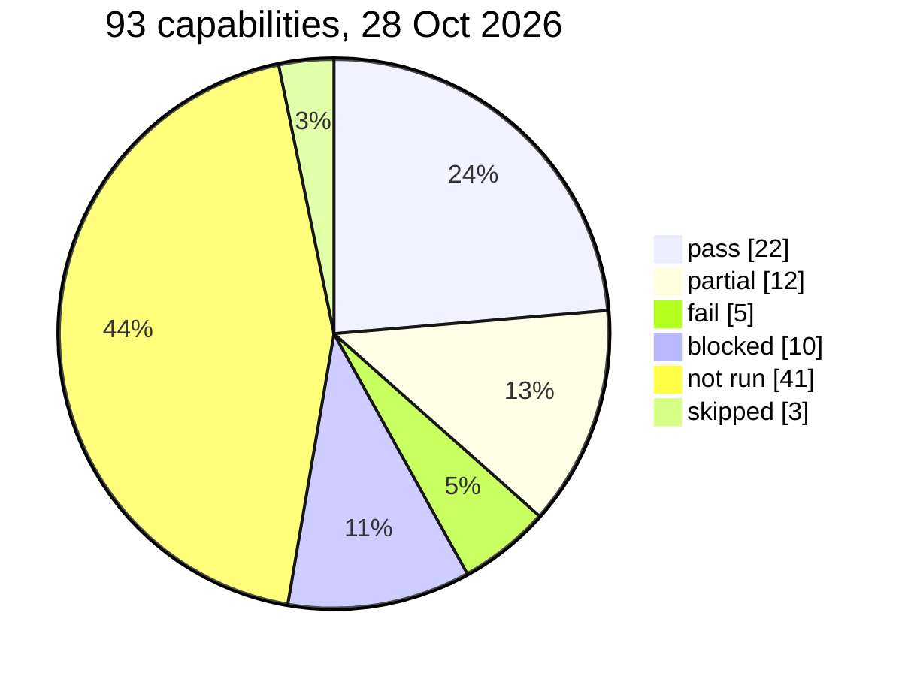

# Test plan and results: every capability

Every capability in the four domain dossiers gets a test. The kind of test depends on its state:

| Class | Meaning | Test |
|---|---|---|
| **T** | Active and reachable now | Run it in the UI on test records; capture a screenshot and the AI log entry |
| **A** | Present but switched off or hidden | Activate it in update set `AIT-TEST-activations` (needs owner approval), then test as T; record how to revert it |
| **D** | Works only with data we don't have | Create minimal test data, then test as T; note what real data it needs |
| **I** | Needs an integration, licence or plugin that's missing | Prove the blocker live (record, plugin or property), no workaround |
| **S** | Skipped on purpose | Reason given |

Status values:
- `pass`: it works as intended;
- `partial`: it works but misses part of the job;
- `fail`: it didn't do the job;
- `blocked`: access, data or integration stopped it, with the blocker proven;
- `not run`: no test yet.

The tests ran on 28 October 2026 on everis2:
- user: `svc_fcaamano`, who has admin but none of the `itil` or change roles;
- surfaces: Service Operations Workspace (SOW), the Otto panel and Employee Center.

Evidence (`NN` = screenshot) is in [../evidence/capabilities-2026-10-28/](../evidence/capabilities-2026-10-28/).
P1-1 evidence is in [../evidence/p1-1-2026-10-28/](../evidence/p1-1-2026-10-28/).

## Results at a glance

| Status | Count | Meaning for the plan |
|---|---|---|
| pass | 22 | Ready to show, most of them after small UX tweaks |
| partial | 12 | Valuable, but routing, data or a hidden precondition gets in the way |
| fail | 5 | All 5 are Otto panel routing or record-lookup failures, not broken skills |
| blocked | 10 | 8 integration or licence (proven live), 1 access (ACL), 1 data |
| not run | 41 | 18 need activation (owner approval) or an integration; 23 can run now and are next |
| skipped | 3 | On purpose |

52 of 93 capabilities have a live result. The testing continues; this table is the state at commit time.

## Service desk ([dossier](10-service-desk.md))

| ID | Capability | Class | Status | Result | Evidence |
|---|---|---|---|---|---|
| SD01 | Triage and categorize ITSM incidents | T | partial | Panel ignored the open record; with the number it ran Incident assist, which gave the right diagnosis but wrote no field. The writing workflow is trigger-only and its trigger is inactive | results log |
| SD02 | Investigate and recommend incident resolution | T | pass | 5-step SAP plan as a work note, about 60 s. First try terminated with "problem on my side" | 02, 03 |
| SD03 | Incident assist, additional context | T | pass | Correct context on the caller and the issue | results log |
| SD04 | Resolution plan, suggested actions | T | pass | Covered by the SD02 run | 02 |
| SD05 | Wrap-up and resolve incident | T | partial | Resolved INC0025194 with notes and a code; SLA paused. Hidden precondition (state must be In Progress), the Approve button starts a new plan, and "Create KB" fails with no reason | 29-35 |
| SD06 | Major incident email content | A | not run | Needs activation | – |
| SD07 | Generate post incident review | D | fail | Routed to the LEAP agent, which asked for an AOPP number | 28 |
| SD08 | Attachment summarization | A | not run | Needs activation | – |
| SD09 | Find catalog item ("wrong door") | T | not run | – | – |
| SD10 | Work Allocator | T | fail | Routed to the LEAP agent | 13 |
| SD11 | Generate my work plan | T | partial | Works on request ("No assigned tasks" for the test user). The daily trigger runs as `system` and was blocked 78 times | 05, 60, 61 |
| SD12 | Proactive escalation signals | T | partial | Natural language misroutes; the exact name works, but "SLA due: UNKNOWN" is wrong | 10-12 |
| SD13 | Explain SLA | T | pass | Correct SLAs and planned breach | 04 |
| SD14 | Who is on call | D | pass | "David Dan, Primary" for Network | 14 |
| SD15 | Routing and category setup agents | T | not run | – | – |
| SD16 | Catalog Agent (Employee Center) | T | pass | Two Visio options; RITM0010057 submitted | 38, 39 |
| SD17 | Catalog form slot fill | A | not run | Needs activation | – |
| SD18 | Catalog item generation | I | not run | – | – |
| SD19 | Request Status Agent | T | pass | Lists the RITM and incidents with states | 40 |
| SD20 | Approval assistance | A | not run | Needs activation | – |
| SD21 | Create incident from chat | T | partial | Gives a tip and three create options, but every form opens empty: nothing from the chat carries over | 41-44 |
| SD22 | Deflection answer, Now Assist Q&A | T | pass | Cited VPN answer in Otto chat (demo KB is a US university's) | 36, 37 |
| SD23 | Conversational subflows and actions | T | not run | – | – |
| SD24 | Image to task | T | not run | – | – |
| SD25 | Requester ticket summary | A | not run | Needs activation | – |
| SD26 | Intent to action (email) | A, I | not run | SMTP off (P1-1) | – |
| SD27 | Email Generator | T | pass | Drafted and sent in P1-1 | P1-1 01, 04 |
| SD28 | Notification agents (admin) | T | not run | – | – |
| SD29 | Compose email in the SOW composer | T | pass | Works (P1-1). The Otto icon shows only when the email body has focus: hard to discover | 64, P1-1 01 |
| SD30 | Chat summarization and reply | I | blocked | 131 chats in 90 days, all handled by the Virtual Agent with no queue; 0 agents available | results log |
| SD31 | Sidebar summarization | T | not run | Needs two users | – |
| SD32 | ITSM Insights dashboards | T | not run | – | – |

## Operations ([dossier](20-operations.md))

| ID | Capability | Class | Status | Result | Evidence |
|---|---|---|---|---|---|
| OP01 | Manage alerts autonomously | T | pass | Test event to Alert0010107; 2 plans completed with no human; AI work note in 2 min | 45-47 |
| OP02 | Alert noise auto-close | T | not run | The Major test alert was not a noise candidate | – |
| OP03 | Alert Assist on demand | T | pass | Overview, cause, impact and 9 steps. It reused this morning's AI resolution | 46, 47 |
| OP04 | Incident from alert with AI insight | T | partial | INC0025306 created, but as a plain copy: Inquiry, P4, no CI, no AI insight | 48 |
| OP05 | Proactive alert grouping | D | not run | – | – |
| OP06 | Create alert automation agent | T | not run | – | – |
| OP07 | AI Worker mode for alerts | A | not run | Needs approval | – |
| OP08 | Alert remediation subflows | I | blocked | No MID Server (`ecc_agent` empty) | results log |
| OP09 | SRE Investigate, observability vendors | I | not run | – | – |
| OP10 | SRE readiness check | T | not run | – | – |
| OP11 | LEAP automation opportunities | T | not run | The LEAP agent captures other requests (see SD07, SD10) | – |
| OP12 | Error analysis and remediation | T | blocked | "You don't have the required access" (ACL, `itil`) | 49 |
| OP13 | Pattern diagnostic (Discovery) | I | blocked | ITOM Discovery not active | results log |
| OP14 | MID Guardian | I | blocked | No MID Server | results log |
| OP15 | Service Mapping AI | I | blocked | Plugin active, no MID Server | results log |
| OP16 | SLO and synthetic agents | I | blocked | No SRM tables | results log |
| OP17 | Health Log Analytics agents | I | blocked | Agent app installed, HLA core missing | results log |
| OP18 | Link to major incident or problem | T | not run | – | – |

## Knowledge, search and analytics ([dossier](30-knowledge-analytics.md))

| ID | Capability | Class | Status | Result | Evidence |
|---|---|---|---|---|---|
| KA01 | KB generation from a task | T | partial | Created KB0010015 in P1-1; the same tool failed to create from wrap-up (SD05) | P1-1, 35 |
| KA02 | KB content creation from a topic | T | fail | Panel insists on a task number | 55 |
| KA03 | Knowledge duplicates and merge | A, D | not run | – | – |
| KA04 | Knowledge gaps | A, D | not run | – | – |
| KA05 | Knowledge Center, health score | A | not run | – | – |
| KA06 | Knowledge content recommendation | T | partial | Wrap-up suggested 3 KB articles, all irrelevant (no SAP knowledge) | 33 |
| KA07 | KB summarization | T | fail | No summary on the portal; the panel described KB0000008 (VPN for Apple) as an article about knowledge management | 53, 54 |
| KA08 | AI search answers | T, A | partial | Employee Center Otto chat: pass. Global search: a fluent answer with the wrong records (inactive duplicates, not the 39 real ones) | 36, 52 |
| KA09 | Now Assist Q&A in VA | T | pass | Cited answer with sources | 36, 37 |
| KA10 | Knowledge graph answers | T | partial | Found the laptop; ignored the open-incidents half | 09 |
| KA11 | Web search answers | I | not run | A Perplexity property and alias exist; deliberately not called | – |
| KA12 | AI Analytics Q&A | T | pass | Chart matches the stats API; no written comparison | 15, 16 |
| KA13 | ITSM Insights dashboard | T | not run | – | – |
| KA14 | Analyze task trends | T | blocked | "No clustered data" (data) | 08 |
| KA15 | Data visualization | T | pass | Stacked chart with edit and add to dashboard | 06, 07 |
| KA16 | Analytics query generation | T | pass | Same as KA12 | 15 |
| KA17 | Dashboard summarization | T | not run | – | – |
| KA18 | AI filter, list questions | T | fail | Panel: "problem on my side". The classic list has no AI filter | 50, 51 |
| KA19 | AI Lens | I | not run | A "Create with Lens" button is on the list | 51 |
| KA20 | Document extraction | T | not run | – | – |
| KA21 | Smart Documents | T | not run | – | – |
| KA22 | Survey analysis agent | D | not run | – | – |
| KA23 | Survey response suggestion | S | skipped | Keep off | – |
| KA24 | Sentiment | T | pass | Sentiment and trend shown on lists and records. Also runs on event-made incidents, where it means nothing | 51, 64 |
| KA25 | Dynamic translation | A | not run | Needs activation | – |

## Platform, governance and voice ([dossier](40-platform-governance.md))

| ID | Capability | Class | Status | Result | Evidence |
|---|---|---|---|---|---|
| PG01 | Build Agent | S | skipped | Creates scoped apps | – |
| PG02 | AI Agent Studio | T | partial | Opens on its first-time tour; banners: "8 agents have no ACL" and new access configuration required. Generation aids not tried | 59 |
| PG03 | Skill Kit evaluation, Auto Chat | T | not run | – | – |
| PG04 | Otto for Setup | T | not run | – | – |
| PG05 | AI Data Kit | T | not run | – | – |
| PG06 | Flow generation | T | not run | – | – |
| PG07 | AI Control Tower | T | pass | Opens on its first-time wizard. 0 managed assets; 334 AI systems and 3 MCP servers unmanaged, with risk not set | 56-58 |
| PG08 | AI security detectors | A | not run | Needs approval | – |
| PG09 | Guardians | T | partial | The planner refused a prompt injection and nothing leaked; the guardian left no trace and the UI said "don't understand" | 17 |
| PG10 | Conversation Evaluator | A | not run | Needs approval | – |
| PG11 | Agent memory | T | pass | No memory stored for the test user | results log |
| PG12 | AI analytics dashboards | T | pass | AI Agent Analytics (OOB): 81 blocked runs, inferred CSAT 3.5, errors. Consumption showed 0 for this week | 60-63 |
| PG13 | MCP server registry | T | pass | 3 active servers, including the iCenter "Test MCP" with 21 tools; no execution log | 58 |
| PG14 | External agents (A2A) | T | pass | None registered | results log |
| PG15 | AI Agent Advisor, Automation Explorer | T | not run | Runs monthly as `agent-miner-svc-account` (all 359 POV calls) | – |
| PG16 | Voice input in the panel | A | not run | Needs approval | – |
| PG17 | Phone voice agents | I | blocked | Twilio config has a placeholder account (`-1`); 0 phone interactions | results log |
| PG18 | Document voice | S | skipped | Not IT | – |

The "results log" is [../evidence/capabilities-2026-10-28/README.md](../evidence/capabilities-2026-10-28/README.md).
