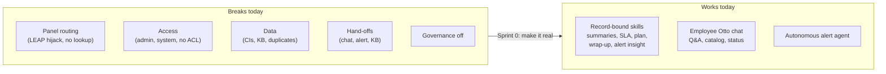
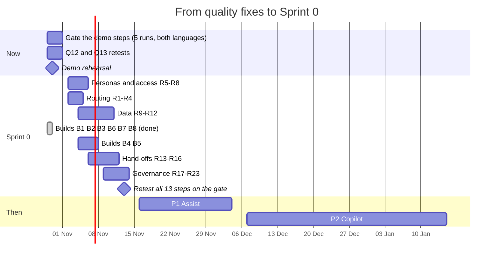

# The real plan: from tested capabilities to an autonomous IT demo

**Date:** 28 October 2026. **Status updated:** 29 October 2026, after two days of quality fixes
([70-quality-plan.md](70-quality-plan.md)).

**Basis:**
- 77 of 93 capabilities tested live on everis2, with 82 screenshots, 2 transcripts and the AI logs;
- results are in [50-test-plan.md](50-test-plan.md), the raw log in the
  [evidence README](../evidence/capabilities-2026-10-28/README.md).

This plan replaces assumptions in the [roadmap](../06-roadmap.md) and the
[implementation plan](../07-implementation-plan.md) with what the instance actually does.

## What the tests prove

| # | Lesson | Evidence |
|---|---|---|
| L1 | **The skills work. The Otto panel's routing is the weak link.** Every skill reached from a record (summarize card, alert insight, wrap-up, SLA, recommendation) worked. Free-text requests in the panel failed in 7 of 7 generate, recommend, create and set-up cases: the LEAP agent took them and asked for an automation opportunity number. LEAP itself shows "Settings are not configured!". Record numbers were not looked up: KB0000008 was described as the wrong article. A plain list question ended in "problem on my side". The suggested skill "Analyze related incidents" looped 59 times. A survey question got "I don't understand". The counter-case: on an alert record, "create an alert automation" reached its own agent and returned a proposal, so record context decides the route. | SD07, SD10, SD15, SD28, KA02, KA07, KA18, KA22, OP06, OP11, OP18 (13, 28, 50, 54, 55, 70, 71, 73, 74, 81, 83) |
| L2 | **Admin is not a persona, and access fails silently.** Some agents ran for the admin test user, others were refused with "You don't have the required access". In two cases the real cause was an inactive workflow or an ACL. 8 agents have no ACL roles. The daily "Generate my work plan" trigger runs as `system` and was blocked 78 times, so the "80 runs" in usage were never real use. | OP12, std change, SD11, PG02, PG12 (18, 49, 59-61) |
| L3 | **Weak data makes agents look wrong.** The alert didn't bind to a CI (`SAP WEB01` exists but isn't a host). Change CI suggestion found nothing. The KB comes from a US university (VPN shared secret, "8-HELP"). Incident numbers are duplicated, and some records are On Hold but inactive. Clustering is empty. All 9 AI Agent Advisor runs failed: only 35 of the 500 closed incidents it needs have a usable issue and root cause. That cost 359 LLM calls for no output. The Insights dashboards show no data because their indicators are not collected. | OP01, CI suggestion, KA06, KA08, KA14, PG15, SD32 (08, 20, 33, 52, 66, 72) |
| L4 | **Hand-offs between AI steps break.** Chat to incident: forms open empty. Alert to incident: a plain copy without the AI insight. Wrap-up to KB: "Unable to create knowledge article". The Approve button in the panel starts a new plan. | SD21, OP04, SD05 (31, 35, 42-44, 48) |
| L5 | **Governance exists but is not switched on.** AI Control Tower manages 0 of 334 AI systems and none of the 3 MCP servers, including the iCenter "Test MCP" with 21 tools. The guardian runs on every call (+426 ms) but has flagged 0 injections since July; its OOB dashboard is the place to show the block. The AI Value Dashboard widgets show "Error". The AI Agent Analytics dashboard (OOB) already shows blocked runs, errors and an inferred CSAT of 3.5. | PG07, PG09, PG12, PG13 (17, 56-58, 60-63, 65, 68) |
| L6 | **Autonomy already works in operations.** An event became an alert, the autonomous agent completed 2 plans with no human, and the AI note arrived in 2 minutes. The on-demand insight even reused this morning's AI resolution. | OP01, OP03 (45-47) |

## Status on 29 October

Two days of quality work on the 13 demo steps ran under the owner's approval for data, configuration
and activations. Each step was measured against an answer key, fixed, and retested. The method and
the scores are in [70-quality-plan.md](70-quality-plan.md). The evidence and revert steps are in
[evidence/quality-2026-10-28](../evidence/quality-2026-10-28/). The demo runs from
[08-demo-script.md](../08-demo-script.md).

**Average: 6.0 to about 9.2 of 12** (12 rescored steps, Q09 per ticket). Top quality is 10 or more, in 5 of 5 runs, in both languages.
No step has passed the full gate yet: every score below comes from one or two runs.

| Step | Before | Now | What changed | What's left |
|---|---|---|---|---|
| Q01 SLA | 3 | **11** | Global copy "Explain SLA (AIT)", 8 SLA definitions linked to the breakdown, Spanish persona | No silence data; a breached sibling SLA isn't mentioned |
| Q02 On call | 7 | **9** | SAP rota, 3 fictitious SAP users, persona role `oc_read` | No shift end; can't assign or page |
| Q03 Recommend | 7 | not rescored | Runs automatically on assignment, in Spanish, as the persona | Doesn't cite similar incidents; routing to Network |
| Q04 Wrap up | 8 | **9** | Spanish persona, the persona in the group | Article step hangs; duplicate runs |
| Q05 Alert insight | 8 | **10** | SAP CIs with owner and group, a kernel change, alerts grouped | English notes; no time-to-full; dependency direction |
| Q06 Alert automation | 4 | **10** | Ask for a grouping automation, the only kind the agent builds | Response automations are only a link; no replay |
| Q07 Knowledge | 3 | **11** | 3 Spanish articles in the open "Knowledge" KB | 30 articles (R10); 7 more questions |
| Q08 Software | 7 | **10** | Two variables (reason, laptop), the persona's laptops | English description (protected item); duplicate not spotted |
| Q09 Status | 6 | **9 / 5** | Approval, overdue and on-hold data | Per ticket 9; the overview reads state only |
| Q10 Wrong door | 9 | **9** | Spanish persona | No catalog item named, no conversion |
| Q11 Analytics | 3 | **9** | Persona role `now.assist.creator.analytics`, tested wording | No numbers or narrative; wording-sensitive |
| Q12 Smart Documents | 5 | 5 | Not retested | Redaction failed; English; silent off-document |
| Q13 Governance | 8 | 8 | Root cause found; one asset Managed | Value needs Managed assets (R17, R22) |

**What the two days taught us**, in addition to L1 to L6:

| # | Lesson | Steps |
|---|---|---|
| L7 | **The user's language decides the answer's language**, not the question or the instructions. Every demo runs as a Spanish persona; autonomous notes run as the system, in English. | Q01, Q05, all |
| L8 | **Most poor answers were missing data, roles or content, not weak AI.** Q07 went from 3 to 11 with three articles and the right knowledge base; Q05 went from 8 to 10 with an owner and a change on the CI. | Q02, Q05, Q07, Q09 |
| L9 | **Each agent can do less than its name says.** The alert automation agent builds only grouping rules, the status overview reads only the state, the on-call agent is read-only, and the chart agent draws but never states numbers. The demo asks for what they can do; the rest is a build. | Q02, Q06, Q09, Q11 |
| L10 | **Missing roles fail silently or degrade the answer.** Without the analytics role, the panel answered with search links. Without `oc_read`, it said "could not be retrieved". | Q02, Q11 |
| L11 | **The 22 October upgrade broke the old AI Value Dashboard.** It reads a removed table. The new value pipeline only computes for Managed assets, and none were. | Q13 |
| L12 | **Conversations nobody ends stay "in progress".** 99 of the 106 open plans are our own test chats, not failures. | Q13 |

## Sprint 0 status

Status: **Done**, **Partial** (started, with what's left), **Open**. The task text is unchanged from
28 October.

### Routing and entry points (L1)

| ID | Task | Status on 29 October |
|---|---|---|
| R1 | Keep the LEAP agent out of general routing | **Open.** Worked around: SLA questions route to the Global copy (Q01) |
| R2 | Suggested prompts per workspace | **Open** |
| R3 | Record context per entry point | **Partial.** Confirmed: the panel needs the record open, or the number in the question (Q02, Q10) |
| R4 | Panel defects to support | **Open.** New ones to add: duplicate runs from one message (Q04), panel freezes on long runs (Q02), empty bubbles in the ESC chat (Q09) |

### Personas and access (L2)

| ID | Task | Status on 29 October |
|---|---|---|
| R5 | 6 personas with real roles | **Partial.** One analyst persona, "Analista AIT (ES)": Spanish, itil, panel, Explain SLA, analytics, `oc_read`, in DEMO.PI.Identity, manager set. 3 SAP users exist for the rota. Still needed: an operations engineer with an Event Management role (Q05, Q06 run as admin today), a change manager, an MI manager, and an employee separate from the analyst |
| R6 | ACL roles for the 8 agents | **Open** |
| R7 | Work plan trigger not as `system` | **Open** |
| R8 | Standard change decision | **Open** |

### Data (L3)

| ID | Task | Status on 29 October |
|---|---|---|
| R9 | SAP service and CIs with support groups | **Partial.** SAP AppSRV01, AppSRV02 and LoadBal01 have group DEMO.PI.SAP and an owner; events bind and route. CI naming and the rest of the SAP CIs are open |
| R10 | 30 client articles; remove the shared secret | **Partial.** 3 Spanish articles (VPN, MFA, SAP V1 801) in the open KB; 27 to go. The IT KB is readable only by ACME employees: decide the KB model |
| R11 | Clean incidents, load 6 months, clustering | **Open** |
| R12 | SAP on-call rota; assigned work | **Done** for the rota (weekly; shift end not shown). Assigned work exists for the analyst persona only |

### Hand-offs (L4)

| ID | Task | Status on 29 October |
|---|---|---|
| R13 | Create Incident agent in the ESC chat | **Open** |
| R14 | Alert to incident with the AI insight | **Done by B7** for incidents created from an alert ("Quick Incident"): the incident gets the AI summary, CI, owner, changes and related alerts. Still open: the OOB rule "Create Incident with AI Insight" is active but created no incident for 4 test alerts |
| R15 | "Unable to create knowledge article" | **Partial.** Narrowed: the same insert works through REST and fails only inside the agent; as the persona the step now hangs. Workaround: generate the article from the form |
| R16 | Sentiment off for event incidents | **Open** |

### Governance and measurement (L5)

| ID | Task | Status on 29 October |
|---|---|---|
| R17 | AI Control Tower: Managed assets | **Partial.** 1 of 336 moved to Managed as a probe (no approvals or tasks triggered); waiting for the value jobs before moving the demo skills |
| R18 | Test MCP owner or deactivate | **Open** |
| R19 | Guardian at BLOCK | **Open** |
| R20 | Weekly AI review | **Open** |
| R21 | Close stuck plans | **Open.** Sized: 106 in progress, 99 from our QA |
| R22 | Indicators and AI Value | **Partial.** Root cause found (L11). Fix = R17, then use the AI Control Tower value view, not the old dashboard |
| R23 | Pause AI Agent Advisor until R11 | **Open** |

## Builds from the quality work

Gaps that configuration can't close. Each is a Global build in an `AIT-` update set, with no scoped
app: a new Global workflow and agent, a script tool on an OOB agent, or a business rule. Six were
built and tested as the persona on 29 October (`../evidence/quality-2026-10-28/builds-2026-10-29.md`,
scripts in `../build/`). Effort: S = hours, M = 1 to 3 days.

| ID | Build | Closes | Status 29 Oct |
|---|---|---|---|
| B1 | **Analytics narrative:** Global workflow "Comparar periodos (AIT)" with a GlideAggregate tool: totals per period, the change, and the groups that explain it | Q11: "which priority explains the difference" | **Done, 11.** Exact in 3 of 3 runs. The chart phrase still goes to the OOB chart agent: ask the numbers in a new chat |
| B2 | **Request overview:** a tool on the OOB status agent for approval, due date, overdue and "waiting for you" | Q09 overview, from 5 | **Done, 11 to 12.** Action, approver and days overdue right in Spanish and English questions |
| B3 | **On-call with action:** shift end, handover and escalation line; "assign to the person on call and leave a note", supervised | Q02, from 9 | **Done, 11.** The user confirms twice before the assignment |
| B4 | **Alert response proposal:** a tool that writes an inactive `em_alert_management_rule` from the alert's fields, with a replay count | Q06 response automations | Built; rule creation untested: needs a persona with evt_mgmt_admin |
| B5 | **Alert analysis copy:** time to full, dependency direction, change number, owner, Spanish | Q05, from 10 | **Partly covered by B7** (change number and owner at hand-off). Time to full and Spanish still need a copy of the OOB agent (S) |
| B6 | **Catalog item:** Spanish texts, and the user's open requests shown before submitting | Q08, from 10 | **Done, 11.** The duplicate shows in the summary; the chat card keeps the English item name |
| B7 | **Alert to incident (= R14):** the incident gets the AI summary, CI, owner, recent changes by number and related alerts | Hand-off L4 | **Done, 11.** One note per incident, from a group or a member alert |
| B8 | **Similar-incident citations:** Global workflow "Plan con incidencias similares (AIT)"; each step cites the incidents it comes from, with the evidence count and a group check | Q03 | **Done, 11 to 12.** Recommends a group change only with 2 or more matches |

Seen in every build: the answer follows the language of the user's profile, not of the question (L7).

## Implementation plan from here

### Now to 1 November: make the demo steps pass the gate

1. **Q13:** check the probe asset after the value jobs (07:36 and 10:11 UTC on 29 October). If value
   appears, move the demo skills to Managed (R17); otherwise unmanage the probe and keep AI Agent
   Analytics as the governance view.
2. **Q12:** retest as the persona, with a PDF exported from a word processor; retest redaction.
3. **Gate runs:** 5 runs per step for Q01, Q02, Q05, Q06, Q07, Q08, Q09 per ticket, Q10 and Q11, in
   Spanish and English, scored on the 6 criteria. A step that falls below 10 in any run goes back to
   its fix list.
4. **Housekeeping:** end the QA chats (R21); switch the test user back to the Default update set.
5. **Rehearse** [the demo script](../08-demo-script.md) end to end, including its preparation list.

### Sprint 0, 2 to 13 November

In this order, because each row depends on the one before:

1. **Personas (R5) first.** Every later test runs as a persona, including an operations engineer so
   Q05 and Q06 stop running as admin.
2. **Routing (R1, R2)**, so free-text requests reach the right agent.
3. **Data (R9 to R11)**: the SAP service model, 30 articles, 6 months of clean incidents. Most
   remaining insight gaps depend on it (L8).
4. **Builds left: B4 and B5.** B1, B2, B3, B6, B7 and B8 were built and tested on 29 October;
   they go through the 5-run gate with the other steps.
5. **Hand-offs (R13, R15, R16 and the OOB alert rule of R14).**
6. **Governance (R17 to R23)**, so the 15 January gate has numbers: managed assets, blocked runs,
   value.
7. **Retest all 13 steps on the gate** on 13 November. The P1 work starts only on steps that pass.

## What changes in the roadmap

| Item | Change | Why |
|---|---|---|
| P0 | Add R1 to R23 (Sprint 0) and B1 to B8. P0-3 (guardians) becomes R19; P0-5 (data) is detailed in R9 to R12 | L1 to L12 |
| P1-2 chat summarization and reply | Move to P4 or drop: there is no live-agent queue (131 chats, all Virtual Agent) | SD30 |
| P2-1 copilot agents | Depends on R1, R2, R5. Investigate problems and Analyze task trends also need R11 | SD12, KA14, problem tests |
| P2-4 change agents | Depends on R1, R5, R8, R9. Three of five failed for routing or data | Change tests |
| P2-6 knowledge health | Depends on R10. Generating KB from a topic isn't reachable; KB from a task works | KA02, KA01 |
| P3-1 triage on insert | The writing workflow runs only by trigger: test it on one group first, as a persona, with field-level approval | SD01, R7 |
| P3-6 alerts | Analysis already autonomous and CI-aware (Q05); add B5, B7 and the noise board (N8) | OP01-OP04, Q05 |
| P4-1 voice | Telephony is a placeholder (Twilio account `-1`). Needs a carrier decision at the entitlements gate | PG17 |
| P4-5 to P4-7 ITOM | No MID Server, no HLA core, no SRM, no ITOM Discovery: decide at the entitlements gate or simulate | OP08, OP13-OP17 |
| Governance gate (15 Jan) | Measurable entry criteria: 0 unmanaged AIT assets, 0 blocked runs in a week, inferred CSAT ≥ 4, AI value shown for the demo skills | PG07, PG12, Q13 |

## Decisions needed from the owner

**Done since 28 October:** data, configuration and activations for the quality plan (approved on the
night of 28 October); roles for the analyst persona and the SAP users (decision 2, partly).

**Open:**

1. Approve the Sprint 0 configuration changes, in update sets `AIT-P0-<stream>-<name>`.
2. Approve builds **B1 to B8** (or choose which), each a Global copy or tool in an `AIT-` update set.
3. **R17:** move the demo skills to Managed in AI Control Tower if the probe shows value.
4. **Language of autonomous notes** (alert insights run as the system, in English): change the
   instructions in a copy (B5) or accept English for operations.
5. **Knowledge base model:** client articles in the open "Knowledge" KB (used now), or a client KB
   with its own user criteria.
6. Approve the class A activations for testing, in `AIT-TEST-activations`, each with its revert step:
   - the 13 never tested: MI email content, attachment summary, slot fill, approval assistance,
     requester summary, knowledge gaps, duplicates and health, translation, security detectors,
     Conversation Evaluator, voice mic, AI Worker mode;
   - 4 found switched off: flow and subflow generation (PG06, SD23), the document extraction skill
     (KA20), and alert noise auto-close (OP02).
7. Test MCP: contact iCenter or deactivate (R18).
8. Clean-up: the test records in the [evidence README](../evidence/capabilities-2026-10-28/README.md)
   and the revert lists in [night-changes.md](../evidence/quality-2026-10-28/night-changes.md), once
   the demo is done.

## Still to test

- Q12 as the persona; Q03 rescored on its answer key; gate runs for every step (above).
- SD24 image to ticket: a person attaches an error screenshot in the chat and asks for a ticket (5
  minutes; the browser automation can't drive the file picker).
- SD31 sidebar summarization: needs a second user in the conversation.
- The 13 class A activations and 2 integrations or decisions (SMTP, web search credential), after
  decision 6.
