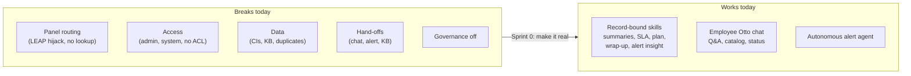
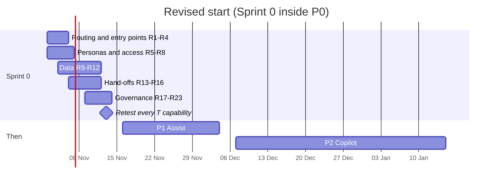

# The real plan: from tested capabilities to an autonomous IT demo

**Date:** 28 October 2026.

**Basis:**
- 61 capabilities tested live on everis2, with 75 screenshots and the AI logs;
- results are in [50-test-plan.md](50-test-plan.md), the raw log in the
  [evidence README](../evidence/capabilities-2026-10-28/README.md).

This plan replaces assumptions in the [roadmap](../06-roadmap.md) and the
[implementation plan](../07-implementation-plan.md) with what the instance actually does.

## What the tests prove

| # | Lesson | Evidence |
|---|---|---|
| L1 | **The skills work. The Otto panel's routing is the weak link.** Every skill reached from a record (summarize card, alert insight, wrap-up, SLA, recommendation) worked. Free-text requests in the panel failed in 7 of 7 generate, recommend, create and set-up cases: the LEAP agent took them and asked for an automation opportunity number. LEAP itself shows "Settings are not configured!". Record numbers were not looked up: KB0000008 was described as the wrong article. A plain list question ended in "problem on my side". The suggested skill "Analyze related incidents" looped 59 times. | SD07, SD10, SD15, SD28, KA02, KA07, KA18, OP11, OP18 (13, 28, 50, 54, 55, 70, 71, 73, 74) |
| L2 | **Admin is not a persona, and access fails silently.** Some agents ran for the admin test user, others were refused with "You don't have the required access". In two cases the real cause was an inactive workflow or an ACL. 8 agents have no ACL roles. The daily "Generate my work plan" trigger runs as `system` and was blocked 78 times, so the "80 runs" in usage were never real use. | OP12, std change, SD11, PG02, PG12 (18, 49, 59-61) |
| L3 | **Weak data makes agents look wrong.** The alert didn't bind to a CI (`SAP WEB01` exists but isn't a host). Change CI suggestion found nothing. The KB comes from a US university (VPN shared secret, "8-HELP"). Incident numbers are duplicated, and some records are On Hold but inactive. Clustering is empty. All 9 AI Agent Advisor runs failed: only 35 of the 500 closed incidents it needs have a usable issue and root cause. That cost 359 LLM calls for no output. The Insights dashboards show no data because their indicators are not collected. | OP01, CI suggestion, KA06, KA08, KA14, PG15, SD32 (08, 20, 33, 52, 66, 72) |
| L4 | **Hand-offs between AI steps break.** Chat to incident: forms open empty. Alert to incident: a plain copy without the AI insight. Wrap-up to KB: "Unable to create knowledge article". The Approve button in the panel starts a new plan. | SD21, OP04, SD05 (31, 35, 42-44, 48) |
| L5 | **Governance exists but is not switched on.** AI Control Tower manages 0 of 334 AI systems and none of the 3 MCP servers, including the iCenter "Test MCP" with 21 tools. The guardian runs on every call (+426 ms) but has flagged 0 injections since July; its OOB dashboard is the place to show the block. The AI Value Dashboard widgets show "Error". The AI Agent Analytics dashboard (OOB) already shows blocked runs, errors and an inferred CSAT of 3.5. | PG07, PG09, PG12, PG13 (17, 56-58, 60-63, 65, 68) |
| L6 | **Autonomy already works in operations.** An event became an alert, the autonomous agent completed 2 plans with no human, and the AI note arrived in 2 minutes. The on-demand insight even reused this morning's AI resolution. | OP01, OP03 (45-47) |

## What we can show tomorrow (no change on the instance)

Use these entry points exactly; they passed today.

| Step | Persona | Entry point | Capability |
|---|---|---|---|
| 1 | Employee | Employee Center search: "How do I connect to the VPN from home?" | Cited answer (SD22, KA09) |
| 2 | Employee | Same chat: "I need Microsoft Visio installed on my laptop" then Submit | Catalog Agent, RITM created (SD16) |
| 3 | Employee | "What is the status of my requests?" | Request Status Agent (SD19) |
| 4 | Analyst | SOW incident, Otto panel: "Recommend a resolution for INC…" | Plan as a work note (SD02, SD04) |
| 5 | Analyst | Same incident: "Explain the SLA", "Who is on call for Network?" | SD13, SD14 |
| 6 | Analyst | Incident In Progress: "Wrap up and resolve INC…", then type the confirmation (don't click Approve) | AI resolution (SD05) |
| 7 | Operations | Alert in SOW, AI insights card | Autonomous analysis and insight (OP01, OP03) |
| 8 | Team lead | Panel: "How many incidents were opened last month by priority…" | Chart from a question (KA12, KA15) |
| 9 | Sponsor, CISO | Platform Analytics, AI Agent Analytics, Security tab | Blocked runs, errors, inferred CSAT (PG12) |
| 10 | Employee or analyst | Panel: "Find catalog item for a user who needs a second monitor" | Wrong door to the right item (SD09) |

Avoid in a live demo: any panel request that asks to generate, write, recommend, create or set up something; change agents;
problem investigation; KB summaries by number; "Analyze related incidents"; list questions in the panel.

## Sprint 0, "make it real" (2 to 13 November, merged into P0)

Each task names its fix, the test that proves it, and whether it needs the owner's approval
because it changes configuration. Effort: S = hours, M = 1 to 3 days, L = a week.

### Routing and entry points (L1)

| ID | Task | Proof | Effort | Approval |
|---|---|---|---|---|
| R1 | Keep the LEAP agent out of the panel's general routing: LEAP isn't configured, so deactivate its workflow or limit it to a LEAP role (Global AIT copy if the original can't change) | SD07, SD10, SD15, SD28 and change plans route to their own agents | S | Yes |
| R2 | Set the panel's suggested prompts per workspace to the exact workflow names that work (Recommend a resolution, Explain SLA, Identify escalation signals, Wrap up and resolve) | A new user starts from a chip, not free text | S | Yes |
| R3 | Record context: test the panel launched from the record header, and the summarize, KB and email buttons on cards. Document which entry points pass record context | SD01 and KA07 run on the open record | M | No |
| R4 | Panel defects: the Approve button starts a new plan; the notification link goes to `/record/undefined`; "Analyze related incidents" loops on the skill picker. Raise them with ServiceNow support; meanwhile the demo script says "type to confirm" | Support case numbers | S | No |

### Personas and access (L2)

| ID | Task | Proof | Effort | Approval |
|---|---|---|---|---|
| R5 | Create 6 personas with real role sets and groups: L1 agent, L2 SAP resolver (member of DEMO.PI.SAP), change manager, operations engineer, MI manager, employee. Each gets a preferred language. Stop testing as admin | Every T test re-run per persona; no "required access" message | M | Yes |
| R6 | Fill the empty access roles of the 8 agents flagged by Agent Studio (Help Optimize Team Productivity, LEAP, Assess conflicts, Assess quality, Investigate problems, …) | Agent Studio banner gone | S | Yes |
| R7 | Work plan trigger: run as a persona with roles, or switch it off. A trigger never runs as `system` | Security tab: no new blocked runs | S | Yes |
| R8 | Decide on "Create standard change request": its override has been inactive since 3 Aug (admin). Activate it in `AIT-P0-GOV-access` or remove it from the story | Std change created from a sentence | S | Yes |

### Data (L3)

| ID | Task | Proof | Effort | Approval |
|---|---|---|---|---|
| R9 | SAP ERP application service and CIs named the way people speak ("SAP ERP", "SAP WEB01" as a host), with support groups, so events bind and agents find CIs | Test event binds to a CI; CI suggestion finds SAP | M | Yes |
| R10 | Replace the US-university KB with 30 articles in Spanish and English on the demo services (SAP, VPN, Outlook, laptops). Remove the article holding a shared secret | VPN, SAP and laptop answers cite our KB | M | Yes |
| R11 | Clean the incident data: duplicate numbers, inactive On Hold records. Then load 6 months of incidents (P0-5) and run the clustering jobs | Global search gives the right P2 list; trends show clusters | M | Yes |
| R12 | On-call rota for the SAP group; assigned work for the analyst personas | Work plan lists tasks; on-call answers for SAP | S | Yes |

### Hand-offs (L4)

| ID | Task | Proof | Effort | Approval |
|---|---|---|---|---|
| R13 | Employee Center: offer the Create Incident AI agent in the Otto chat instead of the empty record producer link | SD21: the incident keeps the chat summary | M | Yes |
| R14 | Alert to incident: flow `AIT - Alert insight to incident` copies the AI overview, cause and steps into the new incident, with category and CI | OP04: the incident carries the insight | M | Yes |
| R15 | Investigate "Unable to create knowledge article" from wrap-up (the KB tool path; P1-1 creation works from the form) | SD05: KB draft created | S | No |
| R16 | Exclude event-created incidents (caller Event Management) from sentiment | No sentiment badge on event incidents | S | Yes |

### Governance and measurement (L5)

| ID | Task | Proof | Effort | Approval |
|---|---|---|---|---|
| R17 | AI Control Tower: move the AIT agents, the used skills and the 3 MCP servers to Managed; set risk; turn approvals on for new agents | 0 unmanaged AIT assets | M | Yes |
| R18 | Test MCP: ask iCenter for an owner and purpose; deactivate it until it is governed | Server inactive or managed with an owner | S | Yes |
| R19 | Guardian at BLOCK for prompt injection, with a visible log; the demo shows the block, not "don't understand" | PG09 re-run shows the block and its log | S | Yes |
| R20 | Weekly AI review on the AI Agent Analytics dashboard (blocked runs, errors, inferred CSAT, consumption); feedback on (P1-6) | First review held | S | No |
| R21 | Housekeeping job: close stuck execution plans and panel interactions left Work in Progress (47 plans, 49 chats) | Counts back to 0 each week | S | Yes |
| R22 | Collect the indicators behind "Insights and Opportunities for Incident" and the AI Value Dashboard, including historic data | Both dashboards show 6 months; AI Value without errors | M | Yes |
| R23 | AI Agent Advisor: pause the monthly run until R11 gives 500 or more closed incidents with real issue and root cause, then run it once | One successful run with clusters and recommendations | S | Yes |

## What changes in the roadmap

| Item | Change | Why |
|---|---|---|
| P0 | Add R1 to R23 (Sprint 0). P0-3 (guardians) becomes R19; P0-5 (data) is detailed in R9 to R12 | L1 to L5 |
| P1-2 chat summarization and reply | Move to P4 or drop: there is no live-agent queue (131 chats, all Virtual Agent) | SD30 |
| P2-1 copilot agents | Depends on R1, R2, R5. Investigate problems and Analyze task trends also need R11 | SD12, KA14, problem tests |
| P2-4 change agents | Depends on R1, R5, R8, R9. Three of five failed today for routing or data | Change tests |
| P2-6 knowledge health | Depends on R10. Generating KB from a topic isn't reachable; KB from a task works | KA02, KA01 |
| P3-1 triage on insert | The writing workflow runs only by trigger: test it on one group first, as a persona, with field-level approval | SD01, R7 |
| P3-6 alerts | Already autonomous (L4) for analysis; add R14 and the noise board (N8) | OP01-OP04 |
| P4-1 voice | Telephony is a placeholder (Twilio account `-1`). Needs a carrier decision at the entitlements gate | PG17 |
| P4-5 to P4-7 ITOM | No MID Server, no HLA core, no SRM, no ITOM Discovery: decide at the entitlements gate or simulate | OP08, OP13-OP17 |
| Governance gate (15 Jan) | Add measurable entry criteria: 0 unmanaged AIT assets, 0 blocked runs in a week, inferred CSAT ≥ 4 | PG07, PG12 |

## Decisions needed from the owner

1. Approve the configuration changes marked "Yes" above, in update sets `AIT-P0-<stream>-<name>`.
2. Grant the test user, or the new personas, real roles (`itil`, `sn_change_write`, rota) and membership of
   DEMO.PI.SAP. Otherwise the access results stay mixed.
3. Approve the 14 class A activations for testing (MI email content, attachment summary, slot fill, approval
   assistance, requester summary, knowledge gaps, duplicates and health, translation, security detectors,
   Conversation Evaluator, voice mic, AI Worker mode), in `AIT-TEST-activations`, each with its revert step.
4. Test MCP: contact iCenter or deactivate.
5. Clean up the test records listed in the [evidence README](../evidence/capabilities-2026-10-28/README.md).

## Still to test (no approval needed)

14 class T and D capabilities have no live result yet:
- Service desk: SD23, SD24, SD31.
- Operations: OP02, OP05, OP06, OP10.
- Knowledge and analytics: KA20, KA21, KA22.
- Platform: PG03, PG04, PG05, PG06.

They don't change the lessons above. They add entry points to the demo and use cases to the backlog.
