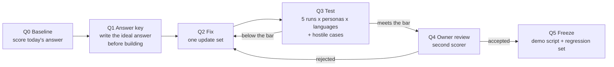
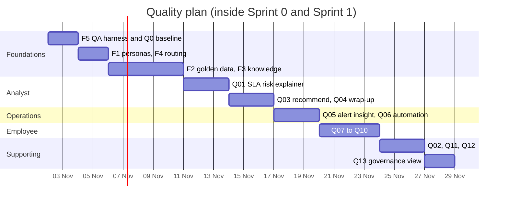

# Quality plan: the 12 demo steps at top quality

**Date:** 28 October 2026.

**Why this plan:** in [50-test-plan.md](50-test-plan.md), "pass" means a capability ran and gave a
correct answer. That is not enough for a client. A reviewer of the results noted that "Explain the
SLA" repeats what the SLA record already shows, and doesn't say why the team is about to breach. Most
of the 12 demo steps in [60-real-plan.md](60-real-plan.md) have the same problem. This plan takes each
step from "it runs" to "a person learns something and knows what to do next", and proves it with
quality assurance (QA), not with one lucky run.

**Rules:**
- **One step at a time.** A step is finished only when it passes the QA gate below, or is parked
  with a written reason. Then the next one starts.
- **No scoped apps.** Everything goes in Global scope, in update sets
  `AIT-Q<nn>-<step>-<name>`, each with a revert step.
- **Owner approval** before any change on everis2. This plan only reads until it is approved.

## 1. What "top quality" means

Every answer is scored on six criteria, from 0 to 2:

| Criterion | 0 | 1 | 2 |
|---|---|---|---|
| **Correct** | A fact is wrong | Right, with a minor slip | Every fact checks against the records |
| **Grounded** | No sources | Sources, but generic or demo content | Cites the client's own records and articles, with links |
| **Insight** | Repeats what is on the screen | Adds some context | Explains something a person couldn't see at a glance: a cause, a pattern, a comparison |
| **Actionable** | No next step | A generic next step | A specific action, owner and time, ideally one click away |
| **Fit** | Wrong language or persona | Generic | The user's language (Spanish or English), the right detail for the persona, the client's vocabulary |
| **Reliable** | Fails or loops | Works on retry | Same quality on every run, within the time target |

**The bar for "top quality":**
- every run scores **10 or more out of 12**, with **no criterion at 0**;
- **5 of 5 runs** for each persona that uses the step (at least two personas when a step serves both
  employees and agents);
- within the step's time target (usually 30 s for a chat answer, 90 s for an agent plan);
- in **Spanish and English**.

A step that meets the bar stays in the demo. A step that doesn't stays out, even if it "works".

## 2. How QA runs

- **Q0 Baseline.** Run the step as it is today and score it. This is the "before" for the client story.
- **Q1 Answer key.** Write the ideal answer for each test scenario *before* building anything, from the
  records themselves (for example, the real time the incident spent in each group). The key is the
  yardstick; without it, a fluent answer looks right.
- **Q2 Fix.** One update set per step. Data, configuration or a custom skill, as the step needs.
- **Q3 Test.** For each scenario: 5 runs, per persona, in both languages. Add hostile cases: a vague
  question, a wrong number, a record the persona can't see, a prompt injection, a question outside the
  knowledge base (the right answer is "I don't know" plus a way forward).
- **Q4 Owner review.** A second person scores a sample blind. The two scores must agree within 1 point.
- **Q5 Freeze.** The demo script records the exact entry point and wording. The test scenarios become
  the regression set: they are re-run after every platform change and before every demo.

**Evidence for every run** goes into `evidence/quality-<date>/`: the transcript exported from
`sys_cs_message`, the execution plan and its tasks (`sn_aia_execution_plan`, `sn_aia_execution_task`),
the model and latency from `sys_generative_ai_log`, a screenshot, and the score sheet. A small script
exports the transcript and the plan for one conversation (F5).

## 3. Foundations first

Most shallow answers come from thin data, not from the AI. One fresh SAP incident with no history, a
demo knowledge base from a US university and an empty SAP group can't produce insight. These five
foundations come before any step. They expand tasks already in Sprint 0
([60-real-plan.md](60-real-plan.md)).

| ID | Foundation | Done when | Sprint 0 task |
|---|---|---|---|
| F1 | **Personas.** 6 users with real roles and groups: employee, L1 agent, L2 SAP resolver, operations engineer, change manager, team lead. Fill DEMO.PI.SAP (0 members today) | Each persona logs in and runs its steps without "required access" | R5, R6 |
| F2 | **Golden scenario data.** SAP ERP service and CIs that events bind to. 6 months of SAP incidents with good close notes, reassignments, time on hold, breached and met SLAs. A recent change on the SAP CI, a known error and a problem. Each record is written to make one scenario testable | Every scenario in this plan has its records, and its answer key can be computed from them | R9, R11, R12 |
| F3 | **Client knowledge base.** 30 articles in Spanish and English on the demo services (SAP, VPN, Outlook, laptops, access). Retire the university articles from AI search, starting with the one holding a shared secret | AI answers cite only the client knowledge base | R10 |
| F4 | **Routing.** Keep the LEAP agent out of the panel's general routing; suggested prompts per workspace | No request in this plan reaches LEAP | R1, R2 |
| F5 | **QA harness.** Score sheet, transcript and plan export script, a regression list | One step scored end to end with the harness | New |

## 4. The 12 steps

Each step lists: today's score, the gap, the target answer, the fix, the tests and the acceptance.

**Q0 baseline, measured on 28 October (evening):** every step was run against an answer key built from
the records first. No step reaches the bar (10 of 12); the average is 6.0. Evidence for each step is
in [evidence/quality-2026-10-28](../evidence/quality-2026-10-28/).

| Step | Score | What holds | What breaks it |
|---|---|---|---|
| Q01 SLA | **3** | Reads the SLA records | Wrong cause; the OOB Explain SLA workflow has never run |
| Q02 On call | **7** | Right person from the rota, honest about the missing phone | No shift end, no next person, no action |
| Q03 Recommend | **7** | Correct 8-step plan in 54 s | Cites none of the similar incidents it found; misses the wrong group (Network vs DEMO.PI.Identity) |
| Q04 Wrap up | **8** | Accurate notes from the work note; resolves | Approve loops; no close code proposed; "Create article" fails inside the agent (the same insert through REST works) |
| Q05 Alert insight | **8** | CI-bound cause, doesn't blame an unrelated change | No "full in about 2 h" estimate; generic steps |
| Q06 Alert automation | **4** | Right use case | Nothing from the alert's fields; no replay; nothing built |
| Q07 Knowledge (VPN) | **3** | Answers with a citation | Irrelevant IPv6 article; the client VPN articles are placeholder drafts |
| Q08 Software (Visio) | **7** | Creates the request | Two options and no recommendation; the reason is lost; duplicate not flagged |
| Q09 Request status | **6** | Lists the requests | No stage, due date or blocker |
| Q10 Wrong door | **9** | Spots the request and the wrong group | No catalog item named, no conversion offered |
| Q11 Analytics | **3** | Real data | Date filter built with OR (matches everything); refined chart renders empty; no numbers |
| Q12 Smart Documents | **5** | 8 of 9 answers right on the golden PDF | Redaction failed twice; silent on an out-of-scope question |
| Q13 Governance | **8** | Agent runs and blocked runs reconcile exactly with the tables | Value Dashboard widgets error; 65 stuck runs; test traffic only |

**Cross-cutting causes**, each one hurting several steps:

1. **Every answer is in English.** The test user's language is English; Spanish records and questions
   still get English answers. F1 (Spanish personas) is the first test of whether that is the user
   setting or the model.
2. **Routing sends everything to Network,** and the DEMO.PI groups had **no members** (the test user
   was added to DEMO.PI.Identity tonight). This breaks Q03, Q04 and Q10.
3. **Client content is missing:** no MFA article, VPN articles are placeholder drafts, the published
   VPN article is US university content. This breaks Q04, Q07 and the "similar articles" in Q03.
4. **Thin operational data:** one change on a CI in 120 days, alerts without CIs, no SLA breakdown
   rows in 30 days. This limits Q01, Q05 and Q06.
5. **OOB workflows not switched on:** Explain SLA (Q01).

The **Verify** lines are facts to check on everis2 before the build starts. They can change the fix.

### Q01 Explain the SLA, and why it's at risk (step 5, SD13)

- **Baseline (measured, 3 of 12):** on INC0010147, a P2 whose resolution SLA is at 766 %, "why did the
  SLA breach?" got a **confident wrong answer**. It blamed the four reassignments, which the records
  show took 80 seconds in total. The real cause is the Database group, which has held the incident
  since 30 April with no work note for six months. Evidence:
  [q01-sla-baseline.md](../evidence/quality-2026-10-28/q01-sla-baseline.md).
- **Why:**
  1. **The SLA agent never runs.** ServiceNow ships an **Explain SLA** agentic workflow with four tools
     (matching SLA, SLA timeline, SLA breakdown by group and person, task SLA details) and twelve
     follow-up questions, including "Who caused the SLA to breach". It is still an inactive template:
     0 executions ever. Every SLA question, this morning's SD13 included, is answered by the generic
     Incident assist, which reads the SLA records and guesses at causes.
  2. **The breakdown data stopped.** `sla_breakdown_by_assignment` has 79 rows in total and none from
     the last 30 days, so new incidents have no time-per-group record for any agent to use.
  3. **The panel can't reach the agent by name.** "Explain SLA" returned a search result.
- **Target answer:** *"Resolution SLA breached on 1 May (P2, 8 h target). The 4 reassignments on 30
  April took 80 seconds and are not the cause. Database (Beth Anglin) has held it since 30 April at
  09:45, with no work note since 13:52 that day: that is the whole delay. Next: ask Database for a
  status today or reassign it; tell the sales team; consider a problem record, as the symptom is
  recurring."* For an SLA still running: the time left, where the time went, the main risk, and the
  next action with an owner (for example the on-call person, Q02).
- **Fix, in this order:**
  1. **Activate the OOB Explain SLA workflow** (class A, owner approval) and make the panel route SLA
     questions to it, from the SLA card and from free text. Retest on the answer key.
  2. **Restore the breakdown data:** find which SLA definitions are linked to the breakdown
     definition "Incident SLAs by Assignment", and why no rows were written in 30 days. Link the demo
     SLAs.
  3. **Only if 1 and 2 fall short of the bar:** a Global copy of the agent with extra instructions
     (separate time from hand-offs; flag silence, meaning no work note for longer than the SLA
     target; always end with a next action), plus a tool for work note gaps and the on-call person.
     A copy, so the OOB workflow stays upgradeable.
- **Verify:** whether activation needs a licence step beyond the provider entitlement; which SLA
  definitions have breakdowns; whether the agent's twelve questions work in Spanish.
- **Tests (each with an answer key):** (a) INC0010147, stuck in one group; (b) wrong first group,
  real time lost on hand-offs (F2); (c) on hold waiting for the caller, SLA paused; (d) on track, where
  the right answer is "no risk", not an invented cause; (e) in Spanish. Hostile: an incident with no
  SLA; an SLA the persona can't see.
- **Acceptance:** names the cause in the key in 5 of 5 runs per scenario; time figures within 5
  minutes of the key; no invented cause on (d). A wrong cause on any run fails the step.

### Q02 Who is on call, and how to reach them (step 5, SD14)

- **Baseline (measured, 7 of 12; morning estimate 6):** tonight the Network rota gave the right person and said honestly there is no phone, with no shift end or action. Morning: "Found 1 expert: David Dan, Primary, david.dan@example.com". A name from demo
  data, nothing else.
- **Target answer:** who is on call now for the incident's group, until when, who is next, the
  escalation path and the contact method, with one action ("notify them" or "assign to them").
- **Fix:** F1 and F2: an on-call schedule for the SAP group with an escalation plan (rota roles for the
  personas). Check whether the on-call skill returns the escalation path; if not, a small tool adds it.
- **Verify:** which groups have schedules today; whether the skill reads escalation plans.
- **Tests:** group with a schedule, now and at a shift change; group without one (the right answer
  says so and names the group manager); a question in Spanish.
- **Acceptance:** the right person for the time in 5 of 5 runs; the action works.

### Q03 Recommend a resolution (step 4, SD02, SD04)

- **Baseline (measured, 7 of 12):** tonight, on an MFA incident, a correct plan that cited none of the similar incidents it found and missed the wrong group. Morning: a 5-step plan specific to SAP, written as a work note in about 60 s. The
  first try ended with "problem on my side".
- **Gap:** reliability, and grounding: with no similar resolved incidents, the plan is general
  knowledge, not the client's history.
- **Target answer:** a plan that cites similar resolved incidents and articles by number, flags a
  recent change on the CI as a likely cause, links to a known error when there is one, and states its
  confidence.
- **Fix:** F2 (similar incidents with real close notes, a change, a known error) and F3. Investigate
  the terminated first run from its execution tasks, and fix or document the cause.
- **Verify:** which sources the "Investigate and recommend" workflow searches (similar incidents, KB,
  changes, problems); why the first run's task was cancelled.
- **Tests:** (a) a known issue with an article; (b) caused by a recent change; (c) new, with no
  history, where the plan must say it has no precedent. 5 runs each, two personas.
- **Acceptance:** cites the right incident, article or change in 5 of 5 runs; no "problem on my side".

### Q04 Wrap up and resolve (step 6, SD05)

- **Baseline (measured, 8 of 12):** on INC0025307 (MFA, Spanish work note) the notes were accurate,
  in English; Approve asked for feedback again; the close code was asked, not proposed; the similar
  articles were about Outlook and VPN; "Create" failed. **Cause, narrowed:** the skill check passes; the
  draft insert is refused only inside the agent's scoped session (the same insert through REST, as
  the same user, works). Likely the "can contribute" rule or a create ACL in that scope; needs a
  scoped test or ServiceNow support. Workaround: the form's "Generate KB article". Evidence:
  [q04-wrap-up-baseline.md](../evidence/quality-2026-10-28/q04-wrap-up-baseline.md).
- **Target answer:** resolution notes and close code from the work notes, a proposed article when the
  fix is reusable, and one approval that resolves the incident and creates the draft article.
- **Fix:** the state precondition (document it, or extend it to On Hold); the Approve button defect
  (raise it with ServiceNow, or use the typed confirmation in the script); the article failure (R15),
  from the execution task's error.
- **Verify:** the workflow's state condition; the error in the failed article task.
- **Tests:** from In Progress and from On Hold; a fix worth an article and one that isn't; Spanish
  work notes.
- **Acceptance:** resolved incident with correct notes and a draft article, 5 of 5, with no workaround
  in the script.

### Q05 Alert insight (step 7, OP01, OP03)

- **Baseline (measured, 8 of 12):** tonight, on a new disk event bound to a CI, no "full in about 2 h" estimate and generic steps. Morning: probable cause, impact and 9 steps, autonomous within 2 minutes. But part of
  it reused the resolution we had just written, and the alert had no CI.
- **Target answer:** for a new failure, the insight correlates the CI, recent changes, related alerts
  and the service impact, and proposes a remediation linked to an article or playbook.
- **Fix:** F2 (events bind to CIs in the SAP service; a change on the CI); a playbook for the main alert
  type.
- **Tests:** three new events (disk, application error after a change, network) on bound CIs, none
  seeded by our own notes; the answer key lists the cause each one should find.
- **Acceptance:** names the change or CI cause in the key in 5 of 5; insight within 2 minutes.

### Q06 Alert automation proposal (step 11, OP06)

- **Baseline (measured, 4 of 12):** right agent, structured proposal, but generic safeguards and nothing built.
- **Target answer:** a draft automation, inactive, with conditions taken from the alert (CI class,
  metric, threshold), actions using a real playbook, and a replay against past alerts ("would have
  matched 14 alerts last month").
- **Fix:** check whether the agent can create a draft in "Respond to alerts". If it can't, the demo
  shows the proposal and a person builds it, and we say so.
- **Verify:** what the "Respond to alerts" link opens, and whether a draft can be created from the agent.
- **Acceptance:** a draft rule whose conditions match the alert in 5 of 5, or the step is presented
  honestly as proposal only.

### Q07 Answer from the knowledge base (step 1, SD22, KA09)

- **Baseline (measured, 3 of 12):** tonight an irrelevant IPv6 answer, in English. Morning: a cited answer, but from a US university's articles, with steps for Apple devices
  and an article that holds a shared secret.
- **Target answer:** in the user's language, from the client's articles, with the steps for the user's
  own device (from their assigned laptop), a link to request access if they lack it, and an offer to
  open an incident if the steps fail.
- **Fix:** F3, then tune the search profile to the client knowledge base.
- **Tests:** 10 questions in Spanish and English with keys; 2 questions with no article (the answer
  says so and offers a ticket); a check that the shared secret never appears.
- **Acceptance:** right article cited in 10 of 10; correct "I don't know" in 2 of 2.

### Q08 Request software (step 2, SD16)

- **Baseline (measured, 7 of 12):** two Visio options, and the chosen item has no questions, so nothing was filled in.
- **Target answer:** the agent picks the one right item, fills its questions from the sentence
  (software, device from the user's assets, reason), says whether it needs approval, confirms, and
  submits.
- **Fix:** one canonical "Install software" item with questions, the duplicate retired; catalog slot
  filling (SD17, class A activation).
- **Tests:** 5 wordings in both languages; a user with two laptops (the agent asks which one).
- **Acceptance:** the request's questions filled correctly in 5 of 5.

### Q09 Status of my requests (step 3, SD19)

- **Baseline (measured, 6 of 12):** a list of requests and states, the same as "My requests".
- **Target answer:** for each open item, what it is waiting on, since when, the expected date, and what
  the user can do ("approval pending with your manager for 2 days; I can send a reminder").
- **Fix:** F2 (requests with approvals and due dates); requester ticket summary (SD25, class A); a tool
  that adds approvals and stages if the agent doesn't read them.
- **Verify:** which fields the Request Status agent reads.
- **Tests:** a request waiting for approval, one in fulfilment, one overdue, one closed.
- **Acceptance:** the right blocker and date for each, 5 of 5.

### Q10 Wrong door: an incident that is really a request (step 10, SD09)

- **Baseline (measured, 9 of 12):** on the incident it saw a request and the wrong group, but named no item. Morning: the panel named the right catalog item, through search, not from the incident.
- **Target answer:** on the incident, the agent sees it is a request, offers the right item filled in
  from the incident, and closes the incident with a link to the new request.
- **Fix:** test the incident-bound action; add slot filling (Q08).
- **Verify:** whether a record-bound "convert to request" action exists on this release.
- **Acceptance:** right item, filled, incident closed with a link, 5 of 5.

### Q11 Analytics from a question (step 8, KA12, KA15)

- **Baseline (measured, 3 of 12):** the date filter was built with OR, so the chart covered 2015 to 2026; the corrected chart rendered empty; no numbers. The morning chart looked correct only because nobody checked its filter.
- **Target answer:** the chart plus two or three sentences: the trend, the comparison with the
  previous period, the outlier, and a drill-down link.
- **Fix:** check whether the analytics skill can add a narrative; if not, a custom skill that reads the
  query result and writes it. F2 gives six months of data worth commenting on.
- **Tests:** 10 questions with answer keys from the statistics API.
- **Acceptance:** numbers match the key in 10 of 10; the narrative names the real outlier.

### Q12 Smart Documents (step 12, KA21)

- **Baseline (measured, 5 of 12):** on a golden PDF, 8 of 9 answers right but redaction failed twice. Morning estimate 10: an accurate summary, answer and redaction preview. Reachable only by URL.
- **Target answer:** the same, opened from an attachment on a record, on a client document in Spanish
  (an SAP runbook), with redaction that catches every planted personal detail.
- **Fix:** the entry point from attachment previews in SOW and the portal; client documents.
- **Tests:** 10 questions with keys; a document with 20 planted personal details (names, emails, IDs,
  account numbers).
- **Acceptance:** 10 of 10 answers right; redaction finds 20 of 20, with no false positives on
  ordinary text.

### Q13 AI governance view (step 9, PG12)

- **Baseline (measured, 8 of 12):** AI Agent Analytics works and reconciles; the AI Value Dashboard shows errors; the numbers come
  from test traffic.
- **Target view:** one page with usage, value (deflection, time saved), quality (feedback, inferred
  CSAT), risk (guardian blocks, blocked runs) and cost, reconciled with the raw tables.
- **Fix:** indicator collection (R22), the AI Value Dashboard errors, feedback on (R20), and real QA
  traffic from this plan, so the numbers mean something.
- **Acceptance:** every number on the page reconciles with its source table.

## 5. Order of work

Step by step, foundations first, then the steps by demo value. Each row starts only when the row
before it passed its gate or was parked.

| Order | Work | Why this order |
|---|---|---|
| 1 | F5 QA harness, then Q0 baseline of all 12 steps | Gives the "before" scores and the tooling every step needs |
| 2 | F1 personas, F4 routing | Every later test runs as a persona, through the right agent |
| 3 | F2 golden data, F3 knowledge base | Every insight depends on them |
| 4 | Q01 SLA risk explainer | The clearest "insight versus restating" story, and the first custom skill (it sets the pattern) |
| 5 | Q03 recommend, Q04 wrap-up | The analyst journey, end to end |
| 6 | Q05 alert insight, Q06 automation | The operations journey |
| 7 | Q07 knowledge, Q08 software, Q09 status, Q10 wrong door | The employee journey |
| 8 | Q02 on call, Q11 analytics, Q12 documents | Supporting steps |
| 9 | Q13 governance view | Needs the QA traffic of the steps before it |

## 6. Tomorrow's demo, until the plan lands

Grades from the measured Q0 baseline (section 4), before any fix.

| Step | Measured | Use tomorrow |
|---|---|---|
| 10 Wrong door | 9 | Show it: right diagnosis; say the conversion comes next |
| 7 Alert insight | 8 | Lead with it; say the estimate and the playbook come next |
| 6 Wrap up and resolve | 8 | Show up to "resolved"; type "No changes" instead of Approve; skip "Create article" until fixed |
| 9 AI governance | 8 | Show AI Agent Analytics (it reconciles); leave out the Value Dashboard |
| 4 Recommend a resolution | 7 | Show it; say citations and routing are being fixed |
| 5 On call | 7 | Show briefly as a lookup |
| 2 Software request | 7 | One quick round with step 3 |
| 3 Request status | 6 | One quick round |
| 12 Smart Documents | 5 | Show the questions only, not redaction |
| 11 Alert automation proposal | 4 | Show as "proposal only", or leave out |
| 5 SLA | 3, **wrong** | Leave out. Show the baseline as the reason for the QA method |
| 1 Knowledge answer | 3 | Leave out until F3 |
| 8 Chart | 3, wrong filter | Leave out |

## 7. Decisions needed from the owner

1. Approve the order of work and the QA bar (10 of 12, 5 of 5 runs, both languages).
2. Approve changes on everis2 step by step: foundations F1 to F4, then each step's update set.
3. Approve the class A activations the steps need: the Explain SLA workflow (Q01), slot filling
   (Q08), requester summary (Q09).
4. Name a second scorer for the owner review (Q4).
