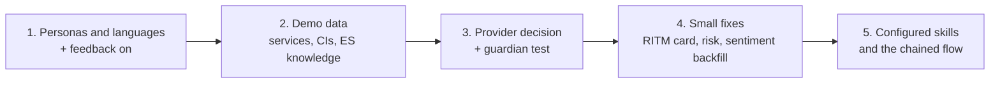

# P1-1 gaps and improvements

Follow-up to the [P1-1 validation](README.md) of 28 October 2026. All figures come from read-only
queries on everis2 on the same day. Nothing was changed.

**Summary:** the P1 assist layer works, but it isn't top quality yet. The weakest points are
language, demo data and measurement, not the skills themselves.

## 1. Gaps that make the demo look weak

| # | Gap | Evidence | Fix | Task |
|---|---|---|---|---|
| G1 | **Outputs come back in English for Spanish records** | AI replies are written in the user's own language setting, not the record's. The test user is English. Of the 122 `itil` users, 92 have no language set, 17 English, 3 Spanish. `sn_generative_ai.disable_dynamic_translation=true`; translation in Virtual Agent is off (`com.glide.cs.dynamic.translation.enable.virtual_agent=false`). Active UI languages: `en`, `es`. | Give each demo persona a preferred language. Configure Now Assist multilingual for ES, EN, PL and PT and turn translation on. Show the KB generation language picker, already enabled (`sn_km_gen_ai.enable_kb_gen_ai_language_picker=true`). | P1-3 (bring forward) |
| G2 | **Demo data is too thin for good AI output** | 393 of 430 open incidents have no CI and 419 have no business service. 279 of 360 open changes have no CI, so the change summary says "conflict status is .". 18 of 30 problems have legacy states the workspace can't display. All 44 published KB articles are English; none are Spanish. | Load services, CIs, change conflicts and Spanish knowledge; fix or retire the legacy problems. This is the biggest quality lever. | P0-5 |
| G3 | **Resolution notes can invent steps** | The notes added "Rebuild the corrupted Outlook profile", which no work note recorded. | Write explicit resolution work notes in the demo scripts. For the client: review before saving, and track whether notes are accepted as written. | P1-7, P2-9 |
| G4 | **Request items have no summary card** | The workspace RITM view has no summarize card; summarizing works only through the Otto panel. | Add the summary card to the RITM page (Global configuration), or use the Otto panel in the script. | P1-8 |
| G5 | **Change risk explanation doesn't appear** | Nothing in the UI. One call in 30 days, on Now LLM. | Find the trigger (probably after a risk assessment or risk calculation); run it on a demo change and test again. | P1-8 |
| G6 | **Sentiment only covers new activity** | `sn_uxc_gen_ai.enable_sentiment_analysis=false`; 0 historical records processed. | Run sentiment once over the demo incidents so lists and dashboards show it everywhere. | P1-8 |

## 2. Gaps for the governed AI story

| # | Gap | Evidence | Fix | Task |
|---|---|---|---|---|
| G7 | **AI quality isn't measured** | 0 feedback logs in 90 days; no feedback configuration. | Turn on feedback; track accepted, edited and rejected outputs per skill from P1. This is the evidence needed before moving from L2 to L3. | P1-6 |
| G8 | **Mixed providers with no stated reason** | Activity response and KB generation run on Claude Haiku 4.5 (Bedrock, Anthropic); everything else runs on Azure OpenAI. The 22 October platform update moved skills off Now LLM. | Choose per skill on quality and cost and record why. For an "all OpenAI" story, switch those two defaults in Now Assist Admin if Azure definitions exist (needs owner approval). | P0-4 |
| G9 | **Guardrails are active but not shown working** | All 5 guardian providers are active (ServiceNow Guardrail, Custom Guardian, Google Model Armor, Microsoft Content Safety, Amazon Bedrock). Prompt injection was found set to log only in the baseline analysis. | Set it to block, run a prompt-injection test and record the evidence. | P0-3 |
| G10 | **Real usage is close to zero** | In the last 30 days other users made about 5 summary calls and 10 sentiment calls. Most AI traffic is agents and alert analysis. | Not a defect on a demo instance, but the client journey needs adoption KPIs; add them with dashboard summarization. | P1-4 |

## 3. What top looks like beyond the gaps

- **Configure the skills, not just switch them on.** In Now Assist Admin, add business service, CI,
  SLA and caller VIP to the summary inputs. Copy the resolution notes and KB skills in Now Assist
  Skill Kit (Global, named `AIT …`) for a fixed structure in the client's tone.
- **Chain the skills into one flow** on an incident, then repeat it in Polish:
  1. sentiment flags a negative caller;
  2. the summary goes on the record;
  3. a reply goes out in the caller's language;
  4. resolution notes are written on resolve;
  5. a KB draft is created in the caller's language.
- **Remove the manual clicks.** Resolution notes on resolve and KB drafts on close, with manager
  review. This is L3 (P3-8), but a cheap preview at the end of P1.

## Suggested order

1. Personas and languages, plus feedback (G1, G7).
2. Demo data (G2).
3. Provider decision and guardian test (G8, G9).
4. RITM card, risk explanation and sentiment backfill (G4 to G6).

Steps 1 and 2 alone fix most of what looked weak in the test.
