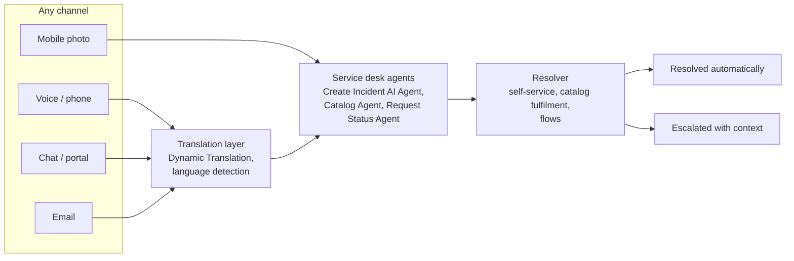
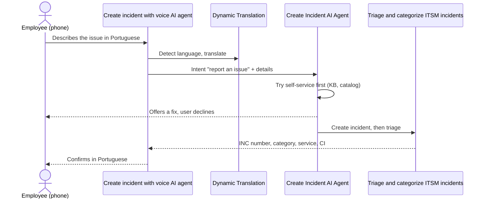
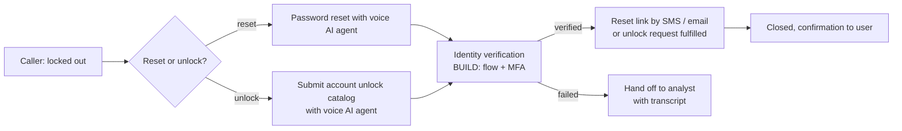
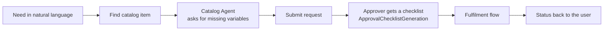
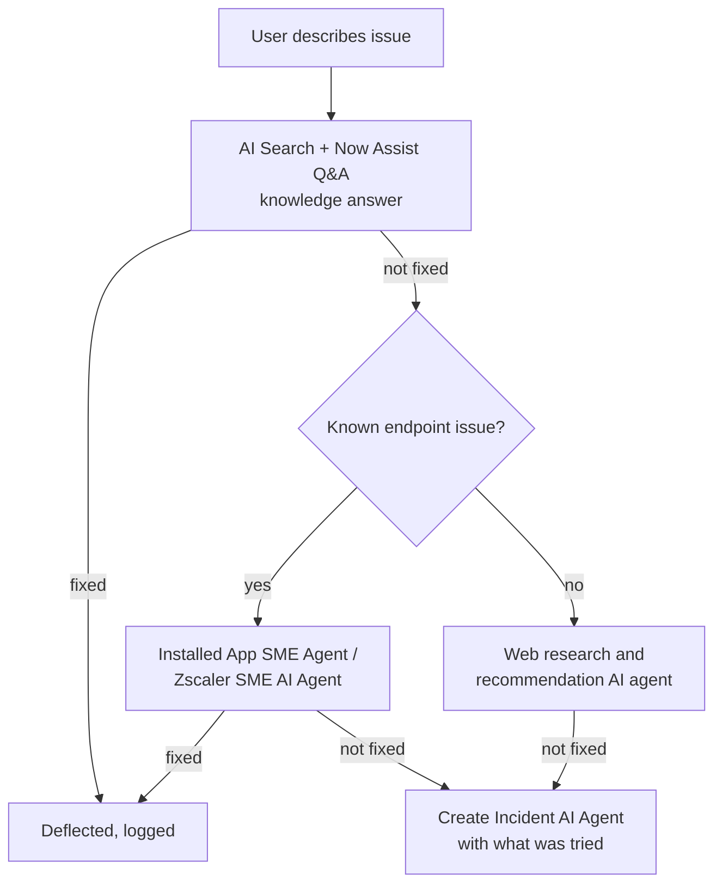
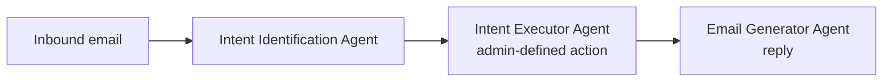

# Journey A: Multilingual agentic service desk

> One workflow, specialised agents, any channel, any language. The employee calls, chats,
> writes or sends a photo; the agents understand, resolve or route, and answer in the
> employee's language.

| ID | Use case | Target level | Ready on everis2 |
|---|---|---|---|
| A1 | Report an incident by phone, in any language | L3 | Voice agents `OFF`, telephony `MISSING` |
| A2 | Password reset and account unlock by voice | L4 | Voice agents `OFF`, identity check `BUILD` |
| A3 | Order from the catalog by conversation | L3 | Chat `ON`, voice `OFF` |
| A4 | "Where is my ticket?" | L4 | Chat `ON`, voice `OFF` |
| A5 | Resolve before a ticket exists (deflection) | L4 | `ON` |
| A6 | Multilingual conversations, both directions | L1 foundation | `ON`, agent chat translation `OFF` |
| A7 | Email to action | L3 | `ON` |
| A8 | Picture to ticket | L2 | `ON` |

---

## A1. Report an incident by phone, in any language

**Persona:** employee with no laptop access, calling the service desk.
**Story:** "My VPN keeps dropping" is said in Portuguese on the phone. The voice agent
transcribes, detects the language, collects the device and location, creates a categorised
incident with the right service and CI, and reads back the number in Portuguese.

| Agent | Role | everis2 |
|---|---|---|
| Create incident with voice AI agent | Voice front door, collects details | `OFF` |
| Create Incident AI Agent | Tries self-service, then logs the incident | `ON` |
| Categorize ITSM incident AI agent | Category and subcategory | `ON` |
| Classify service and CI AI agent | Service, offering, CI | `ON` |
| Additional incident context AI agent | Caller's assets and recent incidents | `ON` |

| Skill | Role | everis2 |
|---|---|---|
| AI Voice Agents Skill Config | Voice agent LLM configuration | `OFF` |
| VoiceInputVTT | Voice to text | `ON` |
| Incident summarization | Summary for the fulfiller | `ON` |
| Translate text (Moveworks) / Dynamic Translation | Language layer | `ON` |

**Prerequisites:** telephony channel for AI voice agents (`MISSING`, confirm the supported
provider and the entitlement); activate the 6 voice agents; add voice languages in Now Assist
multilingual settings.
**Human in the loop:** none for logging; a person picks up if the caller asks for one.
**KPIs:** calls handled without an analyst, time to log, first-time-right category.

---

## A2. Password reset and account unlock by voice

**Persona:** locked-out employee.
**Story:** the caller says "I'm locked out". The agent verifies identity, triggers the reset or
unlock, and sends the link by SMS or email. No ticket is left open.

| Agent | Role | everis2 |
|---|---|---|
| Password reset with voice AI agent | Detects intent, sends the reset link | `OFF` |
| Submit account unlock catalog with voice AI agent | Submits the unlock catalog request | `OFF` |
| Catalog Agent | Fills the unlock item variables | `ON` |

| Skill / platform | Role | everis2 |
|---|---|---|
| AI Voice Agents Skill Config | Voice LLM configuration | `OFF` |
| Flow Designer SMS and Email action steps | Deliver the link | `ON` |
| Identity verification flow | Second factor before acting | `BUILD` (Global flow) |
| Directory integration (AD / Entra ID) | Real reset or unlock | `MISSING` for the demo: simulate with a flow |

**Human in the loop:** only on failed verification.
**KPIs:** resets without an analyst, average handle time, abandoned calls.

---

## A3. Order from the catalog by conversation

**Persona:** employee who needs software or hardware.
**Story:** "I need Visio for a project" in chat or on the phone. The agent finds the item,
asks only for missing variables, submits the request and tells the approver what to check.

| Agent | Role | everis2 |
|---|---|---|
| Catalog Agent | Gathers and validates variables, submits | `ON` |
| Request catalog item with voice AI agent | Voice version; sends the link or creates the request for software | `OFF` |
| Find catalog item AI agent | Suggests catalog items from an incident | `ON` |
| Approval Assistance Agent | Approver side: pending approvals and a checklist | `OFF` |

| Skill | Role | everis2 |
|---|---|---|
| Conversational Catalog Requests | Catalog ordering in conversation | `ON` |
| Now Assist Multi-Turn Catalog Ordering | Multi-turn ordering in Virtual Agent | `ON` |
| Catalog item form slot fill | Fills the form from the description | `OFF` |
| ApprovalChecklistGeneration | Checklist for the approver | `ON` |
| Request summarization, Requested item summarization | Summary for fulfillers | `ON` |

**Human in the loop:** approver for items with cost.
**KPIs:** requests submitted without the portal form, abandoned requests, approval time.

---

## A4. "Where is my ticket?"

**Persona:** employee chasing an open incident or request.
**Story:** the user asks in chat or on the phone. The agent finds their open tickets,
summarises status and last update, adds a comment or raises urgency if asked.

| Agent | Role | everis2 |
|---|---|---|
| Request Status Agent | Status, comments and history of the user's own tickets | `ON` (custom copy) |
| Manage ticket with voice AI agent | Voice version: details, comment, escalate urgency | `OFF` |
| Explain SLA | Why the ticket is waiting and when it is due | `ON` |

| Skill | Role | everis2 |
|---|---|---|
| Incident summarization, Request summarization | Plain-language status | `ON` |
| Request activity response generation | Draft of the reply | `ON` |

**Human in the loop:** none (read and comment only). Urgency raises can notify the assignee.
**KPIs:** status calls deflected, repeat contacts.

---

## A5. Resolve before a ticket exists (deflection)

**Persona:** employee with a common issue (Outlook, VPN, browser, Zscaler).
**Story:** the agent searches knowledge, suggests a fix, runs a safe device fix when the
endpoint agents are connected, and only creates an incident if the fix fails.

| Agent | Role | everis2 |
|---|---|---|
| Create Incident AI Agent | Tries self-service before logging | `ON` |
| Installed App SME Agent | Diagnoses and fixes crashes and slowness of desktop apps | `ON`, endpoint tooling `MISSING` |
| Zscaler SME AI Agent | Diagnoses and fixes Zscaler connectivity | `ON`, endpoint tooling `MISSING` |
| Troubleshoot outlook issue with voice AI agent | Voice version for Outlook | `OFF` |
| Web research and recommendation AI agent | Fix steps from the web | `ON` |

| Skill | Role | everis2 |
|---|---|---|
| Now Assist Q&A | Knowledge answers in chat | `ON` |
| Deflection Ticket Response | Answer that avoids a ticket | `ON` |
| Websearch AI search answers | Web answers | `ON` |
| Build task context from related tables, End user action description generator | Context and plain-language steps for the endpoint agents | `ON` |

**Human in the loop:** user confirms before a device action.
**KPIs:** deflection rate, incidents avoided, knowledge used.

---

## A6. Multilingual conversations, both directions

**Persona:** employee in any country; analyst who speaks only English or Spanish.
**Story:** the employee chats in Polish; the analyst sees English; replies go back in Polish.
Agent outputs and knowledge answers are translated too.

| Component | Role | everis2 |
|---|---|---|
| Dynamic Translation (`sn_dt`) + Azure Translator spoke | Translation service | `ON` |
| VA Language Detection and Translation | Detects language in Virtual Agent | `ON` |
| Conversational Dynamic Translation | Async translation in VA | `ON` |
| Dynamic Translation for Agent Chat | Live agent chat translation | `OFF` |
| Language Configuration Agent, Translation Settings Agent | Now Assist multilingual set-up through conversation | `ON` |
| Language Detection for Work Allocator (skill) | Routes to a speaker of the language when one exists | `ON` |
| UI translation packs | Only Spanish is active | `OFF` for others |

**Human in the loop:** none.
**KPIs:** contacts handled in a language the desk does not staff.

---

## A7. Email to action

**Persona:** employee who emails the service desk.
**Story:** the email is read, its intent matched (new issue, status, access request), the
right action runs, and a reply is drafted or sent.

| Agent | Role | everis2 |
|---|---|---|
| Intent Identification Agent | Matches the email to configured intents | `ON` |
| Intent Executor Agent | Runs the admin-defined action for the intent | `ON` |
| Email Generator Agent | Composes and sends the reply | `ON` |

| Skill | Role | everis2 |
|---|---|---|
| Email Generator | Email drafting | `ON` |
| Email recommendation | Analyst-side reply suggestion | `ON` |

**Build:** intent records and their actions (Global flows) for 5 demo intents.
**KPIs:** emails handled without triage, time to first response.

---

## A8. Picture to ticket

**Persona:** field or office employee with a phone.
**Story:** a photo of an error screen or a broken device creates a categorised task with the
image attached and the error text extracted.

| Agent | Role | everis2 |
|---|---|---|
| Image Processor Agent | Analyses the image and creates the record | `ON` |
| Content insights AI agent | Extracts text and key information | `ON` |
| Record management AI agent | Creates the record, copies the attachment | `ON` |

| Skill | Role | everis2 |
|---|---|---|
| Image to task config | Image-to-task configuration | `ON` |
| Document extraction, Multimodal Chat | Text and content extraction | `ON` |

**KPIs:** time to log from mobile, completeness of the logged incident.
