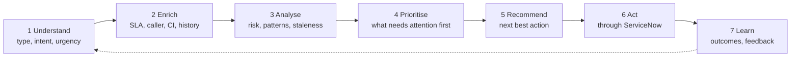
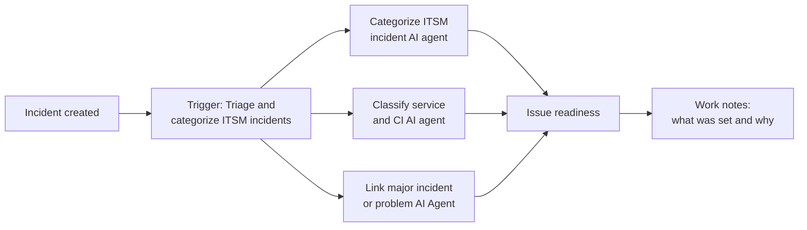
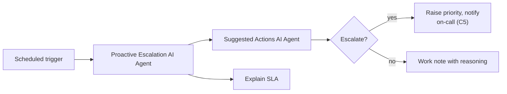

# Journey B: Service intelligence layer

> Business context, SLAs, policies and escalation logic applied to every ticket, every time.
> Understand, enrich, analyse, prioritise, recommend, act, learn.

| ID | Use case | Flow step | Target level | Ready on everis2 |
|---|---|---|---|---|
| B1 | Triage every new incident | Understand, enrich | L3 | `ON` |
| B2 | Route and balance the queue | Prioritise, act | L3 | `ON` |
| B3 | My work plan | Prioritise | L2 | `ON` |
| B4 | SLA and escalation watch | Analyse, act | L3 | `ON` |
| B5 | Customer and service impact | Analyse | L2 | `ON`, needs CMDB service data |
| B6 | Communications on every ticket | Act | L2, routine updates L3 | `ON` |
| B7 | Operational insight | Learn | L2 | `ON` |
| B8 | Ticket-level support | Recommend | L2, plans already L4 | `ON` |

---

## B1. Triage every new incident

**Persona:** service desk lead.
**Story:** every new incident, from any channel, is categorised, given a service, offering
and CI, checked for an open major incident or problem, and marked ready or not ready to work,
with the reasoning in work notes.

| Agent | Role | everis2 |
|---|---|---|
| Categorize ITSM incident AI agent | Category and subcategory | `ON` |
| Classify service and CI AI agent | Service, offering and CI | `ON` |
| Link major incident or problem AI Agent | Links to, or proposes, a major incident on a surge | `ON` |
| Record field value prediction AI agent | Predicts other fields with justification ("Classify tasks") | `ON` |
| Issue readiness | Decides if the ticket has enough to be worked | `ON` |

| Skill / platform | Role | everis2 |
|---|---|---|
| Task Classify Tasks Skill Config | Classification | `ON` |
| Issue Readiness | Readiness check | `ON` |
| Incident summarization | One-line summary for the queue | `ON` |
| Predictive Intelligence for Incident Management | Classic ML fallback for category and group | `ON` |

**To enable:** a trigger on incident insert for the workflow (today it has no execution
mode set); decide which fields the agents may write without approval.
**Human in the loop:** at L3 the agent writes; the analyst can correct, and corrections are
the quality measure. Major-incident proposals need a manager.
**KPIs:** first-time-right category and group, reassignment count, time to triage.

---

## B2. Route and balance the queue

**Persona:** team manager.
**Story:** the backlog is spread across analysts by skill, language, workload and
performance, and routing rules are recommended from history.

| Agent | Role | everis2 |
|---|---|---|
| Work Allocator AI Agent ("Help Optimize Team Productivity") | Assigns backlog tickets by workload and performance | `ON` |
| Incident routing configuration agent | Admin: creates and changes assignment rules with preview | `ON` |

| Skill / platform | Role | everis2 |
|---|---|---|
| Optimal Ticket Assignment | Best assignee | `ON` |
| Language Detection for Work Allocator | Routes by language | `ON` |
| Incident Routing Rule Recommender | Rules from history | `ON` |
| Advanced Work Assignment | Push routing | `ON` |

**Human in the loop:** manager approves bulk reassignment.
**KPIs:** reassignments, backlog age, workload spread.

---

## B3. My work plan

**Persona:** analyst at the start of the day.
**Story:** "Plan my day". The agent scores the analyst's tickets by priority and SLA, builds a
time-blocked plan from calendar availability, highlights quick wins, and offers the next
action on each.

| Agent | Role | everis2 |
|---|---|---|
| Prioritize work AI agent | Scores and orders tickets, builds the plan | `ON` |
| Update work plan AI agent | Saves the approved plan | `ON` |
| Suggested Actions AI Agent | Next step per ticket, runs the chosen one | `ON` |

| Skill | Role | everis2 |
|---|---|---|
| Work planner skill config, Generate my work plan config | Plan generation | `ON` |
| Quick Win Classifier | Flags quick wins | `ON` |
| Schedule event generator | Calendar blocks | `ON` |

**KPIs:** SLA breaches per analyst, tickets closed per day.

---

## B4. SLA and escalation watch

**Persona:** duty manager.
**Story:** every hour the agent checks open tickets for breach risk, negative sentiment and
stale updates, explains why, and proposes or takes the escalation.

| Agent | Role | everis2 |
|---|---|---|
| Proactive Escalation AI Agent ("Identify escalation signals") | Finds tickets that need escalation and why | `ON` |
| Suggested Actions AI Agent | Proposes and runs the action | `ON` |
| Explain SLA | SLA breakdown and timeline | `ON` |

| Skill | Role | everis2 |
|---|---|---|
| Proactive Escalation, Proactive Escalation Skill Config | Escalation reasoning | `ON` |
| Incident sentiment analysis | Frustration signal from comments | `ON` |

**To enable:** a scheduled trigger; an escalation policy document the agent follows.
**KPIs:** breaches avoided, escalations started before breach.

---

## B5. Customer and service impact

**Persona:** service owner, major incident manager.
**Story:** for one incident or a group, the agent shows which business services, service
instances and users are affected, and which tickets share a cause.

| Agent | Role | everis2 |
|---|---|---|
| Business And Technology Management Service Impact Analysis AI Agent | Business and technology services affected | `ON` |
| Service instance impact analysis AI agent | Service instances affected | `ON` |
| User impact analysis AI Agent | Related incidents and cases | `ON` |
| Incident context AI agent | Comparisons, commonality, aggregations (read-only) | `ON` |

| Skill | Role | everis2 |
|---|---|---|
| Alert impact analysis | Impact from alerts | `ON` |
| Incident cluster summary | Summary of a group of incidents | `ON` |

**Prerequisites:** application services and their relationships in the CMDB (see E3).
**KPIs:** time to know the impact during a major incident.

---

## B6. Communications on every ticket

**Persona:** analyst and major incident manager.
**Story:** customer updates, internal work notes, handover summaries and stakeholder emails
are drafted from the record, in the user's language, aligned to policy.

| Agent | Role | everis2 |
|---|---|---|
| Email Generator Agent | Writes and sends emails | `ON` |
| Notification Content Agent | Templates for repeated communications | `ON` |

| Skill | Role | everis2 |
|---|---|---|
| Incident activity response generation | Customer update | `ON` |
| Email recommendation | Email draft from the incident | `ON` |
| Chat reply recommendation, Chat summarization | Live chat | `ON` |
| Sidebar discussion summarization | Swarm summary | `ON` |
| Incident summarization | Handover summary | `ON` |
| Major incident email content recommendation | Stakeholder communications | `ON` |
| NACM response configuration for incident, Resolution Note in NACM | Mobile and chat responses | `ON` |

**Human in the loop:** analyst sends; at L3 only routine "still working on it" updates go out
automatically.
**KPIs:** time spent writing updates, customer update frequency.

---

## B7. Operational insight

**Persona:** service delivery manager.
**Story:** weekly summary of trends, anomalies, repeated issues and performance, asked in
plain language, with charts.

| Agent | Role | everis2 |
|---|---|---|
| Issue trend analysis AI agent ("Analyze task trends") | Recurring issues and root causes | `ON` |
| Data Visualization Generation Agent | Charts from a question | `ON` |
| AI Analytics Q and A | Questions about AI usage and deflection metrics | `ON` |

| Skill | Role | everis2 |
|---|---|---|
| Analyze Task Trends | Trend skill | `OFF` |
| Incident cluster summary, Interaction cluster summary | Cluster summaries | `ON` |
| GAF ITSM Insights Dashboard grouping, mapper, reducer, action strategy | Groups and actions dashboard | `ON` |
| Dashboard Summarization, Dashboard Facts Generator | Dashboard narrative | `ON` |
| Analytics query generation, Analytics insight generation | Questions to queries | `ON` |
| Data visualization generation | Charts | `ON` |

**KPIs:** time to produce the weekly report, actions created from insights.

---

## B8. Ticket-level support

**Persona:** analyst working one ticket.
**Story:** inside the incident: summary, likely cause, similar tickets, next steps, risk,
guided handover. The resolution plan is generated automatically.

| Agent | Role | everis2 |
|---|---|---|
| Incident context AI agent, Additional incident context AI agent ("Incident assist") | Questions about the incident, caller's assets, similar incidents, on-call experts | `ON` |
| Decomposition Agent, Next action recommendation AI agent ("Generate Resolution Plan", autopilot) | Step-by-step plan from similar records, knowledge and web | `ON` |
| Suggested Actions AI Agent | Runs the chosen step | `ON` |
| Web research and recommendation AI agent | Web research when knowledge is thin | `ON` |

| Skill | Role | everis2 |
|---|---|---|
| Generate Resolution Plans Skill Config, Step Decomposer | Plans | `ON` |
| Summarize and Generate Plan in NACM | Mobile version | `ON` |
| Recommend next tool | Picks the next tool | `ON` |
| Suggested steps generation | Older suggested steps | `OFF` (superseded) |

**KPIs:** mean time to resolve, plan steps used.
