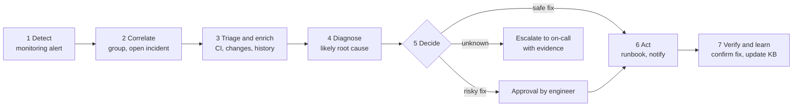
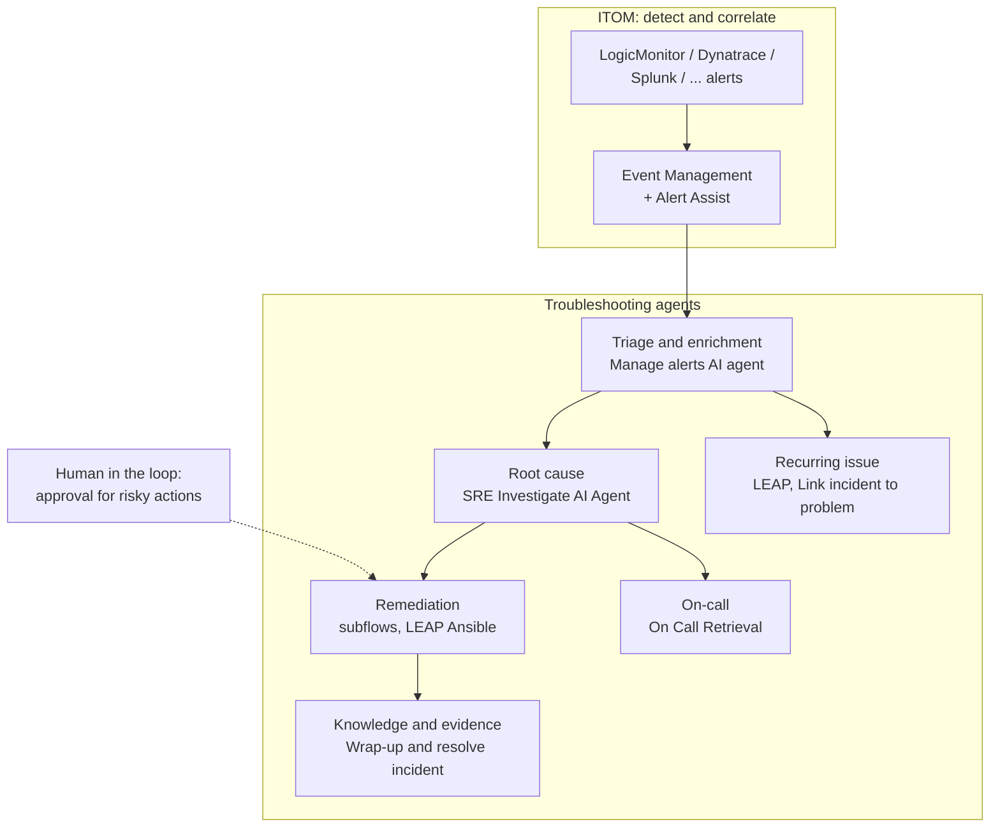
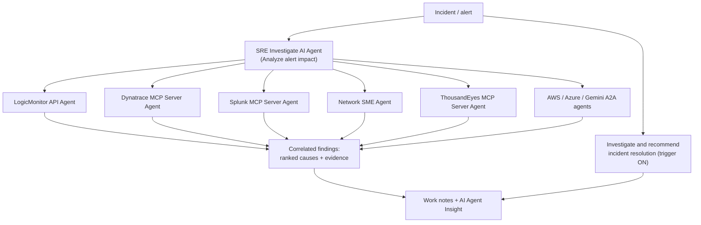
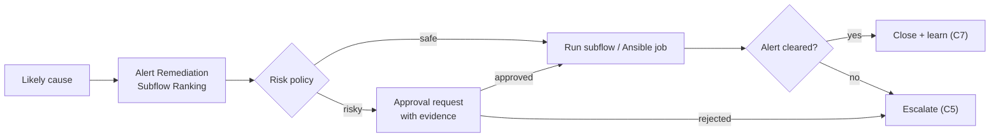

# Journey C: Agentic incident troubleshooting

> From alert to resolution: agents detect, diagnose and remediate, with people in the loop
> for risky actions.

| ID | Use case | Slide agent | Target level | Ready on everis2 |
|---|---|---|---|---|
| C1 | Detect, correlate and open the incident | ITOM | L4 | `ON`, monitoring connection to set |
| C2 | Triage and enrich | Triage and enrichment agent | L3 | `ON` |
| C3 | Root cause analysis | Root cause analysis agent | L3 | `ON`, credentials to set |
| C4 | Remediate with approval | Remediation agent | L3, safe fixes L4 | Agents `ON`, back-ends `MISSING` |
| C5 | On-call and escalation | On-call agent | L3 | `ON`, Teams `MISSING` |
| C6 | Recurring issues to problems | Recurring issue agent | L3 | `ON` |
| C7 | Verify, document, learn | Knowledge and evidence agent | L3 | `ON` |

---

## C1. Detect, correlate and open the incident

**Persona:** operations centre.
**Story:** a LogicMonitor alert storm on a database host becomes one correlated alert, noise is
suppressed, the CI is bound, and one incident opens.

| Agent | Role | everis2 |
|---|---|---|
| Alert Automation AI Agent ("Create alert automation") | Builds enrichment, grouping and response automations from a request | `ON` |
| AIOps "Autonomous Workflow" alert rule | Starts the agentic investigation for qualifying alerts | `ON` |

| Skill / platform | Role | everis2 |
|---|---|---|
| Event Management and Service Mapping core | Alerts, correlation, CI binding | `ON` |
| Alert noise handler | Suppresses noise | `ON` |
| Proactive grouping evaluation | Better grouping | `ON` |
| LogicMonitor connector / event source | Alerts into ServiceNow | To configure (no connector found) |

**Prerequisites:** one real or simulated event source (LogicMonitor, as in the slide);
CI binding needs CMDB data (E3).
**KPIs:** alerts per incident, noise suppressed.

---

## C2. Triage and enrich

**Persona:** operations engineer.
**Story:** the incident arrives already enriched: alert summary, affected CI, recent changes,
similar incidents, impact and priority confirmed.

| Agent | Role | everis2 |
|---|---|---|
| Manage alerts AI agent ("Manage alerts autonomously") | Report, summary, insights and next steps in the AI Agent Insight table | `ON` |
| Alert Impact Verification AI Agent | Checks the alert is eligible for impact analysis | `ON` |
| Business And Technology Management Service Impact Analysis AI Agent | Services affected | `ON` |
| Additional incident context AI agent | Similar resolved incidents, on-call experts | `ON` |
| Triage and categorize ITSM incidents (B1) | Category, service, CI, major incident link | `ON` |

| Skill | Role | everis2 |
|---|---|---|
| Triage and investigate alerts | Alert triage | `ON` |
| Alert analysis, Summarize alert AI insights | Summaries | `ON` |
| Alert impact analysis | Impact | `ON` |
| Related Changes Analysis Skill | Recent changes on the CI | `ON` |

**KPIs:** time from alert to triaged incident, priority corrections.

---

## C3. Root cause analysis

**Persona:** operations engineer, SRE.
**Story:** the SRE agent queries each monitoring tool in parallel through its sub-agent,
correlates metrics, logs and changes, and writes ranked likely causes with evidence to the
incident.

| Agent | Role | everis2 |
|---|---|---|
| SRE Investigate AI Agent | Orchestrates the tool agents, correlates findings | `ON` |
| LogicMonitor API Agent | Entity health, alerting datapoint, collector | `ON`, connection to set |
| Dynatrace, Splunk, Datadog, New Relic, ThousandEyes, AWS CloudWatch MCP Server Agents; Azure Monitor MCP Agent | Tool-specific investigation | `ON`, 8 MCP connections without credentials |
| Gemini Cloud Assist A2A Investigation Agent | Google Cloud investigation through A2A | `ON` |
| Network SME Agent | Network bottleneck and cause | `ON` |
| ITSM incident resolution plan investigation AI agent ("Investigate and recommend incident resolution") | Similar incidents, RAG, catalog items, writes the plan to work notes | `ON`, the only active ITSM trigger |

| Skill | Role | everis2 |
|---|---|---|
| Alert investigation, Alert Investigation Insight | Investigation | `ON` |
| Alert Hypothesizer | Ranked hypotheses | `ON` |
| AI Investigation report for alert | Report | `ON` |
| Datadog, Dynatrace, New Relic, Kentik, Gemini Observability Skills | Tool-specific analysis | `ON` |
| KB Summarization Skill | Related knowledge | `ON` |

**Prerequisites:** credentials for one monitoring tool (LogicMonitor for the slide story); a
simulated data set if no live tool is available.
**KPIs:** time to probable cause, accepted hypotheses.

---

## C4. Remediate with approval

**Persona:** operations engineer approving; agent executing.
**Story:** the agent ranks the approved runbooks for this alert, runs safe ones directly
(clear disk, restart a service on a non-production CI), asks for approval for risky ones,
then verifies the alert cleared.

| Agent | Role | everis2 |
|---|---|---|
| LEAP Ansible Execution Agent | Runs mapped Ansible playbooks and reports job status | `ON`, Ansible Automation Platform `MISSING` |
| LEAP Ansible Agent | Finds Ansible job templates for the catalogue | `ON` |
| Installed App SME Agent, Zscaler SME AI Agent | End-user device fixes | `ON`, endpoint tooling `MISSING` |
| Suggested Actions AI Agent | Runs the step the engineer picks | `ON` |
| Web Automation Agent | Acts on web consoles with no API | `ON` (demo only) |

| Skill / platform | Role | everis2 |
|---|---|---|
| Alert Remediation Subflow Ranking | Picks the right runbook | `ON` |
| Remediation subflows | The runbooks | Present, alert rules `OFF` |
| Remedial action consent classifier | Decides if user consent is needed | `OFF` |
| Flow Designer "Script on MID" step; SSH and PowerShell steps | Execution | MID step `ON`, MID Server unconfirmed, SSH and PowerShell `MISSING` |
| Approval step and risk policy | Human in the loop | `BUILD` (Global flow + decision table) |

**Human in the loop:** risky actions always approved; safe actions listed in a decision table
the client owns.
**KPIs:** incidents auto-remediated, failed remediations, rollback count.

---

## C5. On-call and escalation

**Persona:** on-call engineer.
**Story:** when the agent cannot fix it, it finds who is on call, sends findings and evidence,
and escalates to the next level if nobody acknowledges.

| Agent | Role | everis2 |
|---|---|---|
| On Call Retrieval ("Who is On Call") | Who is on call now or at a given time | `ON` |
| On Call Shift Creator | Builds rotas (set-up) | `ON` |
| Proactive Escalation AI Agent | Escalation reasoning | `ON` |
| Email Generator Agent | Message with the evidence | `ON` |

| Platform | Role | everis2 |
|---|---|---|
| On-Call Scheduling, escalation policies | Rotas and escalation | `ON` |
| SMS action step | Page | `ON` |
| Microsoft Teams spoke | Notify via Teams, as in the slide | `MISSING` |

**KPIs:** time to engage, escalations without acknowledgement.

---

## C6. Recurring issues to problems

**Persona:** problem manager.
**Story:** the agents spot repeats, link similar incidents, open or link a problem with a
first analysis, and a person validates the trend.

| Agent | Role | everis2 |
|---|---|---|
| Artifact creation agent ("LEAP agent") | Creates a problem, KB article or playbook for an automation opportunity | `ON` |
| LEAP Problem Creation Agent | Problem from a LEAP cluster | `ON` |
| Link incident to problem AI agent | Links to a problem from the last 6 months | `ON` |
| Problems investigation AI agent ("Investigate problems") | Root cause, impact, plan from incidents, changes and CIs | `ON` |
| Issue trend analysis AI agent | Recurring issue patterns | `ON` |

| Skill | Role | everis2 |
|---|---|---|
| Insights Clustering - Grouping Incident, POV Incident, Resolution Step Generation | Clusters of similar incidents | `ON` |
| LEAP Outcome Enhancer, Outcome Filter | Cleans clusters | `ON` |
| Problem summarization | Problem summary | `ON` |
| Problems investigation skill | Investigation | `ON` |

**Human in the loop:** problem manager validates before the problem is opened at L3.
**KPIs:** repeat incidents, problems opened from clusters.

---

## C7. Verify, document, learn

**Persona:** analyst closing; knowledge manager.
**Story:** after the fix, resolution notes and code are written, a known error or KB draft is
created and attached, and the major incident gets a post-incident review.

| Agent | Role | everis2 |
|---|---|---|
| Incident resolution details AI agent ("Wrap-up and resolve incident") | Resolution notes and code | `ON` |
| Incident known error article AI agent | Attaches or proposes a known error | `ON` |
| Incident knowledge article AI agent | Attaches or creates a KB article | `ON` |
| LEAP KB Creation Agent | KB drafts from cluster resolution steps | `ON` |
| Post incident review AI agent | Post-incident review report | `ON` |

| Skill | Role | everis2 |
|---|---|---|
| Resolution notes generation | Notes | `ON` |
| KB generation | Article draft | `ON` |
| LEAP KB Generator | Article from clusters | `ON` |

**Human in the loop:** knowledge articles go through the normal review workflow.
**KPIs:** incidents closed with knowledge, articles reused.
