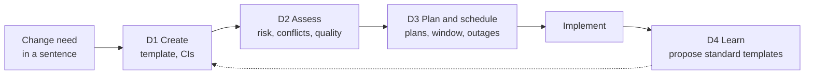
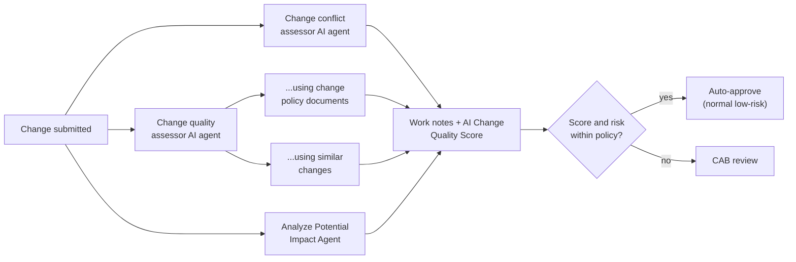

# Journey D: Change and release

> Changes cause most major incidents. The same agents that diagnose incidents can make changes
> safer: from a sentence to a complete, risk-checked, scheduled change, and a growing set of
> standard changes that run without CAB.

| ID | Use case | Target level | Ready on everis2 |
|---|---|---|---|
| D1 | Create a change from a sentence | L2 | `ON` |
| D2 | Assess risk, conflicts and quality on submit | L3 | `ON`, Change Predictive Intelligence `OFF` |
| D3 | Plan and schedule | L2 | `ON` |
| D4 | Grow standard changes | L2 | `ON` |

---

## D1. Create a change from a sentence

**Story:** "Patch the payroll database servers next weekend" becomes a change with the right
model or standard template, primary and affected CIs.

| Agent | Role | everis2 |
|---|---|---|
| Create change request agent | Starts from any change request, even vague | `ON` |
| Change template suggestion agent | Infers what, why, how and when; finds the template or model | `ON` |
| Standard change template recommender AI agent ("Create standard change request") | Creates the change from a standard template | `ON` |
| Change CI suggestion AI agent ("Suggest configuration items") | Primary and affected CIs | `ON` |

| Skill | Role | everis2 |
|---|---|---|
| Change request summarization | Summary | `ON` |

**KPIs:** time to raise a change, changes raised with complete CIs.

---

## D2. Assess risk, conflicts and quality on submit

**Story:** on submit, three checks run and write their results: conflicts and impacted
services, quality against policy or similar successful changes, and a risk explanation.

| Agent | Role | everis2 |
|---|---|---|
| Change conflict assessor AI agent | Conflicts and impacted CIs and services | `ON` |
| Change quality assessor AI agent and its two specialists | Quality score field by field | `ON` |
| Analyze Potential Impact Agent | Services affected | `ON` |
| Change outage assistant AI agent | Outage records for impacted CIs | `ON` |

| Skill / platform | Role | everis2 |
|---|---|---|
| Change request risk explanation | Plain-language risk | `ON` |
| Change Management - Predictive Intelligence Core | Classic ML risk | `OFF` |

**To enable:** a trigger on change state "Assess"; a change policy document per model.
**Human in the loop:** CAB keeps the decision for anything outside policy.
**KPIs:** change success rate, changes that skip CAB safely, failed changes.

---

## D3. Plan and schedule

| Agent | Role | everis2 |
|---|---|---|
| Change Request Plans AI Agent ("Generate change request plans") | Implementation, backout, test plans, justification, risk and impact | `ON` |
| Schedule Change Request AI Agent ("Schedule a change") | Picks a window | `ON` |
| Change Schedule Configuration Agent | Admin: blackout and maintenance schedules | `ON` |

**KPIs:** changes with complete plans, schedule conflicts.

---

## D4. Grow standard changes

**Story:** the agent finds groups of similar successful normal changes and proposes a standard
change template for them, so the next one skips CAB.

| Agent | Role | everis2 |
|---|---|---|
| Standard change template proposal AI agent ("Create standard change template proposal") | Similar changes to a template proposal | `ON` |

**Human in the loop:** change manager approves the template proposal.
**KPIs:** share of standard changes, CAB load.

## Admin agents useful when setting up the demo

CAB Configuration Agent, Change Models Configuration Agent, Change Risk Configuration Agent,
Change Team Role Configuration Agent. All `ON`. They are a good "configure by conversation"
moment for the platform team audience.
