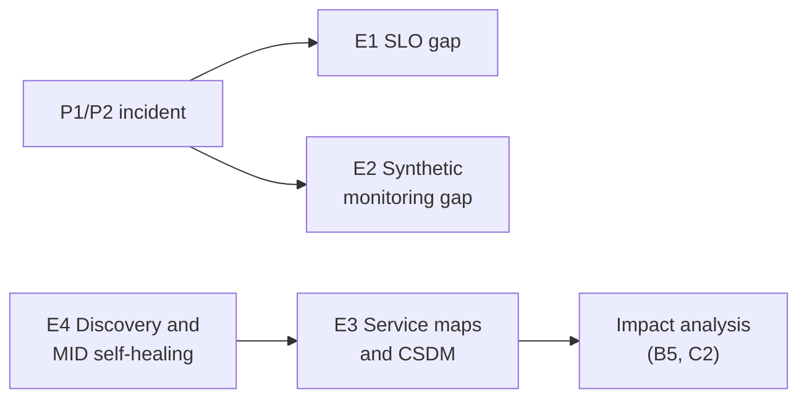

# Journey E: Reliability and CMDB health

> Autonomous operations only work on good data. These use cases keep the CMDB, service maps,
> monitoring coverage and the MID Server healthy, mostly through agents.

| ID | Use case | Target level | Ready on everis2 |
|---|---|---|---|
| E1 | SLO gaps after a major incident | L3 | Agents `ON`, SLO data app `MISSING` |
| E2 | Synthetic monitoring coverage | L2 | Agent `ON`, synthetic monitoring `MISSING` |
| E3 | Service maps and CSDM | L2 | Mixed, CSDM activation `OFF` |
| E4 | Discovery and MID Server self-healing | L3 | Agents `ON`, Discovery and MID `OFF` or unconfirmed |

---

## E1. SLO gaps after a major incident

**Story:** after a P1, the agent checks whether the alert was covered by an SLO; if not it
creates one from incident, outage and alert history and opens a reliability task.

| Agent | Role | everis2 |
|---|---|---|
| Reliability Domain Agent | Checks P1 and P2 incidents for SLO and synthetic gaps | `ON` |
| SLO Gap Agent | Detects the gap for the incident and CI | `ON` |
| SLO Creator Agent | Creates the SLO and SLI from history | `ON` |

| Skill | Role | everis2 |
|---|---|---|
| Generate Reliability Plan | Reliability plan | `ON` |

**Prerequisites:** the SLO core app is not installed; confirm entitlement (ITOM AIOps).

---

## E2. Synthetic monitoring coverage

| Agent | Role | everis2 |
|---|---|---|
| Synthetic Creator Agent | Finds unmonitored HTTP endpoints of the affected service and creates monitors | `ON` |

**Prerequisites:** synthetic monitoring app `MISSING`.

---

## E3. Service maps and CSDM

**Story:** the agent proposes application services from running processes or tags, maps their
topology, and links business applications to infrastructure, so impact analysis works.

| Agent | Role | everis2 |
|---|---|---|
| Tag-Based Service Map Creation AI Specialist | Services from tag-based candidates | `ON` (custom) |
| Service Map Creation AI Specialist | Topology from candidates | `OFF` |
| CSDM Business Application to Infrastructure AI Specialist | Links CSDM layers | `OFF` (custom) |

| Skill / platform | Role | everis2 |
|---|---|---|
| Business App Inference, Business App Similarity | Business application suggestions | `ON` |
| Service Mapping Candidate, Service mapping candidates Impact | Candidates | `OFF` |
| CSDM Activation plugin | CSDM data model | `OFF` |

**Human in the loop:** CMDB owner approves new services.

---

## E4. Discovery and MID Server self-healing

**Story:** a failed discovery or an unhealthy MID Server is diagnosed and fixed by agents:
missing attributes, pattern failures, keystore, network or upgrade errors.

| Agent | Role | everis2 |
|---|---|---|
| Pattern Diagnostic Agent ("Pattern Diagnostic Workflow") | CI data quality from Discovery pattern metadata and logs | `ON` |
| Error Analysis and Remediation Agent | Error Framework remediation | `ON` |
| MID common, keystore, network and upgrade AI agents ("MID Guardian Workflow") | MID Server diagnosis and fixes | `ON` |

| Skill / platform | Role | everis2 |
|---|---|---|
| Error Framework AI Insights Skill | Error insights | `ON` |
| Discovery schedules | Data | Inactive |
| ITOM Discovery licence plugin | Entitlement | `OFF` |
| MID Server | Execution | Unconfirmed |

**KPIs:** CI completeness, discovery failure rate, MID Server downtime.
