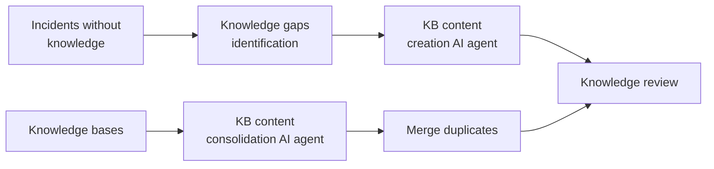
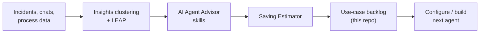

# Journey F: Knowledge, experience and AI governance

> The enablers. Autonomy needs good knowledge to act on, a feedback loop from users, a
> pipeline of the next automation candidates, and governance the client's risk team accepts.

| ID | Use case | Target level | Ready on everis2 |
|---|---|---|---|
| F1 | Knowledge health | L2 | Agents `ON`, several skills `OFF` |
| F2 | Experience and surveys | L2 | `ON` |
| F3 | Approvals for managers | L2 | Agent `OFF` |
| F4 | Find the next automation (use-case factory) | L1 | `ON` |
| F5 | AI governance and control tower | L0 enabler | `ON`, guardrails at monitor |

---

## F1. Knowledge health

**Story:** duplicates are found and merged, gaps are found from incidents without an article,
and new articles are drafted into the right knowledge base.

| Agent | Role | everis2 |
|---|---|---|
| KB content consolidation AI agent | Detects duplicate articles | `ON` |
| KB content creation AI agent | Writes an article into a writable knowledge base | `ON` |

| Skill | Role | everis2 |
|---|---|---|
| Knowledge duplicates grouping, topic, action strategy | Duplicate clusters | `ON` |
| Identify duplicate articles, Merge duplicate articles | Duplicate actions | `OFF` |
| Knowledge gaps identification (ITSM), gap grouping, topic, action strategy | Gaps | `OFF` |
| Knowledge Content Recommendation | Suggestions | `ON` |
| Article Optimization recommendations | Article quality | `OFF` |
| Predictive Intelligence for Knowledge Management | Classic ML | `OFF` |

---

## F2. Experience and surveys

| Agent | Role | everis2 |
|---|---|---|
| Survey Analysis AI agent ("Identify ways to improve service") | Satisfaction trends and prioritised recommendations | `ON` |
| Survey filling data collection, Survey response suggestion AI agents ("Propose survey responses") | Survey answers from the record | `ON` |

| Skill | Role | everis2 |
|---|---|---|
| Survey analysis, Identify ways to improve service | Analysis | `ON` |
| Incident sentiment analysis | Sentiment | `ON` |

---

## F3. Approvals for managers

| Agent | Role | everis2 |
|---|---|---|
| Approval Assistance Agent | Pending approvals, request details, approve/reject checklist | `OFF` |

| Skill / platform | Role | everis2 |
|---|---|---|
| ApprovalChecklistGeneration | Checklist | `ON` |
| Outlook Actionable Messages | Approve from Outlook | `ON` |

---

## F4. Find the next automation (use-case factory)

**Story:** this is how we keep building use cases with the client. The agents mine
incidents, conversations and process data for repeated work, estimate savings, and propose
which agent or automation to build next.

| Agent | Role | everis2 |
|---|---|---|
| Automation Finder, Automation Table Discovery Agent ("Automation Explorer") | Finds existing automations and their tables | `ON` |
| Artifact creation agent (LEAP) | Problem, KB or playbook for an opportunity | `ON` |

| Skill | Role | everis2 |
|---|---|---|
| AI Agent Advisor - Agent Assignment, Agent Creation, Artifact Extraction, On-Instance Tool Match, Resolution Step Generation | Proposes agents and tools from clusters | `ON` |
| Saving Estimator | Value of the automation | `ON` |
| Insights Clustering skills | Clusters | `ON` |
| Process Inefficiency Highlights, Work Notes Analysis (Process Mining) | Process findings | `OFF` |

---

## F5. AI governance and control tower

**Story:** before L3, show the client how AI is governed: which models, which skills, what
guardrails, who approved each agent, what each agent did.

| Agent | Role | everis2 |
|---|---|---|
| Guardian Settings Viewer and Modifier Agents ("Guardian Settings NAC") | Prompt injection, offensiveness and other guardians | `ON` |
| Model Provider Query, Policy and Edit agents ("Manage Model Provider Workflow") | Model providers and policies | `ON` |
| Model Version Viewer and Modifier Agents | Model versions per skill | `ON` |
| Skill Configuration and Skill Discovery Agents ("Skill Management") | Turn skills on and configure them | `ON` |
| SHA Diagnostic Agent ("Help me troubleshoot") | Configuration diagnostics | `ON` |
| AICT Security Analyzer Agent | Security event context | `OFF` |
| AI Analytics Q and A | Usage and deflection metrics | `ON` |

| Skill / platform | Role | everis2 |
|---|---|---|
| AICT Correctness Detection, Security Posture Summarizer, Agent System Prompt Leakage, Secure Policy Violation Detection | AI security checks | `ON` |
| AICT usage skills (models, datasets, systems) | Asset usage | `OFF` |
| Conversation Evaluator skills (coherence, hallucination, intent accuracy, ...) | Conversation quality | `OFF` |
| Prompt injection guardian | Guardrail | At MONITOR: move to BLOCK |
| AI Control Tower approvals | Approval of AI assets | All off: turn on |

**This is a gate:** no use case goes to L3 before F5 is in place.
