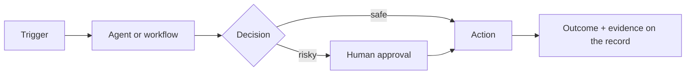

# Use-case template

Copy this section into the journey file it belongs to (or start a new journey file), give it
the next free ID, and add a row to [../03-use-case-map.md](../03-use-case-map.md).

How to find the agents and skills: search the catalogs ([../04-agent-catalog.md](../04-agent-catalog.md),
[../05-skill-catalog.md](../05-skill-catalog.md)), or the everis2 mirror
(`instances/everis2/metadata/*/sn_aia_agent/`, `*/sn_nowassist_skill_config/`), or ask the
F4 use-case factory agents.

---

## X0. <Use case in a few words, as the user would say it>

**Persona:** who benefits.
**Story:** two or three sentences: the trigger, what the agents do, how it ends.
**Current level:** L? on everis2 today. **Target level:** L?. **Phase:** P?.

| Agent | Role in this flow | everis2 |
|---|---|---|
| | | `ON` / `OFF` / `MISSING` / `BUILD` |

| Skill / platform | Role | everis2 |
|---|---|---|
| | | |

**Prerequisites:** plugins, entitlements, integrations, data.
**Build (Global scope, update set `AIT-P?-X0-<name>`):** flows, tools, agent copies, triggers.
**Human in the loop:** which steps need a person, and what moves it to the next level.
**KPIs:** two or three measures the client cares about.
**Demo script:** the clicks or phrases that show it in under three minutes.
