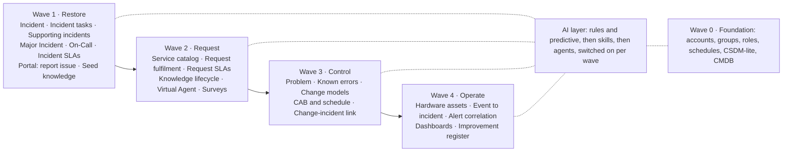
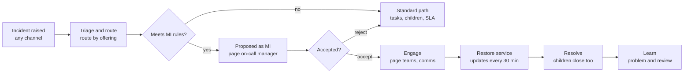

# ServiceNow ITSM Accelerator — Functional Design

Oct 13, 2026 · @Fernando Caamaño

> **Provenance.** Exported on 2026-10-13 from the reviewed Claude Doc
> (https://claude.ai/code/artifact/46491413-089f-4503-8428-f25c70971a1a), including the decisions
> made in its comment threads. From now on this file is the source of truth; the doc is not kept in sync.
>
> **Read with care.** The design was written for one development instance (pdi2,
> dev389847). Statements such as "on the dev instance", "active on the instance" and the
> "Instance prerequisites" table describe that PDI on 2026-10-13, not every target. Since
> then, CSDM Activation and Glide Virtual Agent have been activated there. In snagentic, an
> accelerator must discover these facts per target instance. The "Implementation batches"
> tracker was a plan for building on pdi2 directly; it is superseded by the snagentic
> plan for this spec.

## Purpose and principles

The accelerator turns a fresh ServiceNow instance into a working ITSM service desk in weeks: a CSDM-lite foundation, a production-grade Incident and Major Incident process with on-call, and an AI layer that helps agents and end users from day one. Wave 1 ships Incident, Incident Tasks, supporting incidents, Major Incident and On-Call on top of that foundation; every later ITIL process plugs into the same model.

**Who it serves**

- Mid-size companies (500 to 20,000 employees) with one internal IT organisation, optionally a few external vendors.
- A service desk (L1), resolver teams (L2/L3), a Major Incident Manager on rotation, and employees who only use the portal.

**Guiding principles**

1. **Out-of-box first.** Activate and configure the platform's own plugins (Major Incident Management, On-Call Scheduling, Incident Communications, Service Operations Workspace, Employee Center) instead of rebuilding them. Custom code only where a gap is real and named.
2. **Configuration over code.** Assignment rules, data lookups, SLA definitions, flows and decision tables before business rules and scripts.
3. **Service-centred.** Every ticket points at a *service offering* and, when known, a *CI*. Routing, SLAs, priority, on-call and reporting all key off the service, so the model is CSDM-lite now and grows into full CSDM later without rework.
4. **Data-driven setup.** Everything company-specific (groups, services, schedules, SLA targets) loads from templated data sets, so a second customer is a data swap, not a rebuild.
5. **Opinionated defaults, documented switches.** Each capability ships with one recommended behaviour and a short list of supported variations, recorded as system properties.
6. **AI as a layer, not a dependency.** Every process works without Now Assist; skills and agents shorten it when licensed.
7. **Upgrade-safe.** No edits to out-of-box records that can be extended; all changes captured in the accelerator's application and update sets, delivered through review and validation.

**Out of scope for the accelerator itself**: customer-specific integrations (monitoring tools, HR feeds beyond a template), discovery configuration, HR/CSM/SecOps processes, and licensing decisions.

## Capability map and waves

The accelerator ships in five waves on one foundation: wave 0 lays the data, wave 1 restores service, and each later wave adds a process without reworking earlier ones. This design details waves 0 and 1 and sizes waves 2 to 4 so wave 1 leaves the right hooks.

AI is not a separate wave: each wave switches on the skills and agents for its own processes, and every process still works with AI off.

## Foundation: accounts, CSDM-lite and base CMDB

The foundation is the data every process reads: who people are, which groups do the work, and which services and CIs a ticket is about. It is loaded from templates before any process is switched on, and it is the single source for routing, SLAs, on-call and reporting.

### Organisation and accounts

| Entity | Table | What the accelerator delivers |
| --- | --- | --- |
| Companies | core\_company | One company record per customer account, plus vendor records (vendor flag) for third-party resolvers |
| Locations | cmn\_location | Region > country > site hierarchy with time zone per site |
| Departments, cost centres | cmn\_department, cmn\_cost\_center | Template with head of department, used for approvals and reporting |
| Users | sys\_user | Import template (CSV now, Entra ID / LDAP later): email, manager, location, department, VIP flag, time zone |
| Groups | sys\_user\_group | Standard group taxonomy with group types and a manager per group |
| Schedules | cmn\_schedule | 24x7, regional business hours, and holiday schedules for SLAs and on-call |

**Multiple accounts.** One instance can serve several customer accounts. Each account is a company record, and its users, groups, locations, services, SLAs and on-call rotas are loaded and tagged against that company from its own foundation templates.

- **Domain separation off:** accounts share one domain. Records carry the account's company, and data access, assignment rules, SLAs and reports filter by it.
- **Domain separation on:** each account gets its own domain under a provider domain (the delivery and service desk teams). Account data and per-account configuration (SLA definitions, assignment rules, rotas, notifications) live in that account's domain; shared configuration stays in global or the provider domain.

The installer checks whether the Domain Support (domain separation) plugin is active and picks the matching model, creating the account's domain and tagging its data on load when it is.

**Roles are granted through groups, never to users directly.** The accelerator ships one persona group per role bundle:

| Persona | Typical group | Roles |
| --- | --- | --- |
| Employee | (none, default) | snc\_internal |
| Service desk agent | Service Desk | itil |
| Resolver | one per tower, e.g. Network Operations | itil |
| Major Incident Manager | Major Incident Management | itil, major\_incident\_manager |
| On-call / rota manager | each resolver group's manager | rota\_manager |
| Knowledge author / manager | Knowledge Authors, Knowledge Managers | knowledge, knowledge\_manager |
| Process owner | ITSM Process Owners | itil\_admin |

Group naming follows `<Tower> - <Team>` (for example `Infrastructure - Network`), so reports and AI routing read cleanly. Group types (`itil`, `resolver`, `mim`, `cab`, `catalog`, `knowledge`) let reference qualifiers show only the right groups on each field.

### CSDM-lite service model

The accelerator implements four CSDM domains in a reduced form that can grow into full CSDM without migration. Each ticket points at a **service offering** (what the user experiences) and, when known, a **CI** (what is broken).

| CSDM element | Class | Lite scope | Example |
| --- | --- | --- | --- |
| Business service | cmdb\_ci\_service\_business | 8 to 15 services employees recognise | Email and Collaboration |
| Business service offering | service\_offering | 1 to 3 per service; carries support group, SLA tier and hours | Email - Standard |
| Technical service | cmdb\_ci\_service\_technical | IT-internal capabilities | Database Hosting |
| Technical service offering | service\_offering | Carries the resolver group and on-call rota | Database Hosting - Production |
| Business application | cmdb\_ci\_business\_app | Application portfolio, owner and criticality | SAP S/4HANA |
| Application service | cmdb\_ci\_service\_auto family (manual) | The running instance per environment | SAP S/4HANA - Production |
| Infrastructure CIs | servers, databases, network gear, computers | Only what supports a production application service | sap-db-01 |

Relationships follow CSDM: a business application is *consumed by* its application services; a business service offering *depends on* application services; an application service *depends on* infrastructure CIs and technical service offerings.

**Ownership fields drive the processes.** Every offering carries *support group*, *managed by group*, *change group*, *approval group*, *business criticality* and *service hours*. Wave 1 reads support group (assignment), criticality (priority and MI candidacy) and service hours (SLA schedule).

### Base CMDB

- Classes in scope: the CSDM classes above, Windows and Linux servers, database instances, network gear, and end-user computers.
- Population: import templates with OOB identification and reconciliation rules; Discovery or Service Graph Connectors replace them later without changing the model.
- Data quality: required fields per class, CMDB Health completeness and correctness checks on the CSDM classes, and a monthly owner attestation.
- Instance note: *CMDB CSDM Support* is active on the dev instance; *CSDM Activation* (the guided CSDM data foundations) is not, and should be activated in wave 0.

### How a ticket finds its team

1. The service offering's **support group** (preferred: CSDM routes by what the user experiences).
2. The CI's support group, when the offering is blank.
3. An assignment data lookup on category and location.
4. Fallback: Service Desk.

The same chain picks the on-call rota for Major Incidents and P1s, so one data change re-routes tickets, pages and SLAs together.

### Data loading

Foundation data loads per account from one spreadsheet template per entity, through an import set and transform map per entity shipped in the scoped app. Data never travels in update sets.

| Step | Entities | Depends on |
| --- | --- | --- |
| 1 | Companies (account, providers, vendors) | none |
| 2 | Locations, departments, cost centres | Companies |
| 3 | Users | Companies, locations, departments |
| 4 | Groups, memberships, roles | Users, providers |
| 5 | Schedules and holidays | Locations |
| 6 | Business services, offerings, technical services | Groups, schedules |
| 7 | CIs and relationships | Offerings, locations |
| 8 | Assignment lookups, SLA and OLA targets, on-call rotas | All of the above |
| 9 | Seed knowledge articles | Groups, offerings |

- **Validate before load**: the Foundation loader skill checks each template (mandatory fields, references that resolve, CSDM-lite rules) and returns an error report; nothing is imported until it passes.
- **Re-runnable**: every transform coalesces on a business key (email, group name, offering name, company), so a reload updates records instead of duplicating them.
- **Per account**: every row carries its account; with domain separation on, the transform also sets the account's domain.
- **Same load on every instance**: dev, test and production get the same templates and imports, run in the step order above; large loads (users, CIs) run in batches as scheduled imports outside business hours.
- **Later sources**: users and groups move to Entra ID or LDAP, and CIs to Discovery or Service Graph Connectors, on the same keys; the templates stay for first load and bulk changes.

## Wave 1: Incident, Major Incident and On-Call

Wave 1 restores service: any user or agent can raise an incident against a service, it reaches the right team in minutes, parallel work runs as tasks, duplicate reports link to one parent incident, and a business-critical outage becomes a Major Incident with a paged on-call team and a communication plan. It is built on plugins already active on the instance: Incident, Major Incident Management, Incident Communications Management, On-Call Scheduling (with mobile push), Incident Resolution Fields and Service Operations Workspace.

### Incident

**Channels**

| Channel | How it creates the incident | Who |
| --- | --- | --- |
| Employee Center | "Report an issue" record producer: service, short description, impact on me, attachment | Employees |
| Virtual Agent | Conversation topic that suggests knowledge first, then opens the incident | Employees |
| Email | Inbound action on the service desk mailbox; replies update the ticket | Employees, vendors |
| Phone / walk-up | Service Operations Workspace, contact type set by the agent | Service desk |
| API / monitoring | Integration user via REST or the ITSM spoke (event management in wave 4) | Systems |

**Key fields**: caller, contact type, business service, service offering, configuration item, category and subcategory, impact, urgency, priority, assignment group, assigned to, parent incident, problem, caused by change, resolution code and notes.

**Category taxonomy** is deliberately short so routing and AI classification stay accurate: *Hardware, Software, Network, Access and Identity, Security, Inquiry / Help*, each with 3 to 6 subcategories. Service offering, not category, is the main routing key.

**Priority** uses the OOB impact x urgency matrix (P1 to P5). Two switchable rules add to it:

- VIP caller raises urgency by one level.
- Impact defaults from the offering's business criticality when the agent leaves it blank.

**Lifecycle**: New > In Progress > On Hold > Resolved > Closed, plus Canceled.

- On Hold requires a reason: *Awaiting Caller, Awaiting Vendor, Awaiting Change, Awaiting Problem*. SLA pauses only for *Awaiting Caller* and *Awaiting Vendor* (switchable).
- *Awaiting Caller* sends two reminders and auto-resolves after 5 business days without reply.
- Resolved requires a resolution code and notes; Resolved auto-closes after 3 business days; the caller can reopen from the portal or by replying within that window, and the reopen count is kept.
- Only the Service Desk and the assignment group can cancel, with a reason.

**Assignment and escalation**

- Routing follows the chain in the foundation section; an agent can override with a reason.
- Reassignment count over 3 notifies the group manager (ping-pong signal).
- Hierarchical escalation is SLA-driven: at 75% of the resolution SLA the group manager is notified, at 100% the process owner.
- P1 and P2 tickets assigned outside the group's service hours trigger the group's on-call rota.

**Communication**: caller notified on open, comment, on hold, resolved; group on assignment; assignee on assignment and reopen; P1/P2 also to the group manager and the Major Incident Management group. All templates share one layout and link to the portal ticket view.

**Agent experience**: Service Operations Workspace is the only agent UI; the classic UI stays for administrators. The workspace shows related incidents on the same CI or offering, suggested knowledge, and the on-call contact of the assignment group.

**Resolution and knowledge**: a *Create knowledge* checkbox on resolution raises a draft article in the IT knowledge base with the incident's symptoms and resolution prefilled. A satisfaction survey goes to 1 in 5 resolved incidents (switchable).

### Incident tasks

Incident tasks carry parallel work while one group keeps ownership of the incident, for example a desk-side swap, a vendor engagement or an access change.

- Each task has its own assignment group, assignee, state (Open, Work in Progress, Closed Complete, Closed Incomplete, Closed Skipped) and an optional OLA.
- Task templates create common task sets in one click, for example *Laptop replacement*: image device, swap device, recover data.
- The incident cannot be resolved while tasks are open; the resolver either closes them or confirms closing them as incomplete.
- Comments a task assignee marks *share with incident* copy to the parent's work notes.

### Supporting incidents (parent and child)

When several users report the same issue, each report is its own incident, linked as a child to one parent incident that represents the fault. This uses the out-of-box parent and child model, so no new field is needed on incident. Help from other teams is requested with incident tasks, not child incidents (see Incident tasks).

| Need | How | Behaviour |
| --- | --- | --- |
| Same issue, many users | Child incidents linked to one parent (e.g. 40 users report "cannot send email") | Children follow the parent: they resolve and close with it, inheriting resolution notes; parent comments copy to every caller |
| Help from several teams at once | Incident tasks on the parent, one per team (e.g. DBA, network and application teams on an ERP outage) | Tasks run in parallel, each with its own group and state; the incident cannot be resolved while tasks are open; task work notes flow to the incident |

- Agents link children from the parent (search similar open incidents) or from the child ("Link to parent").
- Linking a duplicate copies the parent's priority if higher, and stops the child's resolution SLA.
- An incident with 5 or more children in 30 minutes on a critical offering is proposed as a Major Incident.

### Major Incident

Major Incident Management (OOB) adds candidate, accepted, rejected and canceled states, the Major Incident Workbench, and post-incident reports. The accelerator configures it as follows.

A rejected candidate returns to the standard path; an accepted one always ends with a problem record and a post-incident review.

**Becoming a major incident**

- Any agent can *propose* with a reason.
- Trigger rules propose automatically: P1 on an offering with business criticality *1 - most critical*; 5 or more incidents on the same offering or CI within 30 minutes; a P1 raised by a VIP; category *Security* with impact *High*.
- The on-call Major Incident Manager is paged for every candidate and accepts or rejects within 15 minutes (target), with a reason either way.

**On acceptance**

- Priority locks at P1, the Major Incident Manager becomes the assignee, and the resolver group's on-call engineers are paged for the affected offering and its technical offerings.
- A communication plan attaches by offering criticality: stakeholders (IT leadership, service owner, service desk, affected business contacts), channel (email, SMS, Teams) and cadence (every 30 minutes for criticality 1, 60 minutes otherwise). Each update is a communication task with a template.
- An outage record opens on the offering, which drives the *System status* banner on Employee Center and deflects duplicate reports.
- A conference bridge link and a timeline (work notes, state changes, pages, communications) are kept in the workbench.

**During**: duplicate reports link as children; resolver teams work in parallel through incident tasks; the Major Incident Manager posts updates from the workbench, which go to the stakeholders and to every child's caller.

**Closing**

- Resolving the major incident resolves duplicate children, sends the final communication and closes the outage record with start and end times.
- A problem record is created automatically and a post-incident review is due within 5 business days; the review captures timeline, impact, root cause hypothesis and actions.

**Measures**: time to accept, time to restore, communication cadence met (%), reviews completed within 5 days (%).

### On-Call

On-Call Scheduling (OOB, with mobile push) pages the right person when work cannot wait for business hours.

- **Who has a rota**: every group that supports an offering with 24x7 service hours, plus Major Incident Management and the Service Desk lead.
- **Rota shape**: primary, secondary and manager escalation; weekly rotation by default, follow-the-sun for groups across 2 or more regions; each rota in the group's time zone.
- **Escalation policy (default)**: push and SMS to the primary; repeat after 10 minutes; then the secondary; after a further 10 minutes the group manager. Voice call is an option per rota.
- **Triggers**: P1 and P2 assigned outside service hours, major incident engagement, and (wave 4) critical events.
- **Acknowledgement**: from the mobile app, SMS reply or email; acknowledging assigns the incident to the responder and records time to acknowledge.
- **Coverage**: rota managers manage time off and overrides; agents see who is on call for any group from the incident form.
- **Measures**: pages per person per week (fatigue), time to acknowledge, escalations past primary.

**Voice paging: basic and AI-agent tiers**

| Tier | How it works | When |
| --- | --- | --- |
| Basic | ServiceNow Notify with Twilio: SMS and a scripted voice call ("Press 1 to accept, 2 to escalate") following the escalation policy above | Wave 1, default offering |
| AI voice agent | An AI agent places the call, briefs the engineer in plain language (what broke, affected service and users, priority, SLA time left, similar incidents and suggested first steps), answers follow-up questions, and takes the response by voice: accept, decline with reason, or escalate. It writes the call summary, outcome and time to acknowledge to the incident, then joins or opens the bridge if it is a major incident | Planned as the modern offering, after wave 1 |

The AI voice agent reuses the On-Call Assistant (AI layer) for context and the same escalation policy and rotas, so switching tiers is a property per rota, not a process change. It needs a voice channel that can host a conversational agent (Twilio voice with a speech or realtime model, or a contact-centre platform), the AI Agents licence, and guardrails: it never accepts on the engineer's behalf, it reads no personal data aloud beyond the caller's name, and a failed or unanswered call falls back to the basic tier.

## SLAs, Knowledge and the end-user portal

These three shared capabilities ship in wave 1 at the size Incident needs, and grow in wave 2 when Request Fulfilment arrives.

### SLAs

Incident SLAs are defined **per customer and per service offering**, with a target for each priority. The clock runs on the offering's schedule (24x7 or regional business hours) and the caller's time zone. The table below is the default template that a new customer or offering starts from.

| Priority | Response target | Resolution target | Clock |
| --- | --- | --- | --- |
| P1 - Critical | 15 minutes | 4 hours | 24x7 |
| P2 - High | 30 minutes | 8 hours | Offering schedule |
| P3 - Moderate | 4 business hours | 3 business days | Business hours |
| P4 - Low | 1 business day | 5 business days | Business hours |
| P5 - Planning | 2 business days | 10 business days | Business hours |

Targets are held as data, so each customer and offering overrides the template without code.

- **Response** stops at first assignment to a person plus a first customer-visible comment, or at resolution.
- **Resolution** pauses for *Awaiting Caller* and *Awaiting Vendor*, stops at Resolved, and restarts on reopen.
- A priority change cancels the running SLA and starts the new one retroactively from the incident's creation.
- Warnings at 50% (assignee), 75% (group manager), and breach (process owner).
- **OLAs per provider**: every resolver group belongs to a provider (the customer's internal IT or an external vendor company). OLAs are defined per customer, offering and provider, and run on incident tasks and on assignment to that provider's groups, so each provider's performance is measured on its own part of the work (default 8 business hours). Vendor underpinning contracts come with Vendor Management later.
- **Reporting**: the active *Incident SLA Management* content pack, extended to show SLA and OLA achievement by customer, offering, provider, group and priority.

### Knowledge

| Knowledge base | Audience | Publishing |
| --- | --- | --- |
| IT Help | All employees | Author > knowledge manager review > published |
| IT Internal | itil users | Instant publish by the owner group |
| Known Errors | itil users (summary to employees) | Created from problems in wave 3 |

- Categories mirror the business services, so a portal search on "VPN" lands in the same place as the ticket form.
- Four article templates: *How-to*, *Troubleshooting* (symptom, cause, resolution), *FAQ*, *Known error*.
- Every article has an owner group and a 12-month review date; expiring articles create a review task for the owner.
- Ratings and "flag article" create feedback tasks; an article linked to a resolved incident counts as a use.
- **Seed content**: 25 starter articles most companies need (password and MFA reset, VPN, printing, Teams/Outlook basics, new device setup), written generically for customer edit.
- **Measures**: self-service deflection, article use per incident, articles past review date.

### End-user portal (Employee Center)

Employee Center is already active on the instance and is the only end-user portal; the legacy Service Portal is not used for employees.

- **Home**: search first, system status (open outages on offerings), my open items, popular articles, announcements.
- **Taxonomy**: topics aligned to the business services (Email and Collaboration, Devices, Access and Accounts, Business Applications, Network and Remote Access).
- **Wave 1 content**: *Report an issue*, *My tickets* (view, comment, reopen, confirm resolution), knowledge, system status, Virtual Agent chat.
- **Wave 2 catalog**: a starter catalog of about 20 items almost every company needs:
  - Hardware: laptop, monitor, peripherals, mobile device (from a product model catalog)
  - Software: standard software request, licence removal
  - Access: application access, shared mailbox, distribution list, file share
  - People: new hire IT setup, leaver IT offboarding, role change
  - General: "Something else" IT request
- **Catalog standards**: shared variable sets (requested for, business justification, cost centre), one fulfilment flow pattern per item type (manager approval, cost approval above a threshold, fulfilment tasks), request SLAs; no bespoke workflow per item.
- **Branding**: logo, colours and wording as theme data, so each customer is a configuration change. The same content serves the Now Mobile app.

## Later waves: Request, Problem, Change, Asset, Event

Each later process reuses the foundation unchanged: the same groups, offerings, schedules, portal and AI layer. Only the core capability every company needs is in scope; richer variants are listed as extensions.

| Process | Wave | Core capability | Key design choices | Extensions later |
| --- | --- | --- | --- | --- |
| Request Fulfilment | 2 | Starter catalog, approvals, fulfilment tasks, request SLAs | One flow pattern per item type; approvals from manager and cost centre; fulfilment group from the offering | Universal Request, procurement integration |
| Problem | 3 | Reactive and proactive problems, RCA, known errors, workarounds | Mandatory after every major incident; proposed when 3+ incidents hit one CI in 7 days; known errors publish to the Known Errors base | Problem analytics, PIR templates per service |
| Change | 3 | Standard, normal and emergency models, CAB, change schedule | OOB change models and approval policies; risk from offering criticality and CI; blackout and maintenance windows; conflict detection on CI | DevOps change velocity, release management |
| Asset (HAM-lite) | 4 | Hardware asset lifecycle linked to computer CIs | Model catalog shared with the request catalog; stockrooms per site; leaver flow recovers assets | Software asset management, contracts |
| Event | 4 | Monitoring alerts to incidents | Alert rules create incidents on the offering; critical alerts trigger on-call; correlation groups alerts behind one incident | AIOps, service maps |
| Continual improvement | all | Dashboards and an improvement register | Performance Analytics per process; actions from post-incident reviews tracked to closure | Process mining |

**Cross-process links built from the start**, so later waves switch on rather than retrofit:

- Incident has *problem* and *caused by change* fields on the form from wave 1.
- Major incidents already create a problem record in wave 1; the full Problem process picks them up in wave 3.
- The product model catalog created for hardware requests in wave 2 becomes the asset model catalog in wave 4.
- *Change - Change Related Incidents* is already active, so failed changes link to their incidents as soon as Change goes live.

## AI layer: skills and agents

The AI layer has three tiers so value lands whatever the customer has licensed: predictive and rules-based help that needs no generative licence, generative **skills** that do one job on one record, and **AI agents** that run multi-step work with tools and a human checkpoint. Every process in this design works with the AI layer switched off.

**Instance today**: Now Assist Core, Predictive Intelligence for Incident, Agent Assist Recommendation, Virtual Agent (Lite) and Build Agent are active. Now Assist for ITSM and the AI Agents application are not installed; tiers 2 and 3 need them (see prerequisites).

### Tier 1: predictive and rules (no generative licence)

- Similar incidents and related knowledge in Service Operations Workspace (Agent Assist).
- Predictive Intelligence for category, assignment group and priority. On a fresh instance there is no history to train on, so the routing chain does the work first and models are trained once a few thousand incidents exist.
- Virtual Agent topics: report an issue, check my ticket, reset password, system status.
- Recommended actions in the workspace (playbook-style next steps per category).

### Tier 2: Now Assist skills

Skills are single, bounded generative tasks an agent triggers or the platform calls. *OOB* means a Now Assist for ITSM skill to enable and tune; *Accelerator* means a custom skill built with Now Assist Skill Kit and shipped in the accelerator. Exact OOB availability is confirmed against the customer's release before build.

| Skill | Process | Source | What it produces | Who uses it |
| --- | --- | --- | --- | --- |
| Incident summarisation | Incident | OOB | Summary of history, actions and current status on open or handover | Agents, managers |
| Resolution notes | Incident | OOB | Resolution notes drafted from work notes at resolve | Resolvers |
| Knowledge from incident | Knowledge | OOB | Draft article in the matching template | Resolvers, authors |
| Chat and email reply | Incident | OOB | Suggested customer-facing reply | Service desk |
| AI Search answers | Portal | OOB | Direct answer from knowledge on Employee Center search | Employees |
| Triage rationale | Incident | Accelerator | Suggested offering, business application, CI, category and priority with a one-line reason | Service desk |
| Stakeholder update | Major Incident | Accelerator | Communication draft per audience (executive, IT, end user) from the timeline | Major Incident Manager |
| Post-incident review draft | Major Incident | Accelerator | Timeline, impact, contributing factors and actions, ready for review | Major Incident Manager |
| On-call handover | On-Call | Accelerator | Shift summary: open P1/P2, active MIs, pending pages, notes | On-call engineers |
| Article quality check | Knowledge | Accelerator | Gaps against the template, unclear steps, outdated references | Knowledge managers |
| Change summary and risk explanation | Change (wave 3) | OOB | Plain-language summary and why the risk score is what it is | CAB, approvers |
| Catalog item description | Catalog (wave 2) | OOB | Item description and variables drafted from a short brief | Catalog admins |

### Tier 3: AI agents

Agents are built in AI Agent Studio, run as a dedicated least-privilege user, and write every action to the record's work notes with an AI tag.

| Agent | Wave | Trigger | What it does | Human checkpoint |
| --- | --- | --- | --- | --- |
| Incident Triage Agent | 1 | New incident from any channel | Reads the description, checks outages and similar open incidents, sets offering, business application, CI, category and priority, links to a parent if duplicate, routes | Auto-applies above a confidence threshold; below it, a suggestion in the workspace |
| Major Incident Coordinator | 1 | Major incident proposed | Gathers evidence (affected users, related alerts, recent changes on the CI), recommends accept or reject, then keeps the timeline, drafts each update when due, collects children, drafts the review at close | Manager accepts the MI and approves every outbound communication |
| On-Call Assistant | 1 | Agent or employee asks; page unacknowledged | Answers who is on call for a service, pages, escalates, posts handover summaries | None for lookups; paging a manager asks for confirmation |
| Self-Service Resolution Agent | 1 | Employee in Virtual Agent or portal | Diagnoses with knowledge, runs safe fixes (password reset, MFA re-registration, account unlock), raises a well-formed incident if unresolved | The employee confirms each fix |
| Knowledge Curator | 2 | Weekly, and on resolution | Clusters resolved incidents with no article, drafts articles, flags stale ones to owners | Author reviews; knowledge manager publishes |
| Request Concierge | 2 | Employee describes a need | Finds the catalog item, fills variables from the conversation, submits | The employee submits |
| Problem Investigator | 3 | Recurring incidents on one CI or offering | Proposes a problem with the linked incidents and a root-cause hypothesis | Problem manager accepts |
| Change Risk Advisor | 3 | Normal change submitted | Checks conflicts, recent incidents and failed changes on the CI, recommends model, risk and CAB need | Change manager decides |

**Guardrails for every agent and skill**

- Customer-facing text and any change to a P1 or major incident need human approval.
- Personal data is masked through the Now Assist guardian and data privacy settings before prompts leave the instance.
- Each skill and agent has an on/off property and a confidence threshold, held in the accelerator.
- Measures: suggestion acceptance rate, minutes saved per incident, self-service deflection, and agent error reports reviewed monthly.

### Build-time skills for the delivery team

The accelerator also ships Claude Code skills for the people who install it, alongside the existing servicenow-design, build, review and deliver skills:

- **Foundation loader**: turns a customer's spreadsheets (groups, users, locations, services) into import data sets and validates them against the CSDM-lite rules.
- **Service model builder**: interviews the service owner and produces offerings, ownership fields and relationships.
- **Process configurator**: applies the switchable properties (SLA targets, pause reasons, MI triggers, rota policy) per customer.
- **Readiness check**: verifies plugins, roles, rotas, SLA schedules and portal content before go-live.

## Packaging, prerequisites and open decisions

The accelerator is delivered as one scoped application for what it owns plus capability-sized global update sets for configuration on out-of-box tables, with customer data kept apart from both.

### Packaging

| Package | Contents | Why separate |
| --- | --- | --- |
| Scoped app *ITSM Accelerator* | System properties (all switches), custom skills and agents, import templates and transform maps, readiness dashboard, shared script includes | Owned assets move between instances as one versioned unit |
| Global configuration, one update set per capability | Incident, incident task, MIM, On-Call, SLA, Knowledge and Employee Center configuration on OOB tables | Incident and its relatives are global tables; per-capability sets let a customer take only what they need |
| Data sets | Foundation data per customer; a fictional demo company for the dev instance | Swapping customers never touches configuration |
| Tests | ATF suites per capability, extending the active Incident ATF tests | Each wave proves itself before go-live and after upgrades |

Every change goes through the workspace flow: design and agree, build, validate until passed, review, then plan and push to the instance after approval.

### Instance prerequisites

| Plugin or app | On the dev instance | Needed for |
| --- | --- | --- |
| Incident, Major Incident Management, Incident Communications | Active | Wave 1 |
| On-Call Scheduling, On-Call mobile push | Active | Wave 1 |
| Service Operations Workspace (Incident, ITSM) | Active | Agent experience |
| Employee Center, Employee Center Core | Active | Portal |
| Predictive Intelligence for Incident, Agent Assist Recommendation | Active | AI tier 1 |
| CMDB CSDM Support | Active | Service model |
| CSDM Activation | Inactive | Wave 0 CSDM data foundations |
| Glide Virtual Agent (full), ITSM Virtual Agent topics | Inactive (Lite only) | Virtual Agent topics |
| Now Assist for ITSM | Not installed | AI tier 2 |
| AI Agents (AI Agent Studio), AI Agent Resource Access Security | Not installed / inactive | AI tier 3 |

**Installation via snagentic checks before it installs.** For each plugin or app in the table above that the waves being deployed need, the installer:

1. Checks the target instance for the plugin and its state (installed and active, installed but inactive, or not installed).
2. Skips it if it is already active, and logs the version found.
3. Otherwise installs or activates it (with its dependencies and demo data off), then re-checks that it is active before continuing.
4. Stops and reports if the plugin cannot be installed, for example when the instance is not entitled to it (Now Assist for ITSM, AI Agents) or the version is below the minimum. Nothing that depends on it is deployed.

The result feeds the readiness check, and any install goes through the same approval step as every other change pushed to the instance.

### Wave 1 build sequence

1. Foundation: data templates, persona groups and roles, schedules, CSDM-lite model with demo services.
2. Incident: taxonomy, priority rules, hold reasons, routing chain, notifications, workspace configuration.
3. Incident tasks and task templates.
4. Supporting incidents: duplicates linked to a parent, incident tasks for parallel team work.
5. Incident SLAs and escalation warnings.
6. On-Call: rotas, escalation policies, after-hours triggers.
7. Major Incident: trigger rules, communication plans, outage and system status, post-incident review.
8. Employee Center: report an issue, my tickets, system status, 25 seed articles.
9. AI tier 1, then tiers 2 and 3 as licences allow.
10. ATF suites and the readiness check.

### Open decisions

- [x] Supporting incidents: decided. Duplicate reports are child incidents of one parent (OOB, no new field); help from several teams at once uses incident tasks.
- [x] Tenancy: decided. Multiple accounts per instance, each account a domain when domain separation is enabled (see Organisation and accounts).
- [x] Licences: decided. Customers license ITSM Advanced, which includes a set of Now Assist capabilities, so tier 2 is in scope. Still to confirm: which Now Assist skills and agents the package covers, the assist allowance, and whether custom skills and AI agents (tier 3) are included.
- [x] Collaboration: decided. Microsoft Teams for major incident bridges and updates in wave 1. The integration sits behind one channel-neutral step (create bridge, post update) so Slack and other tools can be added later without changing the process.
- [x] On-call delivery: decided. ServiceNow Notify with Twilio for the basic offering in wave 1; an AI voice agent that calls and briefs the engineer is planned as the modern tier (see On-Call). Still to choose: the voice platform for the AI agent.
- [x] SLA targets: decided. Per customer and per offering from day one, with OLAs per provider (see SLAs).
- [x] Scoped app: decided. Scope x\_nttdata\_acc (14 characters, within the limit).
- [x] Data loading: decided. One template per entity, loaded per account in dependency order through the scoped app's import sets, validated by the Foundation loader first, re-runnable on business keys, never through update sets (see Data loading).

## Implementation batches

The build runs as 14 batches, each small enough to design, build, validate, push and test as one unit. Batches 1 to 5 are the target for the first overnight run; 6 to 9 are stretch; 10 to 14 need licences, credentials or later sessions.

| # | Batch | Scope | Proof | Tonight | Status |
| --- | --- | --- | --- | --- | --- |
| 1 | Readiness and scoped app | Plugin inventory check; activate missing free plugins (CSDM Activation, Glide Virtual Agent); create x\_nttdata\_acc with all switch properties | Readiness report | Target | Not started |
| 2 | Foundation loaders | Import set tables and transform maps for the 9 entities, coalescing on business keys, domain-aware; CSV templates | Load the demo set twice, no duplicates | Target | Not started |
| 3 | Schedules and demo service model | 24x7, business-hours and holiday schedules; a fictional demo account with groups, users, services, offerings, applications and CIs | Every offering has a support group and schedule | Target | Not started |
| 4 | Incident core | Taxonomy, priority rules, hold reasons, routing chain, reminders and auto-close, reassignment alert, notifications, workspace layout | ATF suite plus browser smoke test: raise, route, hold, resolve, reopen | Target | Not started |
| 5 | Incident tasks and parent/child | Task templates, resolve blocked by open tasks, notes to parent; duplicates as children of one parent | ATF: children close with parent; parent blocked by open task | Target | Not started |
| 6 | SLAs and OLAs | Default priority template per account and offering, OLAs per provider, warnings at 50, 75 and 100% | ATF: SLA attaches with the offering's schedule; pauses on hold | Stretch | Not started |
| 7 | On-Call | Rota templates, escalation policy, after-hours P1/P2 trigger; Notify connection behind an alias | Page sent in the PDI (email and push) | Stretch | Not started |
| 8 | Major Incident | Trigger rules, communication plans, outage and system status, auto-problem, review; Teams behind a channel-neutral step | Browser walk-through of the MI path | Stretch | Not started |
| 9 | Employee Center and knowledge | Report an issue, my tickets, system status, knowledge bases, 25 seed articles | Browser walk-through as an employee | Stretch | Not started |
| 10 | AI tier 1 | Virtual Agent topics, recommended actions, Predictive Intelligence definitions (trained once data exists) | VA conversation creates an incident | Not tonight | Not started |
| 11 | AI tiers 2 and 3 | Now Assist skills, custom skills, AI agents, AI voice agent | Per skill and agent acceptance test | Not tonight | Blocked |
| 12 | Wave 2: Request | Starter catalog, fulfilment pattern, request SLAs, knowledge lifecycle | Per item | Not tonight | Not started |
| 13 | Wave 3: Problem and Change | Problem, known errors, change models, CAB | Per process | Not tonight | Not started |
| 14 | Wave 4: Asset and Event | HAM-lite, event to incident | Per process | Not tonight | Not started |

**Every batch runs the same cycle**

1. Branch and update set named after the batch.
2. Check the design against the instance (describe and advise on the tables touched).
3. Build as files, with ATF tests in the same batch.
4. Validate until it has passed, then review.
5. Plan the push and wait for approval; push.
6. Run the batch's proof in the PDI and record the evidence (screenshots or a recording).
7. Update this table.

**What one night cannot deliver**

- **Batch 11** is blocked: Now Assist for ITSM and AI Agents are not installed on the PDI, and the ITSM Advanced entitlement is still to be confirmed.
- **Twilio and Teams** need accounts and credentials; batches 7 and 8 ship with those steps behind aliases, untested until credentials exist.
- **Domain separation** cannot be enabled on a PDI, so only the single-domain path of the multi-account design is tested.
- **Demo data** (groups, users, services, CIs, rotas, articles) is data, not metadata: it is loaded through the batch 2 loaders on the instance, not pushed.
- **Waves 2 to 4** are full processes; each needs its own session.
